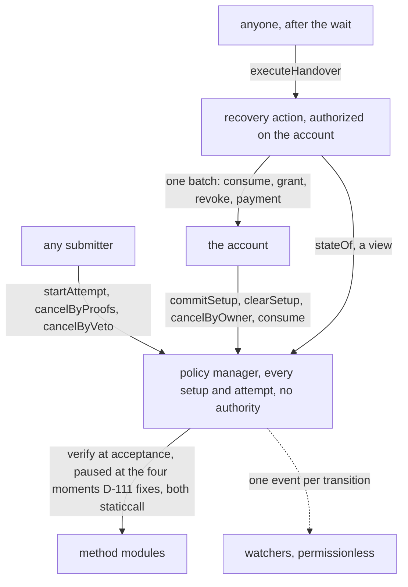
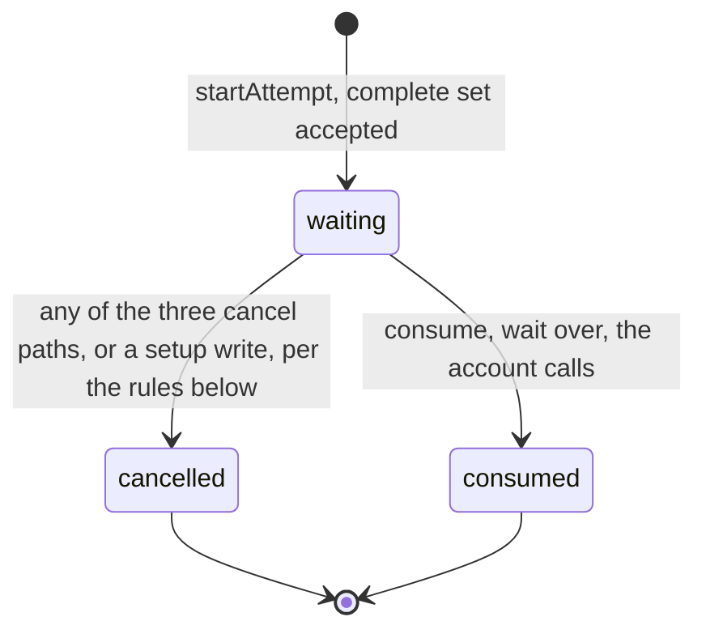
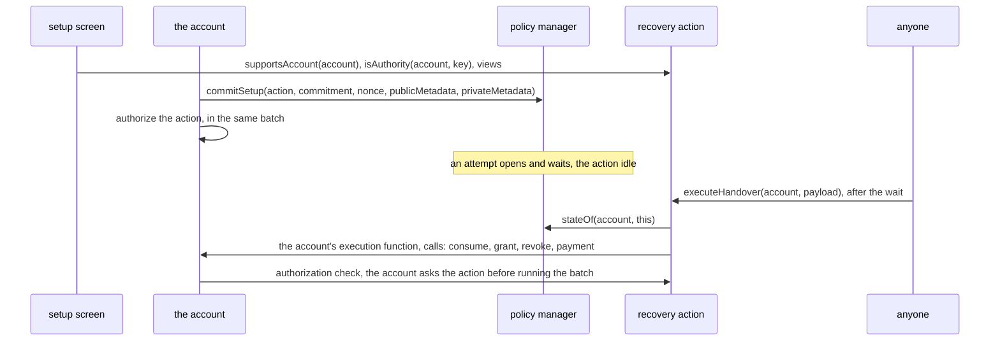
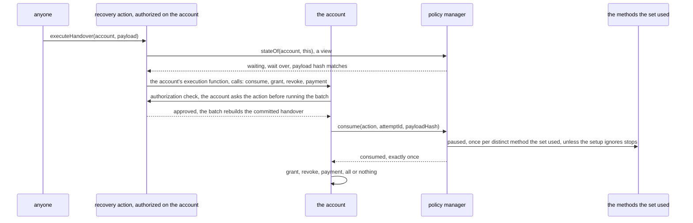
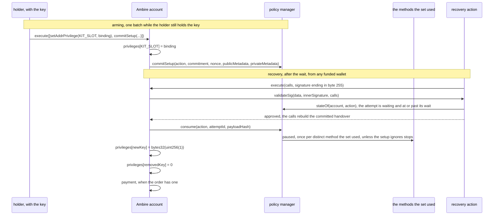
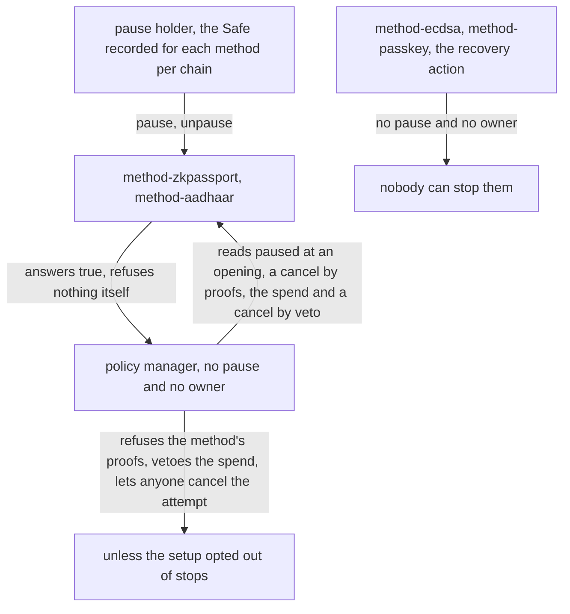

# Contracts tech design

This document is the technical design of the social recovery contracts. It is written to be read on its own, by whoever builds or reviews these contracts. Sections carry ids from D-100 to D-111. The document reasons about each contract first and gives its interface inside that contract's own section, so each signature follows the reasoning that produced it. Where an ecosystem convention shaped a choice, the section names the convention.

## D-100 Scope

This document is the full technical design of the on-chain kit, and it covers six things.

- It says what each contract is responsible for, and why.
- It declares each contract's storage, functions, events and errors.
- It gives the attempt state machine in full.
- It gives each interface inside that contract's own section.
- It lists what any account must provide to run an action, and specifies the recovery action for the demo's account, Ambire's `AmbireAccount`.
- It specifies the pause a method can carry.

The six kit interfaces in this document are stable at the signatures in D-103, D-104 and D-105, and so is the Ambire action's own interface in D-105. The byte layouts are fixed by their test vectors under `test/fixtures/kats/`. Those vectors are the agreement between the SDK and the contracts on every digest and encoding. The action's fork tests check the pinned Ambire source against the deployed bytecode on both chains, and the deployment script checks that no kit slot collides with an address Ambire's own slot convention would produce. A failed check blocks deployment. The check ran on 2026-09-30 and found one mismatch, the position where the account stores its privileges, so storage claims follow the deployed bytecode.

## D-101 Architecture

The kit's core is one contract, the policy manager, and it authorizes actions. An action is a contract that carries out one kind of outcome on one account implementation, a key handover, a transfer, a migration, under a policy the holder committed. The manager knows nothing about the outcome. It judges proofs against the policy and releases an approval, and what the action does with it is the action's own code. Recovery is the first action and the one this document follows, and any other outcome a holder wants gated by people, credentials and time is another action under its own policy. The first three entries below are the kinds of contract that make the kit, and the fourth is the account they serve, which stands outside the kit:

1. **The policy manager** makes every decision and holds every setup and every attempt. It is one contract, and every account calls it directly. It takes setups from accounts, judges requests against them and runs the state machine, every setup and attempt keyed by the account and the action. It holds no authority over any account: its one spend call is `consume`, which only the account itself can make, which releases an approved attempt exactly once, and the committed action performs what the release allows. Only an account writes its own configuration, enforced in one contract instead of once per module, and a hostile method reaches no holder's configuration and no other method's, since every setup and every attempt lives here and a method holds nothing of any holder's. What a method does hold is its own trusted keys and its own stop, which D-104 and D-111 specify. It carries no pause and no owner, and neither does an action.
2. **The method modules** are the judges of credentials, one per kind, permissionless to deploy and adopt. Each answers one question in a read-only call: does this proof approve this digest under this configuration? How it answers is its own business. The wallet method checks the signature in its own code, while an identity method calls its proof system's deployed verifier and turns that answer into the kit's one verdict. The Aadhaar verifier is stateless code pinned by its address. The zkPassport verifier is the project's stateful root router, pinned together with the version and helper the method accepts, and its outside roles remain parties the method declares. The kit ships four methods, all ordinary instances of the same interface, and two of them additionally carry a key admin and a stop, which D-104 and D-111 specify and which the setup screen shows at adoption. A method module is a verifier the manager consults, and no account authorizes one.
3. **The actions** carry out the outcomes, one action per outcome per account implementation: each fixes the payload layout the helpers approve, screens accounts for the setup screen, and spends the approval by running the account's own batch through whatever call that account exposes, the consume first and the outcome's writes behind it. An action for another implementation is another contract.
4. **The account** is not part of the kit. Any smart account adopts the kit through an action written for the way that account carries out a batch, which is its own execution function wherever it has one and its keystore's own approval path where it has none, and the manager reads nothing of the account. The demo runs on Ambire's `AmbireAccount`, the smart account the Kohaku extension creates for its users. The kit does not build it. The section on the smart account says what any account must expose.

This document specifies in full the recovery action for Ambire's `AmbireAccount`, the demo's account, and the view functions every action exposes to the screens. The kit builds and audits every action it offers. Naming an action in a setup selects the code that spends any approval, and the account's own grant is what lets that action run calls with the account's authority. The section on the actions states the action's duties and that risk.



One request runs through this architecture, told from the contracts' side:

1. Helpers sign the binding digest off chain. It is typed data naming the account, the action, the attempt, the payload and what the account will pay whoever submits. For the recovery action the payload is the new key coming in and the exact key being removed.
2. A submitter calls `startAttempt` with the written-out setup body, the payload, the payment order and every proof.
3. The manager recomputes the commitment, checks each place in order, and dispatches each proof to its method as a static call.
4. When every proof passes and every clause meets its threshold, the attempt opens and the wait starts counting. No proof is ever checked again for this attempt. The manager stores the payload's hash and the payment order next to the clock, and the opening event publishes the payload and the body in the clear, so everything the release will perform is public from this moment.
5. Once the wait is over, anyone calls the action's `executeHandover`. The action reads the manager's `stateOf` as an early exit, then builds the account's batch and hands it to the account's execution function. That batch is the consume first, then the two key writes, then the payment. Before running the batch the account asks the action, through whatever authorization check that implementation offers, and the action rebuilds the handover from the batch and checks it against the waiting attempt, the one guard on the account's authority. On the demo's account that check is `validateSig`, the callback the account makes to the action before it runs the batch.

   The writes come after the consume in the batch, so nothing executes without the spend and nothing is spent twice.
6. Every step emitted its event, so a watcher can rebuild the whole sequence from the chain alone.

## D-102 The smart account

This section lists what an account must provide to run an action, so an integrator can check an implementation against it before writing the account half of an action. The manager is installed on no account and reads none, so this list is the whole surface the kit touches on an account. At `commitSetup` the manager asks the action, not the account, whether the action serves the calling account.

An account can run a recovery when it has three things:

- A way for one outside contract, the action, to run a batch of calls with the account's own authority, all of them landing or none. The account grants that through its own key, and every implementation names the grant differently, a module install, a privilege slot, a Safe module. Where that grant is exclusive to the action, the action initiates the batch and its own frame is where the guard sits. Where it is a door any caller can reach with a blob anyone can build, the account must ask the action whether to run the batch before it runs it, and that answer is then the whole guard, which is the shape the demo's account takes and D-105 specifies.
- Calls that add a key and remove a key, reachable inside that batch. On most implementations these are calls the account makes on itself. On some they go to a separate contract that holds the keys, with the account still the caller.
- Four reads the action makes of the account: one that says which implementation it runs, answered by a view where the account offers one and read out of its code where it does not, one that says whether an address is a key on it, one that says whether the action is authorized, and, wherever the account's table mixes keys with code, one that says whether an address holds any authority at all. The action's `supportsAccount`, `isAuthority` and `isAuthorized` answer the screens from the first three, and the broader view is one implementation's own, which is why the recovery action declares it and the shared interface does not.

Nothing else is required of an account the kit reaches this way, and Ambire's account, a Safe and a 7579 account all have the three things, each through an action of its own. The account needs no standard, no hook into the manager, no knowledge of the kit and no upgrade path. An account whose keys live in an EIP-8130 keystore has none of the three and reaches the outcome by another route, since its keys are written by a change batch a shared contract holds rather than by the account at all, so the action for it is an authenticator that answers whether a batch is approved and the manager does not change. That action is out of scope for this kit, and it shows that the manager binds to no account standard rather than to an account this list describes.

An account turns one action off by clearing that action's setup at the policy manager, one call the account makes per committed action, `clearSetup`, since the manager then has nothing to release and the action's code builds only what a release authorizes. Removing the authorization as well turns nothing further off, the way removing a token approval moves no balance, and it matters for one reason the section on that state gives.

Two facts follow from that split. A setup can exist with no authorization at all, since storing a setup is a call the account makes to the policy manager, `commitSetup`, which asks nothing else of the account, so a setup a wallet commits before authorizing the action still admits an attempt: anyone with a satisfying proof set opens one, publishes the rule and runs the clock, and the missing authorization stops the spend alone. The mirror case, an authorization removed with the setup left behind, is the dormant setup the security notes name. A third state, an authorization left live with no setup behind it, is reachable by `clearSetup` alone, and the security notes name it beside the dormant setup.

The key writes of a handover run in the account's own frame, with the account as the caller, so no contract outside the account can write its keys. The consume call is the account spending its own approval at the manager, which is why only the account may make it.

The security notes record one account behavior the action cannot repair, a second contract holding the account's authority that sends the consume alone and spends the approval while executing nothing.

## D-103 The policy manager

### Responsibility

The manager makes every decision and holds every setup and every attempt, and it holds none of the kit's authority. The deployed artifact is `PolicyManager`, since what it holds is policies and recovery is the first action the kit builds on it. One account's policy for one action is what this document calls a setup. A policy here is a rule over credentials and an action is one committed contract that carries out an outcome, narrower words than the session-permission standards use for them.

- Configuration comes from the account itself and from nobody else, keyed by the action, so one account holds one independent setup per action.
- Recovery operations come from anyone, authorized by proofs alone.
- The manager never calls an account. Its outbound calls are the method verifications, the pause reads and, in `commitSetup`, the action's `supportsAccount` for the calling account, all static calls that can write nothing. It holds no authority anywhere. An approved attempt is released through `consume`, a call the account itself makes, and the committed action's own code performs what that release allows. The section on the actions states that trust. The interface below lists every external function, and none of them calls an account, so a reader can check the claim by reading the list against the code.

### Storage

Every setup and every attempt the kit holds live in two persistent mappings, and no other kit state is stored anywhere but inside a method that holds trusted keys or a pause:

```solidity
// Inside PolicyManager, which inherits IPolicyManager, so Setup and Attempt need no qualifier.
mapping(address _account => mapping(address _action => Setup)) internal _setups;
mapping(address _account => mapping(address _action => Attempt)) internal _attempts;
```

The `Setup` struct each entry holds is declared inside `IPolicyManager`, in the interface block below, and says field by field what the manager remembers about one action on one account.

The storage keys by account and action address, so one account holds one setup per committed action, and the recovery action is one of them. Two setups for one outcome would take two action addresses, and the setup screen, the integrator's own adoption surface outside the kit, refuses to commit the second, since two would run two parallel attempts with the weaker rule deciding the account. The screen carries the same duty for a second manager deployment.

The manager writes a block number or a timestamp into a `uint48` field with a checked cast, as OpenZeppelin's `Time` library does through `SafeCast.toUint48`, so a value past the width reverts rather than wraps. A truncated `setupCommittedAtBlock` would point a rebuild client at the wrong block, and a truncated time would shorten a wait, so the kit takes a visible failure over a silent wrong value, the same rule `consumableAfter`'s sum follows. The width runs out tens of millions of years away, so no deployment meets it. Neither counter ever decreases. The nonce rises on every setup write, a clear included, and the attempt counter moves only when an opening allocates an id, so a clear raises the first and leaves the second where it was, and retired proofs can never count again under a recycled attempt id. The manager never stores the cleartext setup body. It arrives in calldata at recovery, and the manager checks it against its committed hash.

The attempt record keeps what the manager needs at the spend and cannot recompute, which the `Attempt` struct below fixes field by field. Among them are the payload's hash, the payment order and the clock, beside the distinct methods the accepted set used and the holder's pause choice. Every stop read after acceptance reads that copy rather than the body. The opening event publishes the payload and the body in the clear, so storage keeps the hashes and watchers keep the content. The manager keeps the configuration private regardless, since the commitment is the only configuration in storage.

### The attempt state machine

This subsection gives every state an attempt can hold, the call that moves it into each, and the rule the manager applies at each transition.



The rules at each transition:

- **A second request never displaces a waiting attempt.** A rule is satisfied or it is not, so no set satisfies it more than another and the manager has nothing to rank, and a second request fails as `PolicyManager_AttemptAlreadyActive` whoever sends it. The sets are not interchangeable for the holder, since the methods a set names are the ones that can veto its spend, which is why the verification order asks the client to prefer the set naming the fewest of them. The first satisfying set therefore holds the action's one slot for the whole wait, and any other set's path is a cancel by proofs and then a fresh request, two transactions and a new wait.

- **A setup edit while an attempt waits** cancels that attempt in the same transaction, before the nonce increases, with its own cancel event.

    The edit itself takes effect at once, with no wait of its own, since the authority that writes a setup is the account's own and the kit does not defend against a stolen key. That authority is every contract the account authorized as well as the holder's key. The write that replaces the whole setup gets no delay and no disclosure, while the recovery it forecloses gets days and the cancel paths the state machine lists. Argent's account is the one neighbour that guards the setup as strongly as the recovery, at the price of a second timelock the holder waits out to change their own guardians. The kit does not carry a third shape, a pending setup that activates after the current setup's own wait. It would give the holder the same notice a recovery gives them, and it would also leave a holder with a compromised setup unable to replace it for that whole window. The wait itself is read from the body at acceptance and written into the attempt as `consumableAfter`, so no later write re-times an attempt already waiting, where Zodiac's delay modifier reads its cooldown from global storage at execution and so lets one owner call push every queued item forward. No attempt outlives the setup it was judged under, and the consume re-checks the attempt's nonce against the setup's as a second check, so a write path that forgot to cancel would still not release a retired setup.
- **A cancel with nothing to cancel** reverts on all three paths, `cancelByOwner`, `cancelByProofs` and `cancelByVeto`, since each would otherwise emit a transition that did not occur, which the event rule forbids. `clearSetup` on an action with no setup reverts for the same reason.
- **The manager never learns whether the account authorizes an action.** Granting and removing the authorization are the account's own calls on itself and no hook reaches the manager, so a removal leaves the setup and any attempt in the manager. Leaving is one write, `clearSetup`, and the SDK pairs the authorization removal beside it where there is a setup to clear, since `clearSetup` reverts for a holder whose setup is already gone and a batch carrying both would revert whole. On an account that cannot revoke the authorization, `clearSetup` alone turns the action off, since it cancels any waiting attempt and moves the nonce, so `consume` finds no live attempt and refuses the stale nonce besides. A setup left behind is dormant rather than dead, revived by a later re-authorization, the hazard the security notes name.
- **A request must carry the exact next attempt id.** The helpers sign over the id the manager will allocate, and the manager rejects a request carrying any other id, lower or higher, so nobody can save a proof set for a later attempt.
- **A consume and a cancel by proofs aimed at the same attempt** both name it by id, and the consume names its payload hash besides, so whichever lands second reverts rather than acting on whatever replaced its target, and a replacement attempt always runs its own full wait from its own acceptance. The holder's own `cancelByOwner` names the attempt id too, and `clearSetup` names the setup nonce it removes, as `commitSetup` names the one it writes. An account batch the holder signed stays valid until the account's own nonce moves, and on Ambire's account a batch that reverts leaves that nonce where it was, so whoever keeps the bytes of a reverted cancel or clear can send them again later. Naming the target makes those bytes act on the attempt or the setup they were signed for and on nothing that replaced it.
- **No deadline to consume exists**, so a satisfied attempt whose wait is over stays spendable until someone executes or cancels it. The one deadline is on the request: every proof signs its `validUntil`, and the manager refuses the request once it passes, so a gathered proof set goes stale while an accepted attempt does not. There is no separate expiry path, because a cancel clears an attempt wherever somebody can send one, and an expiry would add a deadline whose approach hurries whoever meant to execute. Argent's account takes the other branch, where an escape expires on its own after a further period, so both sides of this choice have a shipped precedent. The security notes state what ours costs, the case the cancels do not reach among it, a keyless holder whose helpers cannot be reassembled. The holder with a key uses `cancelByOwner`, a proof set satisfying the rule uses `cancelByProofs`, and anyone uses `cancelByVeto` once a method the attempt used has been stopped. A cost falls on each side. An attempt nobody can execute blocks the action's only attempt slot until a cancel clears it, and an attempt everybody forgot stays spendable by anyone, so a holder who regains their key with an attempt waiting is told to cancel it.
- **The payment is a call in the action's batch**, after the consume, so a payment call that reverts takes the whole batch with it and nothing is consumed: the attempt stays waiting and the proofs stay valid. Whether an account that cannot cover the order reverts is the token's and the payee's business, which D-110 states. The SDK checks the balance before submitting.

### The setup body

This section says what the committed body contains and how the manager reads it. The body is the rule written out with the wait and one risk choice beside it. The manager decodes it with four internal functions, named below so the document can refer to them, and none of them is part of any public interface. What each one computes decides behavior, so this section fixes that, while the setup-body vector fixes the exact bytes. Every preimage this document writes as `keccak256` over a list of values is `abi.encode` over exactly that list in that order, including the setup commitment and each credential commitment, so every dynamic member carries its own length and no two different bodies or configs hash alike by re-splitting one run of bytes. The manager accepts each credential salt as a supplied word and derives no default. The two sections after it say how the manager checks a request against this body and what the proofs sign.

```
setupBody = (
    uint48  wait,           // seconds between acceptance and consumableAfter; no floor, no ceiling
    bool    ignoresPause,   // whether a method's stop reaches this holder's accepted attempts
    Clause[] clauses        // one or more; the rule is the AND of them
)
Clause = (
    uint8     threshold,    // how many of this clause's credentials must fill
    bytes32[] credentials   // each keccak256(method, config, salt), in the holder's order
)
```

The action is not in the body bytes, and it is still signed and committed. Every proof signs the action address inside the digest, and the setup commitment hashes the account, the action, the nonce and the body together, so a body committed under one action never verifies under another. The body leaves it out only because the manager already stores the setup under the action's address, which the account names in the `commitSetup` call. A second action on the same account has its own setup, its own body and its own attempts.

- A **place** is the flat index of a credential across all clauses in body order, so place 0 is the first credential of the first clause and the numbering runs on into the next clause. The proofs' strictly increasing places therefore also walk the clauses in order.
- `credentialAt(body, place)` returns the credential hash at that index and reverts with `PolicyManager_PlaceOutOfRange` past the end, so a place the rule does not have fails before any method sees it.
- `ruleSatisfied(body, proofs)` counts the filled places inside each clause against its threshold and answers whether every clause meets its own. When one does not, it names the first failing clause, which is what `PolicyManager_RuleUnsatisfied` reports. It returns false for a body with no clauses, so an empty rule never opens an attempt. It also returns false for a rule whose every clause has a threshold of zero, since that rule and no other is met by a request with no proof at all, and it is the one rule shape the contract refuses on its own. A clause at zero beside a clause above zero is allowed, and a body whose only clause sits at zero is the all-zero shape `ruleSatisfied` refuses. The rule is the AND of its clauses, so a zero clause is a condition nothing has to fill while every other clause still has to be met, and a holder who parks a retired credential in such a clause keeps a rule that works. A clause whose threshold exceeds its credential count is named, not refused, since its count fails anyway and the name only tells the caller which clause is impossible. The body with no clauses and the all-zero rule both fail as `PolicyManager_RuleUnsatisfied` naming clause zero, since neither refusal comes from a clause that missed its threshold. No invariant carries the contract's refusal. At the commit the manager sees only the hash, so keeping an empty or all-zero rule from being armed is the wallet's duty, and the setup body tests check that `ruleSatisfied` refuses both shapes.
- `ruleSatisfied` also refuses on its own a place that is not strictly above the place before it, reverting as `PolicyManager_PlacesNotStrictlyIncreasing` before it counts anything, so no place counts twice whatever its caller checked first. Through the manager this refusal never fires, since the manager's own order check at each place runs earlier.
- `ruleSatisfied` counts only places inside the rule. A place at or past the total credential count counts toward no clause and does not change the answer, since on the manager's path `credentialAt` has already refused it as `PolicyManager_PlaceOutOfRange`. When every clause meets its threshold, `ruleSatisfied` answers true and names clause zero, and the manager reads the clause only when the answer is false.
- A place counts as filled only after its method returned the magic value, never by its position in the proofs array. A request whose proofs run out fails as `PolicyManager_RuleUnsatisfied`. One failing proof reverts the whole call, so every entry in the array has passed by the time the count runs. Counting upward from verified proofs is what makes the commitment a rule rather than the whole authorization, and Safe's `checkNSignatures` walks the signatures it was given the same way. A neighbouring wallet counted downward from its guardian list instead and shipped a quorum an empty signature blob satisfied, which its own audit read past. Counting upward is the contract-side half of the degenerate-rule risk the SDK carries.
- `ignoresPauseOf(body)` reads the holder's choice. At an opening and at a cancel by proofs the manager reads it from the revealed body. At acceptance it copies the choice onto the attempt, since neither the spend nor the cancel by veto receives the body and neither may trust a value the caller supplies. So the choice reaches all four reads of a stop. The setup screen states it in the holder's own words rather than by naming the mechanism.
- `waitOf(body)` reads the wait. `startAttempt` computes `consumableAfter` in the width the attempt stores it in, so a wait that carries the sum past that width reverts the request rather than wrapping into a shorter wait, and D-109 writes the one form that does it. A holder whose wait carries the sum past that width can never recover, so the SDK refuses at setup any wait above what the width leaves over the current time, one of the numbers the SDK owes.
- A clause's threshold is a `uint8`, which bounds how many credentials a clause can require and not how many it lists. The list is a `bytes32[]`.
- The library that holds the four readers also holds one encoder, `encode(wait, ignoresPause, clauses)`, over the `Clause` struct `IPolicyManager` declares, a `uint8` threshold and a `bytes32[]` credential list, so a test or a vector replay builds a body with the same code that reads it. The manager reads bodies and never builds one.

The commitment hides the body, so a client bug can commit a dead setup that no contract check catches at the write. A preimage computed over the wrong action is found only when the holder has lost their key and tries to recover. The body layout is fixed for the life of each deployment, since nothing upgrades in place, so a new clause kind means a new manager and a migration. Several deployments can be live at once, so the SDK keys its body encoder on the manager's address. Before its screen reports success, the SDK re-derives the commitment it just committed from its own record.

A backup describes the body and the nonce of the write that carried it, so a holder who keeps one re-attaches it to every write that creates or replaces a setup, including a write that commits the identical rule, since a rebuild client, the client that reconstructs a holder's setup on a new device from the chain and their backup, reads the last such write alone and an empty field there leaves that holder nothing. The field is opaque bytes the manager never reads, so the manager cannot check that and the duty is the SDK's. A rebuild client reads the backup from the last write that created or replaced a setup and treats an empty field there as no backup rather than as a reason to walk the history. The rebuild client owes the same re-derivation.

### Verification order at acceptance

The manager verifies a request inside `startAttempt`, in one transaction and in the order below. The action plays no part in it and never sees a proof. At execution the consume re-checks the state the manager stored here and then asks the methods the set used whether any of them vetoes the release. Before the manager reads any place, it checks five things:

1. The account has a setup under the request's action.
2. The action has no active attempt.
3. The request names the stored setup nonce.
4. The attempt id is the next one.
5. The request's validity window has not passed. The window is one field of the request that every proof signs, the way EIP-2612's permit carries its deadline inside the signed message, so the manager checks it once here and never per place, a place being one credential's slot in the rule and numbered by the setup body section above.

Then the manager recomputes the setup commitment. It hashes the body in the request with the account, the action and the stored setup nonce, and the result must equal the stored commitment.

A cancellation runs the same checks with five differences. Four change what it checks and one removes a check. The second check inverts, since a cancel needs the attempt an opening refuses. The attempt id must be the live one rather than the next. Every proof signs the cancelling form of the digest rather than the approving one, so an approval never counts as a cancel. The manager checks the attempt's own setup nonce against the setup's, an extra check that is redundant here as at the consume, since a setup write already cancels. And the cancellation path does not check that a setup exists, since no attempt waits without one, so the attempt check refuses every cancellation an absent setup could reach.

When a request fails for several reasons at once, the manager reports the most fundamental first, since that is the one the client must fix and fixing it settles the rest. For an opening the order is: no setup, an attempt already waiting, the request's setup nonce, its attempt id, then its window. A cancel by proofs keeps that order, with no waiting attempt in place of the first two. A stale setup nonce means the whole set must be gathered again, so reporting a wrong attempt id first would point at a symptom. The consume and the veto cancel carry no setup nonce, so they check the live attempt, its id and the attempt's own nonce, in that order. The holder's own calls follow the same rule: `cancelByOwner` checks the live attempt, then its id, and `clearSetup` checks the setup, then its nonce. A refactor keeps this order, and tests pin it.

Then, for each filled place, on both kinds:

1. The place is strictly greater than the previous one, so no place is filled twice and the loop crosses the clauses in order. A clause is one any-N-of-M group of the rule, in the shape the setup body section above encodes. Safe's `checkNSignatures` requires the same ordering of its signers for the same reason. The ordering makes a repeated place unrepresentable rather than merely forbidden. A repeated credential is a different thing: a rule may name one credential at two places, each place carries its own salt, so both verify and both count, and refusing that is the setup screen's, a risk the SDK carries.
2. The manager recomputes the credential hash. The place names its method address, its config and its salt in the clear, and the manager hashes the three the way the setup did and compares against the credential hash at that place in the revealed body. A wrong method, config or salt fails here, before any call, so the module that runs is the one the holder committed and the config it judges is the one the holder wrote. The manager assumes the code at that address does not change, and the security notes name the cases where it does not.
3. The manager reads the method's pause, once per distinct method and before any proof of it is read, and refuses the whole request as `PolicyManager_MethodStopped` when the method reports itself stopped. It skips this read when the revealed body says the holder ignores stops. The method itself refuses nothing, since the manager is the only reader of a stop, the rule the pause section fixes.
4. The manager computes the place's digest, per the digest section below, and dispatches `verify` as a static call. A verdict counts only when the static call succeeds and returns exactly 32 bytes whose whole word equals the magic value, the selector of `verify` itself, left-aligned. Reading four bytes rather than the word would admit a verifier that returns the selector followed by anything, and accepting more than one word would admit trailing bytes the decoder ignores, which is why Safe's own signature validator pins the length. Skipping the success check would read a revert carrying those bytes as an approval, the line whose absence in a neighbouring signer library an attacker exploited in June 2026. A revert, an empty return and a wrong value all read as false. The method vectors fix the value it compares against. The acceptance tests cover every answer this step refuses: a revert, a revert carrying the magic value, an empty return, a return shorter or longer than one word and a word other than the magic value.

A request changes state only when every check passes. One bad proof beside a satisfying set fails the whole request, so the SDK submits the smallest set that satisfies the rule rather than everything it gathered, and verifies each proof by the same static call before it submits anything. Among equally small sets it prefers the one naming the fewest methods that carry a stop, since the methods a request names are the ones that can veto its spend. That pre-check is a filter and never a guarantee, since a method's verdict can depend on state another transaction moves between the simulation and inclusion, the same limit a sponsor's own simulation has. A surplus proof makes the whole request depend on a method the rule did not need and puts that method's stop in front of the spend, an exposure the submitter would be choosing for the holder.

### The digest

This section says what a proof approves and how the manager rebuilds it from the request. The digest is EIP-712 typed data, so a wallet that renders typed data shows a signer the fields by name. Whether a given wallet renders an unknown struct that way or as a hash is that wallet's own behavior, which the design does not vouch for.

The payload is the one field the manager cannot type, since its layout is the committed action's own. It travels as plain bytes, and a wallet renders it as hex. A guardian approving with a wallet that renders typed data therefore sees the account, the attempt number and the payment in the clear, and the payload, for the recovery action the new key and the removed one, only as bytes. A typed summary of the outcome, carried beside the opaque payload and signed with it, would render as named fields on a wallet that renders typed data. The kit does not carry one, and what it costs is what decided it. The manager would have to keep the summary or its hash on the attempt so the action could read it back, every action would owe a decode of its own, and both would freeze as vectors, which is complexity the contracts carry for a disclosure the approval page already owes.

The approval page reads the payload field by field, decoding it in the committed action's layout, and the integrator's screens carry that page. So the signing screen alone shows less than the whole request, a cost the security notes record. A passkey assertion and an identity proof render nothing at all, since the digest enters them as a challenge or a public input, so for those helpers the approval page was always the only disclosure.

The domain is this deployment's own: the name `PolicyManager`, the digest format's version, the chain id and the manager's address. An approval signed for one chain or one deployment therefore verifies on no other. The name and the version are constants of the binding digest library. The library computes the domain separator on every call, reading the live chain id itself, and the manager passes only its own address, so no caller can build a separator for another chain and none is stored at deployment. A stored separator would keep the old chain id on a branch of a chain split that changed it, so approvals signed for the other branch would verify there too. A redeploy at a new address invalidates every gathered approval, whether or not the format changed. No kit contract upgrades in place. A bug fix is therefore a deployment at a new address, and after a migration the helpers sign every approval again.

The format's version is the string constant `DIGEST_VERSION = "1"`, and it is not `version()`, which is the deployment's release number. The value changes only when the signed schema or its meaning changes. The manager publishes the whole domain through `eip712Domain()`, per ERC-5267, so the SDK reads it instead of guessing it. The domain contains the name, version, chain id and verifying contract, with no salt or extensions. Two message types carry the two acts. The type name is part of what a proof signs, so an approval never counts as a cancel:

```
Approval(
    address account, address action, uint64 attemptId, uint64 setupNonce,
    bytes32 setupBodyHash, bytes payload, PaymentOrder order,
    uint48 validUntil, uint256 place)
PaymentOrder(address token, uint256 amount, address payee)

Cancellation(
    address account, address action, uint64 attemptId, uint64 setupNonce,
    bytes32 setupBodyHash,
    uint48 validUntil, uint256 place)
```

How the manager fills those fields from a request, and what it checks around them, in the order it runs:

```
// what arrives
request = (account, action, attemptId, setupNonce, setupBody, payload, order, validUntil, proofs[])
body    = decode(setupBody) = (wait, ignoresPause, clauses[])                    // the setup body section above

// the request against the stored setup
setup = _setups[account][action]
require(setup.commitment != 0)                                                  // PolicyManager_NoSetup
require(_attempts[account][action].state != Waiting)                            // PolicyManager_AttemptAlreadyActive
require(setupNonce == setup.nonce)                                              // PolicyManager_WrongSetupNonce
require(attemptId == setup.attemptCounter + 1)                                  // PolicyManager_WrongAttemptId
require(now <= validUntil)                                                      // PolicyManager_RequestExpired
require(keccak256(account, action, setupNonce, setupBody) == setup.commitment)  // PolicyManager_SetupCommitmentMismatch
                                                                                // body fields count only from here

// each proof against the revealed body
for p in proofs, places strictly increasing:                                    // PolicyManager_PlacesNotStrictlyIncreasing
    require(keccak256(p.method, p.config, p.salt) == credentialAt(body, p.place))   // PolicyManager_CredentialMismatch
    if (!body.ignoresPause) require(!_vetoes(p.method))                         // PolicyManager_MethodStopped, once per distinct method
    digest = eip712(domain, Approval(account, action, attemptId, setupNonce,
                                     keccak256(setupBody), payload, order, validUntil, p.place))
    require(p.method.verify(p.config, digest, p.proof) == MAGIC)                // PolicyManager_ProofRejected
require(ruleSatisfied(body, proofs))                                            // PolicyManager_RuleUnsatisfied

// what the attempt keeps
attempt = (attemptId, setupNonce, now + body.wait, Waiting, body.ignoresPause, keccak256(payload), order, distinct methods)
```

A cancellation runs the same block with the five differences the verification section names, and its digest is the `Cancellation` type with no payload and no order.

Each field defeats one replay. The request declares the setup nonce its proofs were signed under and the manager refuses any but the stored one, failing as `PolicyManager_WrongSetupNonce`, so an approval given under a retired setup fails with a named error before any proof is read, rather than as a rejected proof, and the digest is computed over that checked value. The action address ties a proof to one action, so an approval gathered for one action never counts for another the same account runs. The attempt id ties a proof to one attempt, the place ties it to one place in the rule, and the payload and the order tie it to one outcome and one price.

The order is one nested struct, the same `PaymentOrder` the request carries and the attempt stores, so the three places that hold it agree byte for byte.

`setupBodyHash` is the one pre-hashed member, and its preimage is the setup body's own bytes and nothing else, the same bytes the request carries and the same the commitment closes over with the account, the action and the nonce. So the digest binds the setup without carrying it, and a client that hashes the body one way for the commitment and another for the digest produces a request no proof verifies. The setup-body, setup-commitment and digest vectors derive from the same body, so the corpus lets a replay compare both hashes without pretending that either digest file carries the commitment.

A cancellation names an attempt and no outcome, which is what a cancel is. It carries no payment order: a cancel is paid by whoever submits it, a decided cost, since the manager calls no account, and a canceller with no funded wallet of their own submits from any other, the way an opening request already travels. The proofs themselves are not in the digest, since a proof cannot sign itself. A method verifies that its credential approved exactly this digest, in the method's own way: a signature over it for a wallet, a passkey assertion whose challenge is it, a zero-knowledge proof with it as a public input.

The manager's `hashApproval` and `hashCancel` views compute these digests, and they call the same internal encoder the verification path calls, so the view and the check cannot disagree. The encoder reads the request where it arrives, in calldata, so hashing one digest per place never copies the proofs, and a request's cost does not grow with the square of its proof count. A client uses them to cross-check its own bytes, not to replace them. A wallet's typed-data signing call takes the domain, the types and the message, not a digest, and a passkey or an identity proof needs the digest before any transaction exists. So the SDK derives the typed data locally, and both stacks replay the digest vector.

### Interface

This subsection declares every external function of the manager: its configuration doors, its attempt calls, its one spend door, its views and its introspection. A reader can check against the list that none of them calls an account.

The same block declares every type the manager's calls and logs carry, inside the interface body and ahead of the functions: the enum first, then the structs, then the events, then the errors. So one interface holds everything a client or another contract names. Code outside the interface names each of them through it, as `IPolicyManager.AttemptRequest` or `IPolicyManager.PolicyManager_WrongSetupNonce`, while the manager inherits the interface and names them bare.

```solidity
/// @title IPolicyManager
/// @author defi-wonderland
/// @notice The one contract that approves attempts, for any action. It stores each account's
///         policy per action and judges requests against it. It runs the attempt state machine
///         and holds no authority over any account.
/// @dev The manager never calls an account. The account spends an approved attempt by calling
///      consume, and it can do so exactly once. The action's code decides what runs around that
///      spend. The manager carries no pause and no owner. The only stop in the kit is the pause a
///      method may carry. The manager reads that pause at an opening, at a cancel by proofs, at the
///      spend and at a cancel by veto.
interface IPolicyManager {
    /*///////////////////////////////////////////////////////////////
                                 ENUMS
    ///////////////////////////////////////////////////////////////*/

    /// @notice The state of one attempt record. Waiting is the only live state. Cancelled and Consumed
    ///         are history, and None means no attempt was ever recorded.
    enum AttemptState {
        None,
        Waiting,
        Cancelled,
        Consumed
    }

    /*///////////////////////////////////////////////////////////////
                                STRUCTS
    ///////////////////////////////////////////////////////////////*/

    /// @notice What the account pays, and to whom. The guardians approve it inside the digest, so nobody
    ///         can redirect it after they sign. A zero amount means nobody is paid.
    /// @param token The ERC-20 token paid, or address(0) for the native asset.
    /// @param amount The amount of the transfer the batch carries. Whether the payee receives it
    ///        depends on the token, since the manager reads no balance.
    /// @param payee Who is paid, usually the submitter or their paymaster. address(0) leaves the order
    ///        open, so whoever builds the batch names the payee.
    struct PaymentOrder {
        address token;
        uint256 amount;
        address payee;
    }

    /// @notice Everything one attempt submission carries. It names the account and the action, writes
    ///         out the rule, and carries the outcome being approved in the committed action's own
    ///         layout, what the account pays for it and the proofs.
    /// @param account The account the action runs on.
    /// @param action The action the setup was committed under.
    /// @param attemptId The attempt id, which must equal stateOf(account, action).nextAttemptId.
    /// @param setupNonce The setup version the proofs were signed under. Any value other than the
    ///        stored one fails as PolicyManager_WrongSetupNonce, never as a rejected proof.
    /// @param setupBody The committed rule written out in full. The manager hashes it with the account,
    ///        the action and setupNonce, and the result must equal the stored commitment.
    /// @param payload The outcome being approved, in the committed action's layout. The manager stores
    ///        its hash.
    /// @param order What the account pays at execution, and to whom.
    /// @param validUntil The time until which this signed request may still be submitted. Every proof
    ///        signs it.
    /// @param proofs One entry per filled place, with place values strictly increasing.
    struct AttemptRequest {
        address account;
        address action;
        uint64 attemptId;
        uint64 setupNonce;
        bytes setupBody;
        bytes payload;
        PaymentOrder order;
        uint48 validUntil;
        ProofPlace[] proofs;
    }

    /// @notice One filled place in the rule. At each place the body stores only the hash of a
    ///         credential's method, config and salt. The manager recomputes that hash from this entry
    ///         and requires it to equal the hash at `place`, so the method, config and salt must be
    ///         exactly the ones the holder committed.
    /// @param place Which place in which clause of the rule this entry fills.
    /// @param method The module that verifies this credential.
    /// @param config The credential in the method's own layout, which only that method decodes.
    /// @param salt This credential's supplied salt. The manager derives no default and only hashes what
    ///        it is given.
    /// @param proof The method's proof bytes, in the method's own layout, which only that method
    ///        decodes.
    struct ProofPlace {
        uint256 place;
        address method;
        bytes config;
        bytes32 salt;
        bytes proof;
    }

    /// @notice A cancellation submission. It is like AttemptRequest but approves no outcome, which is
    ///         why it carries no payload. It carries its own validUntil, so a cancel signed ahead of
    ///         the attempt it names cannot wait for that attempt forever.
    /// @param account The account whose attempt is cancelled.
    /// @param action The action the attempt belongs to.
    /// @param attemptId The exact attempt these proofs cancel.
    /// @param setupNonce The setup version the cancel proofs were signed under, checked like the
    ///        opening request's.
    /// @param setupBody The committed rule written out.
    /// @param validUntil The time until which this signed cancellation may still be submitted.
    /// @param proofs Proofs signed as cancellations of this exact attempt.
    struct CancelRequest {
        address account;
        address action;
        uint64 attemptId;
        uint64 setupNonce;
        bytes setupBody;
        uint48 validUntil;
        ProofPlace[] proofs;
    }

    /// @notice A summary of one action on one account in a single read, which stateOf returns.
    /// @param setupCommitment The committed setup, or bytes32(0) when no setup exists.
    /// @param setupNonce The current setup nonce. Every commitSetup and clearSetup raises it by one and
    ///        nothing lowers it, so a proof signed under an older setup never matches again.
    /// @param nextAttemptId The id the next accepted request must carry.
    /// @param setupCommittedAtBlock The block of the last setup write, a block number rather than a
    ///        time.
    /// @param attempt The last attempt record. Waiting is the only live state, and the others are
    ///        history.
    struct ActionState {
        bytes32 setupCommitment;
        uint64 setupNonce;
        uint64 nextAttemptId;
        uint48 setupCommittedAtBlock;
        Attempt attempt;
    }

    /// @notice The attempt record per action. Each new attempt overwrites it, and nothing deletes it.
    ///         It holds the clock and what the spend checks, all of it public since the opening event.
    /// @param attemptId The id this attempt was allocated.
    /// @param setupNonce The setup version it was judged under. Consume and cancel refuse any other.
    /// @param consumableAfter When the wait ends.
    /// @param state Waiting while live, and Cancelled or Consumed once ended.
    /// @param ignoresPause Copied from the body this attempt was judged under, so the spend and the
    ///        cancel by veto read it without the body. It sits beside state so the first five fields
    ///        share one storage slot.
    /// @param payloadHash keccak256 of the committed payload, which consume checks.
    /// @param order The payment the guardians approved.
    /// @param usedMethods The distinct methods the accepted set used, in the order the proofs named
    ///        them. Consume asks each one whether it vetoes the spend.
    struct Attempt {
        uint64 attemptId;
        uint64 setupNonce;
        uint48 consumableAfter;
        AttemptState state;
        bool ignoresPause;
        bytes32 payloadHash;
        PaymentOrder order;
        address[] usedMethods;
    }

    /// @notice What the manager remembers about one action on one account. The commitment and the
    ///         nonce are the configuration only the account writes; the attempt counter is moved by
    ///         the permissionless opening call, and the block is written by every setup write.
    /// @param commitment keccak256(account, action, nonce, body); bytes32(0) when none.
    /// @param nonce Rises on every setup write, never rewinds.
    /// @param attemptCounter The last allocated attempt id, never rewinds.
    /// @param setupCommittedAtBlock The block of the last setup write, including a clear, so a client
    ///        reads that one block rather than the whole history, taking the last matching event in it
    ///        since two writes for one action can share a block; a block number rather than a time,
    ///        unlike every other uint48 here.
    struct Setup {
        bytes32 commitment;
        uint64 nonce;
        uint64 attemptCounter;
        uint48 setupCommittedAtBlock;
    }

    /// @notice One clause of the setup body. The rule is the AND of the clauses.
    /// @param threshold How many of this clause's credentials must fill.
    /// @param credentials Each keccak256(method, config, salt), in the holder's order.
    struct Clause {
        uint8 threshold;
        bytes32[] credentials;
    }

    /*///////////////////////////////////////////////////////////////
                                EVENTS
    ///////////////////////////////////////////////////////////////*/

    /// @notice The account committed a new setup for one action.
    /// @param _account The account that committed the setup.
    /// @param _action The action the setup governs.
    /// @param _nonce The setup nonce this write holds.
    /// @param _setupCommitment The commitment written.
    /// @param _publicMetadata The holder's optional public note, for anyone to read. It is empty by
    ///        default.
    /// @param _privateMetadata The holder's own copy of their configuration for a future device,
    ///        encrypted unless the holder chose the clear path. It is a separate field because its
    ///        audience is the opposite of the public one's.
    event SetupCommitted(
        address indexed _account,
        address indexed _action,
        uint64 _nonce,
        bytes32 _setupCommitment,
        bytes _publicMetadata,
        bytes _privateMetadata
    );

    /// @notice The account removed the action's setup through clearSetup. A recommit emits
    ///         SetupCommitted alone, so each setup write emits one event.
    /// @param _account The account whose setup was removed.
    /// @param _action The action whose setup was removed.
    /// @param _nonce The nonce this clear wrote, which is the previous one plus one. SetupCommitted
    ///        carries the same value for a write.
    event SetupCleared(address indexed _account, address indexed _action, uint64 _nonce);

    /// @notice A complete proof set opened an attempt.
    /// @param _account The account the attempt runs on.
    /// @param _action The action the attempt runs under.
    /// @param _attemptId The id the attempt was allocated.
    /// @param _setupNonce The setup version the attempt was judged under, so a watcher
    ///        binds the attempt to the setup that authorized it.
    /// @param _setupBody The committed rule written out, in the clear.
    /// @param _usedPlaces The place values the accepted set filled, strictly increasing. The configs in
    ///        the transaction's calldata show which person each place is.
    /// @param _usedMethods The distinct methods that set used, which consume asks for a veto. With them
    ///        the event stream carries the whole attempt the manager stored.
    /// @param _payload The outcome approved, in the committed action's layout, in the clear.
    /// @param _order The payment the guardians approved.
    /// @param _consumableAfter When the wait ends.
    event AttemptStarted(
        address indexed _account,
        address indexed _action,
        uint64 _attemptId,
        uint64 _setupNonce,
        bytes _setupBody,
        uint256[] _usedPlaces,
        address[] _usedMethods,
        bytes _payload,
        PaymentOrder _order,
        uint48 _consumableAfter
    );

    /// @notice The attempt was cancelled.
    /// @param _account The account whose attempt was cancelled.
    /// @param _action The action the attempt ran under.
    /// @param _attemptId The attempt cancelled.
    /// @param _canceller Who cancelled. It is the account itself for the holder's cancel and the caller
    ///        for a cancel by proofs or by veto. It is zero for a cancel that a setup write caused.
    /// @param _stoppedMethod The stopped method whose veto authorized a cancel by veto, and address(0)
    ///        on every other path. So a watcher never reads an administrative cancellation as a guardian
    ///        set withdrawing.
    /// @param _setupNonce The setup version the cancelled attempt was judged under.
    /// @param _usedPlaces The places the cancelling set filled. It is empty for the holder's own cancel
    ///        and for a cancel by veto. It mirrors the opening event, so a holder can tell their own
    ///        guardians withdrawing from a set they should worry about.
    event AttemptCancelled(
        address indexed _account,
        address indexed _action,
        uint64 _attemptId,
        address _canceller,
        address _stoppedMethod,
        uint64 _setupNonce,
        uint256[] _usedPlaces
    );

    /// @notice The account spent the attempt, and the manager saw nothing more. The batch around the
    ///         spend performed the writes and the payment. A reader finds those in the account's own
    ///         transaction and state, never in this event.
    /// @param _account The account that spent the attempt.
    /// @param _action The action the attempt ran under.
    /// @param _attemptId The attempt spent.
    event AttemptConsumed(address indexed _account, address indexed _action, uint64 _attemptId);

    /*///////////////////////////////////////////////////////////////
                                ERRORS
    ///////////////////////////////////////////////////////////////*/

    /// @notice The commitment is bytes32(0), which means no setup, or the commitment of zero-length
    ///         bytes.
    /// @param _supplied The commitment supplied.
    error PolicyManager_InvalidCommitment(bytes32 _supplied);

    /// @notice The nonce is not the expected one: commitSetup got a nonce other than the current one
    ///         plus one, clearSetup got one other than the current one, or a request was signed under a
    ///         nonce other than the stored one.
    /// @param _supplied The nonce supplied.
    /// @param _expected The nonce expected.
    error PolicyManager_WrongSetupNonce(uint64 _supplied, uint64 _expected);

    /// @notice commitSetup named an action that does not serve the calling account: the action's
    ///         supportsAccount did not answer exactly true for it.
    /// @param _account The account that called.
    /// @param _action The action it named.
    error PolicyManager_ActionDoesNotServeAccount(address _account, address _action);

    /// @notice The place is past the end of the revealed rule.
    /// @param _place The place asked for.
    /// @param _count The number of places the rule has.
    error PolicyManager_PlaceOutOfRange(uint256 _place, uint256 _count);

    /// @notice An attempt or a clearSetup named an action with no committed setup.
    /// @param _account The account asked about.
    /// @param _action The action asked about.
    error PolicyManager_NoSetup(address _account, address _action);

    /// @notice A cancel or a consume found no attempt running.
    /// @param _account The account asked about.
    /// @param _action The action asked about.
    error PolicyManager_NoActiveAttempt(address _account, address _action);

    /// @notice A startAttempt arrived while an attempt is already running.
    /// @param _account The account asked about.
    /// @param _action The action asked about.
    /// @param _attemptId The id of the attempt already running.
    error PolicyManager_AttemptAlreadyActive(address _account, address _action, uint64 _attemptId);

    /// @notice A request named an id that is not the next one, or a cancel or a consume named one that
    ///         is not the live one.
    /// @param _supplied The attempt id supplied.
    /// @param _expected The attempt id expected.
    error PolicyManager_WrongAttemptId(uint64 _supplied, uint64 _expected);

    /// @notice The written-out rule does not hash to the commitment.
    /// @param _recomputed The commitment recomputed from the request.
    /// @param _committed The commitment stored.
    error PolicyManager_SetupCommitmentMismatch(bytes32 _recomputed, bytes32 _committed);

    /// @notice The setup changed after the attempt was accepted: the stored setup nonce is no longer
    ///         the one the attempt was judged under.
    /// @param _judgedUnder The setup nonce the attempt was judged under.
    /// @param _currentNonce The setup nonce stored now.
    error PolicyManager_StaleAttempt(uint64 _judgedUnder, uint64 _currentNonce);

    /// @notice The method, the config and the salt do not hash to the credential at this place.
    /// @param _place The place checked.
    /// @param _recomputed The credential hash recomputed from method, config and salt.
    error PolicyManager_CredentialMismatch(uint256 _place, bytes32 _recomputed);

    /// @notice The proofs array holds a duplicate or an out-of-order place.
    /// @param _place The place that broke the strictly increasing order.
    error PolicyManager_PlacesNotStrictlyIncreasing(uint256 _place);

    /// @notice The request or cancellation arrived after its validUntil, the deadline every proof in
    ///         it signed.
    /// @param _blockTimestamp The block's timestamp.
    /// @param _validUntil The request's deadline.
    error PolicyManager_RequestExpired(uint48 _blockTimestamp, uint48 _validUntil);

    /// @notice This method rejected the proof at this place in the rule.
    /// @param _place The place whose proof was rejected.
    /// @param _method The method that rejected it.
    error PolicyManager_ProofRejected(uint256 _place, address _method);

    /// @notice At an opening or a cancel by proofs, the method at this place reports itself stopped,
    ///         so its proof is refused. Never raised when the setup ignores stops.
    /// @param _place The place the stopped method judges.
    /// @param _method The stopped method.
    error PolicyManager_MethodStopped(uint256 _place, address _method);

    /// @notice At consume, a method the attempt used reports itself stopped, so the spend is refused.
    ///         Never raised when the setup ignores stops.
    /// @param _method The method that vetoed the spend.
    error PolicyManager_MethodVetoedSpend(address _method);

    /// @notice cancelByVeto named a method this attempt did not use. A stop only lets anyone cancel the
    ///         attempts that rely on the stopped method. cancelByProofs has no such limit, since any
    ///         set that satisfies the rule may cancel.
    /// @param _attemptId The attempt the cancel named.
    /// @param _method The method named.
    error PolicyManager_MethodNotUsed(uint64 _attemptId, address _method);

    /// @notice A cancel by veto named an attempt whose setup committed to ignore a method's stop.
    /// @param _attemptId The attempt the cancel named.
    error PolicyManager_AttemptIgnoresPause(uint64 _attemptId);

    /// @notice A cancel by veto named a method that did not answer the pause read with true.
    /// @param _method The method named.
    error PolicyManager_MethodNotStopped(address _method);

    /// @notice Every proof verified, but they do not satisfy the rule: this clause has fewer filled
    ///         places than its threshold. A body with no clauses, or whose every threshold is zero,
    ///         fails with clause zero, because a stranger could satisfy it with no proof.
    /// @param _clause The clause whose threshold was missed.
    error PolicyManager_RuleUnsatisfied(uint256 _clause);

    /// @notice A consume arrived before the wait ended.
    /// @param _blockTimestamp The block's timestamp.
    /// @param _consumableAfter When the wait ends.
    error PolicyManager_WaitNotOver(uint48 _blockTimestamp, uint48 _consumableAfter);

    /// @notice A consume named a payload that is not the attempt's.
    /// @param _supplied The payload hash supplied.
    /// @param _committed The payload hash the attempt committed to.
    error PolicyManager_WrongPayload(bytes32 _supplied, bytes32 _committed);

    /*///////////////////////////////////////////////////////////////
                                LOGIC
    ///////////////////////////////////////////////////////////////*/

    // ---- Configuration. Callable by the account alone. ----

    /// @notice Create or replace the caller's setup for the given action.
    /// @dev Increments the setup nonce and cancels the action's active attempt, if one exists. It
    ///      reverts in four cases. A commitment of bytes32(0) is refused because that value means
    ///      no setup (PolicyManager_InvalidCommitment). The commitment of zero-length bytes is refused
    ///      because no setup body produces it (PolicyManager_InvalidCommitment). A nonce other than
    ///      the current one plus one is refused (PolicyManager_WrongSetupNonce). An action that does
    ///      not serve the caller is refused (PolicyManager_ActionDoesNotServeAccount): the manager
    ///      asks the action's supportsAccount(caller) as a static call and accepts only a call that
    ///      succeeds and returns exactly one word equal to true, so an action with no code, one that
    ///      reverts and one that answers anything else are all refused. The check runs before anything
    ///      is written. clearSetup and cancelByOwner make no such call, so an account its action no
    ///      longer serves can still remove its setup. The commitment and the
    ///      nonce arrive as separate arguments. So the nonce check catches a caller whose nonce is
    ///      stale, but it never proves that the commitment was computed over that nonce. A commitment
    ///      built over a different nonce stores a setup that no request can ever match.
    /// @param _action The action this setup governs, by its address.
    /// @param _setupCommitment keccak256 of the account, the action, the nonce this
    ///        write will hold, and the setup body.
    /// @param _nonce The nonce the commitment was computed over, which must be the current one plus
    ///        one.
    /// @param _publicMetadata What the holder chose to show everyone about this setup. It is empty
    ///        by default, and anyone may read it.
    /// @param _privateMetadata The holder's backup of their configuration, which may be empty. It is
    ///        encrypted unless the holder chose the clear path, and it is public on chain like
    ///        everything else.
    function commitSetup(
        address _action,
        bytes32 _setupCommitment,
        uint64 _nonce,
        bytes calldata _publicMetadata,
        bytes calldata _privateMetadata
    ) external;

    /// @notice Remove the caller's setup for the given action.
    /// @dev Increments the setup nonce and cancels the action's active attempt, if one exists.
    ///      Reverts when the action has no setup (PolicyManager_NoSetup), then when the nonce is
    ///      not the current one (PolicyManager_WrongSetupNonce). Naming the nonce ties a signed
    ///      account batch to the setup it removes, so a batch that reverted and is sent again later
    ///      cannot remove a setup committed after it.
    /// @param _action The action whose setup is removed.
    /// @param _nonce The setup nonce the caller removes, which must be the current one.
    function clearSetup(address _action, uint64 _nonce) external;

    /// @notice Cancel the caller's own active attempt with the account's own key.
    /// @dev Only the account may call it, as with commitSetup and clearSetup. Reverts when no
    ///      attempt is waiting (PolicyManager_NoActiveAttempt), then when the waiting attempt has
    ///      another id (PolicyManager_WrongAttemptId). Attempt ids never repeat for one account and
    ///      action, so naming the id ties a signed account batch to the one attempt it cancels, and
    ///      a batch that reverted and is sent again later cannot cancel a later attempt.
    /// @param _action The action whose active attempt is cancelled.
    /// @param _attemptId The id of the waiting attempt the caller cancels.
    function cancelByOwner(address _action, uint64 _attemptId) external;

    // ---- Attempts. Permissionless to call, authorized by proofs alone. ----

    /// @notice Open an attempt with a complete proof set in one transaction.
    /// @dev Anyone may call it. The proofs authorize the attempt, and no check reads the caller's
    ///      identity. When a rule can be met in more than one way, the caller chooses which proofs
    ///      to submit. The attempt records the methods those proofs used, and only those methods
    ///      can veto the spend later. The manager never counts the caller as a filled place.
    /// @param _request The full request, laid out as AttemptRequest.
    function startAttempt(AttemptRequest calldata _request) external;

    /// @notice Cancel the active attempt with a proof set that satisfies the rule.
    /// @dev Anyone may call it, and the proofs authorize the cancel. A cancel proof signs a
    ///      Cancellation type naming one attempt, so an approval proof never counts as a cancel
    ///      proof.
    /// @param _request Like AttemptRequest but with no payload, since a cancel approves no outcome.
    function cancelByProofs(CancelRequest calldata _request) external;

    /// @notice Cancel a waiting attempt after one of its methods has been stopped. Anyone may call
    ///         it.
    /// @dev Anyone may call it, and the call carries no proofs. A stopped method is enough to
    ///      cancel. The method must be one the attempt's accepted proofs used, and its paused()
    ///      must return exactly true. The call reverts in six cases: no attempt is waiting
    ///      (PolicyManager_NoActiveAttempt), _attemptId is not the live attempt
    ///      (PolicyManager_WrongAttemptId), the setup nonce moved (PolicyManager_StaleAttempt), the
    ///      attempt's setup ignores stops (PolicyManager_AttemptIgnoresPause), the attempt did not use
    ///      the method (PolicyManager_MethodNotUsed), or paused() did not return exactly true
    ///      (PolicyManager_MethodNotStopped). The call needs no wait, no payload and no deadline. It
    ///      moves neither the setup nonce nor the attempt counter.
    /// @param _account The account whose attempt is cancelled.
    /// @param _action The action the attempt runs under.
    /// @param _attemptId The exact attempt, so a cancel aimed at one never reaches its successor.
    /// @param _method The stopped method the caller names. The manager checks that the attempt's
    ///        used methods include it, and that membership authorizes the cancel. So no caller can
    ///        make the manager read an address the holder never committed.
    function cancelByVeto(address _account, address _action, uint64 _attemptId, address _method) external;

    // ---- The spend door. Callable by the account alone. ----

    /// @notice Spend the caller's approved attempt under the given action, exactly once.
    /// @dev The caller is the account. The call reverts in six cases: no attempt is waiting
    ///      (PolicyManager_NoActiveAttempt), _attemptId is not the live attempt
    ///      (PolicyManager_WrongAttemptId), the setup nonce moved (PolicyManager_StaleAttempt), the
    ///      wait has not ended (PolicyManager_WaitNotOver), _payloadHash is not the committed one
    ///      (PolicyManager_WrongPayload), or a method the attempt used returns exactly true from
    ///      paused() (PolicyManager_MethodVetoedSpend). The manager skips that last read when the
    ///      attempt's setup ignores stops. A successful call sets the attempt to Consumed, so a second
    ///      call reverts. The action puts this call first in the batch that executes the payload. The
    ///      manager never sees that batch, so only the action's code keeps the spend and the writes
    ///      together.
    /// @param _action The action whose attempt is spent.
    /// @param _attemptId The exact attempt being spent, so a spend aimed at one attempt
    ///        can never release a successor.
    /// @param _payloadHash keccak256 of the payload being executed, checked against the
    ///        committed one.
    function consume(address _action, uint64 _attemptId, bytes32 _payloadHash) external;

    // ---- Views. ----

    /// @notice Everything a client needs about one action's setup and attempt, in one read. It
    ///         does not say whether the account authorizes the action: read that from the account.
    /// @param _account The account asked about.
    /// @param _action The action asked about.
    /// @return _state The committed setup, its nonce, the id the next request must
    ///         carry, and the attempt record.
    function stateOf(address _account, address _action) external view returns (ActionState memory _state);

    /// @notice Returns the digest that the proof at one place of a request must approve. The digest
    ///         is EIP-712 typed data under this deployment's domain. A client derives the same typed
    ///         data locally to sign it and uses this view as a cross-check.
    /// @param _request The request the digest is computed over. Its proofs are ignored.
    /// @param _place The place in the rule the approving credential fills.
    /// @return _digest What the proof at that place must approve.
    function hashApproval(AttemptRequest calldata _request, uint256 _place) external view returns (bytes32 _digest);

    /// @notice Returns the digest that the proof at one place of a cancellation must approve. The
    ///         digest binds one exact attempt, under a type distinct from an approval's.
    /// @param _request The cancellation the digest is computed over. Its proofs are ignored.
    /// @param _place The place in the rule the cancelling credential fills.
    /// @return _digest What the proof at that place must approve.
    function hashCancel(CancelRequest calldata _request, uint256 _place) external view returns (bytes32 _digest);

    /// @notice Returns the EIP-712 domain the digests are computed under, per ERC-5267. The domain
    ///         holds the name, DIGEST_VERSION, the chain id and this address. A client reads it to
    ///         derive the typed data locally.
    /// @return _fields 0x0f, the ERC-5267 bitmap of the four fields in use: name, version,
    ///         chain id and verifying contract.
    /// @return _name The EIP-712 domain's name.
    /// @return _version The EIP-712 domain's version, DIGEST_VERSION.
    /// @return _chainId The chain id of the domain.
    /// @return _verifyingContract This address.
    /// @return _salt Unused, bytes32(0).
    /// @return _extensions Unused, empty.
    function eip712Domain()
        external
        view
        returns (
            bytes1 _fields,
            string memory _name,
            string memory _version,
            uint256 _chainId,
            address _verifyingContract,
            bytes32 _salt,
            uint256[] memory _extensions
        );

    // ---- Introspection. ----

    /// @notice Answers ERC-165, so wallets and clients can ask what this contract is.
    /// @param _interfaceId The ERC-165 interface id asked about.
    /// @return _supported True when this contract implements that interface.
    function supportsInterface(bytes4 _interfaceId) external view returns (bool _supported);

    /// @notice The human-readable name of this deployment, for wallets and clients. It is not the
    ///         EIP-712 domain's name, which is the fixed string the domain view returns.
    /// @return _managerName The deployment's human-readable name.
    function name() external view returns (string memory _managerName);

    /// @notice The semantic version of this deployment.
    /// @return _managerVersion The deployment's semantic version.
    function version() external view returns (string memory _managerVersion);
}
```

Declares IPolicyManager.

### Errors

Each error carries the offending values, so a failed recovery is debuggable. This matters here for a second reason: a method module's revert reads as a false verdict, so the manager's own reverts must look different.

The errors sit in the interface block above, after the events. Each name carries the prefix `PolicyManager_`, so a decoded revert names the contract whose interface declares it. The setup body library raises two of them, `PolicyManager_PlaceOutOfRange` and `PolicyManager_PlacesNotStrictlyIncreasing`, and they keep that prefix, since the library declares no error of its own and both reach a caller through the manager.

### Structs

Two request formats serve the attempt calls, one for an opening and one for a cancellation, and the bytes of both are among what the test vectors freeze. This document fixes the widths here, since the vectors freeze them permanently: timestamps are `uint48`, the width ERC-4337 uses for validity, and `place` is `uint256` because calldata pads every value type to 32 bytes anyway, so a narrower type would save nothing.

The enum opens the interface block above, and the structs follow it. Two of them are not part of any call. `Setup` is the record the manager stores per account and action, declared in the interface so every type the manager holds sits in one place. `Clause` is one clause of the setup body, which the setup body library encodes and reads.

The manager emits the cleartext `_setupBody` and `_payload`. The body is public from the moment an attempt starts, so the event leaks nothing the transaction does not, and a hashes-only event would leave the watcher nothing to read.

A client also reads the event to see what an open attempt contains. `stateOf` says whether an attempt is running, when its wait ends and which payload hash it will release, while `AttemptStarted` carries the rule, the outcome, the order and which places were filled, free for any client to read. `AttemptConsumed` says the spend happened and nothing more, so a watcher reporting a completed handover reads the account's own transaction and signer state beside it.

The manager's events do not carry whether the account authorizes the action. Whether it does is the account's own fact. The account's own view functions carry it, in whatever shape that implementation gives them, and the committed action's `isAuthorized` reads them for the SDK beside this stream. On the manager's own event stream the authorization's removal is therefore invisible, and what carries it is the account's own privilege-change events, which D-108 hands the SDK as the alerting surface.

The configurations of the used credentials travel in the transaction's calldata, public and only inconvenient to index, and the event carries the cleartext body, so every credential hash of the rule is published too, used and unused alike. Which approvals a request publishes is the submitter's choice, since a request may carry more proofs than the thresholds need and the manager verifies every one it carries. The event omits the request's `validUntil`, because a watcher never needs the window after acceptance. From acceptance the attempt is bound by its clock and its id.

## D-104 The method modules

### Responsibility

A method module answers one question in a read-only call and stores nothing of the kit's.

- It keeps no account's configuration and no attempt, and it cannot write during a check: the interface is `view` and the manager dispatches it as a static call, so a module that tries to write reverts. One failing or hostile method can never touch another. The static call enforces that isolation mechanically.
- The manager treats every module as hostile: a verdict counts only as the exact magic value, per the verification order at acceptance above.
- A method may carry a pause of its own, the only stop in the kit. The method only reports it, through `paused()`, and never refuses a proof on its own account. The manager reads that report at the four moments D-111 fixes, honouring the holder's own opt-out at every one of them, so a stopped method's credentials stop counting in requests, approvals and cancels alike until whoever holds that pause lifts it, for every holder who did not opt out. A method that carries none is one nobody can stop, and what a third-party method does about its own bugs is its author's business rather than something this interface requires.
- The interface is minimal. Every function added to it is surface a hostile module could abuse: callbacks, hooks and multi-call flows alike.
- The argument order follows ERC-7913's `verify(key, hash, signature)`, the credential first and the thing it approves second, so an author who has written a 7913 verifier maps it without a second look. A verifier written to ERC-7913 works as a method when its signature and magic value match this one, and it lacks only the declaration and the members named below. The ERC-165 probe is therefore advisory: the setup screen warns on a module that fails it rather than refusing it, since adoption has no gatekeeper. The two match exactly, verified against the final text of ERC-7913 on 2026-09-08, which requires the magic value `0x024ad318` and names it as that interface's own `verify` selector, the same four bytes this method's signature produces. So a conformant ERC-7913 verifier verifies for this kit with no change to its verification code, and a verifier already built to that standard serves as a method here, so nobody writes one twice.
- The pause read belongs to `IPolicyMethodPause` rather than to this interface. A verifier that declares no pause is therefore not missing a member of the interface it claims, and it answers that read with nothing. An address whose fallback answers it with the exact word is refused at every opening that names it, since the manager reads the stop before it reads any proof of that method. Where the holder committed to ignore stops the manager never makes that read, so the credential fills and no spend is vetoed. Either way an address whose fallback answers that read vetoes nothing, and what it costs is the credential rather than the attempt.

### What a method may hold of its own

The kit ships four methods: `method-ecdsa`, `method-passkey`, `method-zkpassport` and `method-aadhaar`. Each is specified in the shipped methods section below. Some of them do not judge a proof alone. The shipped identity methods depend on outside trust values and hold their local values or reviewed snapshots in storage, where the key admin that `IPolicyMethodAdmin` declares can update them:

- `method-zkpassport` holds the accepted zkPassport version and helper pin, plus a snapshot of the root router, reviewed sub-verifier, registry and outside role addresses its verdict depends on. Its key admin replaces those values together after a reviewed zkPassport release or role handover. The root router and sub-verifier remain outside stateful dependencies. Copying their reviewed state makes a redirect or role change detectable and declared, not immutable.
- `method-aadhaar` holds the public key hash of the identity issuer its proofs are checked against, and its key admin replaces that hash when the issuer rotates.
- `method-ecdsa` and `method-passkey` hold no trusted key, so neither has a key admin. They carry no pause either, so nobody can stop them.

The same two methods carry the only stop in the kit, for the same reason. A verdict that leans on somebody else's key can go wrong with no line of the method's code being wrong, and refusing that method is the one repair that does not need every holder's key. The pause lives in the method contract: the method stores one flag, and the deployment's named Safe sets and clears it. The manager stores nothing about it and only reads it. D-111 specifies what the pause reaches and who may ignore it.

The Aadhaar method holds the issuer-key hash directly rather than reading a registry, so whoever its key admin is follows issuer rotations with one transaction and no outside registry admin can change the verdict. The zkPassport integration cannot take that shape: the supported API is the root router, which resolves the verifier and certificate registry for a version. The method therefore checks the returned helper against its stored pin and declares snapshots of the outside router, registry and role addresses in `_trustedKeys`. A role or component change makes the deployment assertion fail until the local admin reviews the release and updates the declaration; a malicious outside role can still affect proofs before that update, so the setup screen treats those addresses as parties rather than presenting the root as stateless.

An updatable trusted key is a decided tradeoff. An updatable key keeps the identity methods alive when the issuer rotates a key, which otherwise breaks every credential of that method with no fix a keyless holder could apply. The security notes weigh the cost. The key admin can set a key they control and then forge every proof of that method, the same power a proxy admin holds over an upgradeable verifier. ERC-7913, the standard for pluggable signature verifiers the methods follow, asks the opposite: that a verifier depend on nothing that can change after deployment, because a guardian set at setup may be used years later. The two identity methods depart from that on purpose, and the setup screen shows their key admin first. The commitment still pins the code, on the assumption that the code at a committed address does not change, but the verdict that code produces now depends on state the key admin writes.

### The declaration of trusted parties

A holder who adopts a method also trusts whoever can change what that method accepts and whoever can stop it. The holder sees every such party before approving, so the interface has a view for it, `trustedParties`, returning five things: the admin able to change the method's keys, the address one acceptance away from that role, the keys the method trusts today, the address that can stop it, and the address one acceptance away from that. Both roles report their pending holder, since a holder reading this at adoption is reading who will be able to act on them and not only who can today. The kit cannot require the view of anyone, since adoption has no gatekeeper. The four shipped methods implement it, and only the two identity methods have anything to declare. `method-ecdsa` and `method-passkey` answer nobody and nothing, the zero address as `_admin` and as `_pauseHolder` and an empty list as `_trustedKeys`. A third-party method may leave the view out, and the setup screen then shows the method as carrying unknown parties.

A third-party method may also lie in it, since nobody checks the answer. The declaration is code, not an off-chain file. The commitment pins the module's address, so on the assumption that the code at a committed address does not change, the code that answered the declaration at adoption is the code that answers it later, while the keys and the roles it reports can change afterwards.

Stateless outside code pinned by address, the Aadhaar verifier among it, is not a party. Stateful outside code is. The Aadhaar method accepts exactly one `_trustedKeys` word, its issuer public-key hash. The zkPassport method accepts exactly eight words in this order: the accepted version, the root router address, the reviewed sub-verifier address, the expected helper address, the root registry address, the last reviewed root admin, the last reviewed root guardian and the last reviewed sub-verifier admin. Each address is left-padded to one word, and the guardian alone may be the zero address. `setTrustedKeys` rejects any other length and rejects zero for every other word. The zkPassport method also refuses an address word with a nonzero byte above its low twenty bytes as `ZkPassportMethod_AddressWordNotClean` rather than truncating it, the rule Solidity's own ABI decoder applies to an address. The setup screen labels each method-specific order.

The zkPassport root's live component and role reads and the sub-verifier's live admin read are deployment and fork assertions. A mismatch blocks a deployment, and blocks a local trusted-key update when the Safe runs the deployment script's check of the proposed words before it signs. The method's own `setTrustedKeys` checks only the words' shape, not the live upstream. The method does not compare the live sub-verifier address during every proof. The root admin and sub-verifier admin can therefore change proof routing or acceptance between reviews, while the guardian can stop the root. The deployment-record Safe may pause the local method after detecting such a change. A third-party method may still lie in its declaration, so the setup screen warns that the list is the author's own word.

### How the manager reads a verdict

The manager calls whatever address the setup names, so a verdict has to be hard to produce by accident. A call to an address with no code succeeds and returns nothing. A contract with a catch-all fallback can return any 32 bytes. A check that read success as approval, or any nonzero word as true, would accept an address that never verified anything.

So `verify` returns a `bytes4`, and the manager accepts one value only: the selector of `verify` itself, the first four bytes of `keccak256("verify(bytes,bytes32,bytes)")`. An empty return, a revert or any other value is a rejection. That value is the magic value of ERC-7913, the standard for pluggable signature verifiers, so every verifier built to that standard already returns it on purpose. ERC-1271, the standard a smart account uses to say whether it accepts a signature, uses the same pattern, and the return is named `_magicValue` after it. A plain bool is the easy value to produce by accident, so this design does not accept one.

One kind of address returns the caller's own selector at the front: a precompile that echoes its input, the identity precompile among them. The length check refuses it, since an echo returns the whole call and the manager accepts one word alone. What remains is a contract that returns exactly the magic value and verifies nothing. A contract that returns the magic value and verifies nothing is a hostile method like any other, the holder's own adoption risk. The security notes name it.

The pause read runs the other way on the same principle. There the manager refuses only on a successful call returning exactly the ABI encoding of `true`. In both reads only a recognized answer carries authority. They differ because one answer authorizes a credential and the other vetoes a release. What each of the four reads does with an answer that is not that word is D-111's, which states all four in one place rather than leaving each section to restate them.

### Interface

This subsection declares the one function every method answers, the declaration a conforming method publishes, and the two role surfaces a method that carries keys or a stop implements beside them.

```solidity
/// @title IPolicyMethod
/// @author defi-wonderland
/// @notice One credential verifier. Anyone may deploy it, and any holder may adopt it.
/// @dev A method may carry a pause of its own, which is the only stop in the kit. The manager reads
///      it at an opening, at a cancel by proofs, at the spend and at a cancel by veto. The manager
///      asks for nothing else, so a method that declares no pause is adoptable unchanged.
interface IPolicyMethod {
    /// @notice Verify one credential's proof against the binding digest.
    /// @dev The manager calls it as a static call, after checking that _config hashes to
    ///      the committed credential.
    /// @param _config The credential's written-out configuration, already recommitted.
    /// @param _digest The hash this proof must approve, from hashApproval or hashCancel.
    /// @param _proof The method-specific proof bytes.
    /// @return _magicValue IPolicyMethod.verify.selector when the proof approves exactly this digest
    ///         under this config. The manager reads any other value, an empty return or a revert as
    ///         false. The name and the pattern follow ERC-1271.
    function verify(bytes calldata _config, bytes32 _digest, bytes calldata _proof)
        external
        view
        returns (bytes4 _magicValue);

    /// @notice The method's own declaration of the parties its verdict depends on. It names the key
    ///         admin able to change its keys, the keys it trusts today and whoever can stop it.
    ///         address(0) means nobody, and an empty list means nothing.
    /// @return _admin Who can update this method's trusted keys, or address(0) when nobody can.
    /// @return _pendingAdmin The address one acceptance away from that role, or address(0) when no
    ///         transfer is open.
    /// @return _trustedKeys The outside values this method's verdict depends on today, such as an
    ///         issuer's key hash, in the layout the method documents.
    /// @return _pauseHolder Who can stop this method, or address(0) when it declares no stop or its
    ///         holder renounced the role. It is the method's own claim: the manager never reads it
    ///         and only asks paused().
    /// @return _pendingPauseHolder The address the pause holder offered the role to, which has not
    ///         accepted yet, or address(0) when no transfer is open. A holder reading it at
    ///         adoption sees that the stop is about to change hands.
    function trustedParties()
        external
        view
        returns (
            address _admin,
            address _pendingAdmin,
            bytes32[] memory _trustedKeys,
            address _pauseHolder,
            address _pendingPauseHolder
        );

    /// @notice Answers ERC-165, so a client can ask a bare address whether it is a policy method before
    ///         adopting it. The answer is advisory: a client may warn about a module that fails it
    ///         rather than refuse it.
    /// @param _interfaceId The ERC-165 interface id asked about.
    /// @return _supported True when this module implements that interface.
    function supportsInterface(bytes4 _interfaceId) external view returns (bool _supported);

    /// @notice The module's human-readable name, for display.
    /// @return _moduleName The module's human-readable name.
    function name() external view returns (string memory _moduleName);

    /// @notice The semantic version of this module.
    /// @return _moduleVersion The module's semantic version.
    function version() external view returns (string memory _moduleVersion);
}

/// @title IPolicyMethodPause
/// @notice The stop surface of a method that carries one. The two identity methods implement it,
///         and the wallet and passkey methods do not. Nobody can stop a method that implements none
///         of it. Ownership of the stop comes from `Ownable2Step`, and this interface does not
///         declare it again.
interface IPolicyMethodPause {
    /// @notice The stop went on. Emitted so that off-chain monitoring, if anyone runs it, can alert
    ///         the holders whose rule names this method, since the manager derives no such
    ///         audience.
    /// @param account The address that turned the stop on.
    event Paused(address account);

    /// @notice The stop came off.
    /// @param account The address that turned the stop off.
    event Unpaused(address account);

    /// @notice Stop this method. Only the pause holder may call it. While the stop is on, the
    ///         method answers the manager's read with true. Unless the holder's setup opted out of
    ///         stops, the manager then refuses the method's proofs at an opening and at a cancel by
    ///         proofs. It also vetoes the spend of any attempt that used the method and lets anyone
    ///         cancel such an attempt. The method itself refuses nothing inside verify.
    function pause() external;

    /// @notice Let this method's proofs count again. Only the pause holder may call it.
    function unpause() external;

    /// @notice Whether this method is stopped. It is the one function of this interface the manager
    ///         calls, and also the one every method may leave out. A method that carries no pause
    ///         implements none of this interface and is adoptable unchanged.
    /// @return _isPaused True while the stop is on.
    function paused() external view returns (bool _isPaused);
}

/// @title IPolicyMethodAdmin
/// @notice The key admin's surface of a method that holds trusted keys. The shipped identity
///         methods implement it. The wallet and passkey methods hold no keys and do not implement
///         it. The key admin is a role of its own, separate from the pause holder of
///         IPolicyMethodPause. Its handover takes the same two steps as OpenZeppelin's
///         Ownable2Step, which the pause holder's role already uses. It narrows that shape in one
///         way. Once the admin renounces, the role stays empty and no caller acts as it.
interface IPolicyMethodAdmin {
    /// @notice The keys changed. Emitted so that off-chain monitoring, if anyone runs it, can alert
    ///         the holders whose rule names this method.
    /// @param _previous The keys trusted before the change.
    /// @param _current The keys trusted from now on.
    event TrustedKeysUpdated(bytes32[] _previous, bytes32[] _current);

    /// @notice A transfer of the key admin role was offered. Emitted so that off-chain monitoring,
    ///         if anyone runs it, can alert the holders whose rule names this method. The offer is
    ///         the one window in which the handover is visible before the new admin can set a key
    ///         and forge proofs with it.
    /// @param _current The admin offering the role.
    /// @param _pending The address the role is offered to.
    event AdminTransferOffered(address indexed _current, address indexed _pending);

    /// @notice The key admin role changed hands.
    /// @param _previous The admin before the handover.
    /// @param _current The admin after the handover.
    event AdminTransferred(address indexed _previous, address indexed _current);

    /// @notice The admin renounced the role. The keys set until now stay the keys forever.
    /// @param _previous The admin that renounced.
    event AdminRenounced(address indexed _previous);

    /// @notice The caller may not act as the key admin, or may not accept a transfer nobody offered
    ///         it. Once the role is renounced, every caller is refused, the zero address included.
    /// @param _account The caller refused.
    error PolicyMethodRoles_AdminUnauthorizedAccount(address _account);

    /// @notice The zero address was given as the initial key admin.
    /// @param _admin The admin refused.
    error PolicyMethodRoles_AdminInvalidAdmin(address _admin);

    /// @notice Replace the keys this method trusts. Only the admin may call it. Each method fixes
    ///         the number and layout of keys it accepts, and any other input reverts.
    /// @param _trustedKeys The keys this method trusts from now on.
    function setTrustedKeys(bytes32[] calldata _trustedKeys) external;

    /// @notice Offer the key admin role to another address. The handover takes two steps, the shape
    ///         OpenZeppelin's Ownable2Step gives ownership. The named address becomes the admin
    ///         only by accepting. So a mistyped address strands nothing, and a compromised admin
    ///         key can be replaced without freezing the keys. Only the admin may call it.
    /// @param _newAdmin The address the role is offered to.
    function transferAdmin(address _newAdmin) external;

    /// @notice Accept a transfer offered to the caller.
    function acceptAdmin() external;

    /// @notice Give up the key admin role for good, the way OpenZeppelin's Ownable renounces
    ///         ownership. trustedParties then reports nobody in that role. The call leaves the
    ///         pause untouched, since the pause is a separate role behind a separate function. It
    ///         is meant for a method whose stack has stopped rotating keys. It is the last resort,
    ///         not the answer to a key that needs replacing.
    function renounceAdmin() external;

    /// @notice The pending admin, or address(0) when no transfer is open.
    /// @return _admin The address one acceptance away from the key admin role.
    function pendingAdmin() external view returns (address _admin);
}
```

`IPolicyMethodPause` and `IPolicyMethodAdmin` are the two role surfaces of a method that carries either, and the shipped identity methods carry both. The wallet and passkey methods implement `IPolicyMethod` alone. One base interface plus optional extensions is the ERC-165 pattern, the way ERC-721 declares its metadata and enumeration extensions. The manager needs no interface check for it, since it reads `paused()` directly and treats a revert or an empty return as not stopped.

`IPolicyMethodAdmin` is the key admin's side. The constructor rejects a zero initial admin, and it runs the initial keys through the same length and zero rules `setTrustedKeys` applies, so a bad initial set reverts the deployment rather than waiting for the deployment assertions to catch it. The key admin calls `setTrustedKeys` when the issuer rotates a key, hands the role on with the two-step transfer beside it, and calls `renounceAdmin` to freeze the keys for good. `trustedParties` reports whatever those calls set. Renunciation clears `pendingAdmin` before removing the admin, so no earlier nominee can accept after the keys freeze. Both steps of a handover emit. The offer's event lets off-chain monitoring, if anyone runs it, see the handover before the new admin holds a key it can forge with. The pause holder's own handover emits through `Ownable2Step`. The word owner is `Ownable2Step`'s and means the pause holder alone.

A renounced role stays empty for good, and nobody acts as it, the zero address included. The key admin's guard refuses every caller while the stored admin is zero, and `acceptAdmin` refuses every caller while no transfer is open. The roles contract narrows OpenZeppelin's owner check and `acceptOwnership` the same way, since the library's own versions let a call from the zero address act for a renounced owner and accept a transfer nobody offered. No signed transaction comes from the zero address, so the difference shows in simulations and tests, where a renounced role would otherwise still answer. A refused caller reverts as `PolicyMethodRoles_AdminUnauthorizedAccount(address _account)` and a zero initial admin as `PolicyMethodRoles_AdminInvalidAdmin(address _admin)`, in the shape of OpenZeppelin's `OwnableUnauthorizedAccount` and `OwnableInvalidOwner`. `IPolicyMethodAdmin` declares both, and the roles contract `PolicyMethodRoles` raises them, so their names carry that contract's prefix.

The two identity methods expose the `IPolicyMethodPause` selectors and advertise `type(IPolicyMethodPause).interfaceId`, but their concrete contracts do not inherit that interface as a Solidity base. They inherit OpenZeppelin's `Pausable`, which already declares the same `Paused(address)` and `Unpaused(address)` events. This structural implementation preserves the interface and lets `Pausable` emit its event topics without a duplicate event declaration. The identity methods also inherit `Ownable2Step` and `ERC165` at the OpenZeppelin release `foundry.lock` pins. The manager never calls `IPolicyMethodAdmin`. Its events let off-chain monitoring, if anyone runs it, alert the holders whose rule names the method. A method module declares no events the manager reads. A module may declare its own errors for whoever simulates a call off chain, each named with its own contract's name as a prefix, but the manager never reads them: any revert counts as a false verdict.

Declares IPolicyMethod, IPolicyMethodPause and IPolicyMethodAdmin.

### The shipped methods

This section says what each of the four methods checks, what its config and proof carry, and whose word its verdict depends on. The method vectors freeze the proof layouts. Each method's config layout crosses the same boundary and freezes with them, since the SDK writes what the method reads.

#### The wallet method

`method-ecdsa` checks that a guardian's wallet signed the digest. Its config is `abi.encode(address guardian)`, one ABI word, and its proof is the guardian's signature as raw bytes rather than `abi.encode(bytes signature)`. For an address with no code it is the 65-byte `r || s || v` signature, and any other length is refused. For an address with code the proof goes unchanged to the guardian's `isValidSignature`, so its length and format are whatever that contract accepts: a Safe signs with 65 bytes per owner, and a passkey account with more. `verify` answers any config of another length with a word other than the magic value, so the guardian's word followed by anything else never fills a place. The SDK writes the one-word form, so only a hand-built config reaches that refusal, and a credential committed over one is dead from the commit. OpenZeppelin's `SignatureChecker.isValidSignatureNow` chooses one path from the address's code at verification time. An address with no code takes the ECDSA recovery path, while an address with code takes the ERC-1271 path. The library does not fall back from one path to the other. A counterfactual smart account therefore cannot validate through ERC-1271 until code exists at its address, and an ordinary address that later delegates to code stops using its bare ECDSA key through this method while the delegation remains.

The method accepts the EIP-712 digest and no other signed form, so a guardian whose wallet cannot sign this typed structure cannot fill a place whatever key they hold, and what a helper's wallet can sign is a question the setup screen asks before the credential is committed. The method refuses a personal-message path, since a message a page can request as a login is a message a phisher can harvest as an approval. The ECDSA path uses OpenZeppelin's recovery checks. The ERC-1271 path calls `isValidSignature(digest, proof)` and accepts the standard magic value in the first return word when the call returned at least one word. This is the library's rule, so trailing return bytes do not turn an otherwise valid answer into a rejection. The manager's read of a method verdict remains stricter because it reads an untrusted plugin surface and accepts exactly one word.

When the guardian is a smart account, the holder is not trusting a fixed key. Who can sign for that account is decided by the account itself, by its owners, its threshold and its own recovery, and all of that can change after setup without the holder knowing. The holder is trusting whoever controls that account at recovery time, so the setup screen shows that account as a trusted party beside the guardian's address. The wallet method itself declares no trusted parties, because this one belongs to the credential, not to the method.

#### The passkey method

`method-passkey` checks that a helper's passkey signed the digest. Its config is `abi.encode(uint256 x, uint256 y, bytes32 rpIdHash)`. The first two fields are the helper's P-256 public key, and the last field is the hash of the relying-party id it was enrolled under. The public key is committed inside the credential hash, and the private key never leaves the helper's authenticator. Its proof is `abi.encode(bytes authenticatorData, bytes clientDataJSON, uint256 r, uint256 s)`, the assertion bytes followed by the two signature scalars.

A passkey never signs the challenge directly. It signs a hash over the authenticator data and the client data, and the challenge sits inside the client data. The method rebuilds that message and checks the assertion steps named here, of the ones WebAuthn Level 2 defines, the rest of which the check list carries: the challenge inside it is the place's digest, which the client data carries as text in WebAuthn's own base64url rendering without padding, so the module compares against that rendering rather than against the raw word, the client data's type is the one an assertion carries, the relying-party hash is the committed one, and the signature verifies under the committed key, through the P256VERIFY precompile, which the deployment script checks is live. It also requires the user-verified flag the same standard defines, read from the assertion it is given. The client that mints a passkey credential owes the enrolment conditions, which the SDK and the wallet's screens carry.

The method implements the field-by-field check list behind those checks, and its vectors freeze it. The method requires the user-present and user-verified flags. It refuses authenticator data shorter than 37 bytes, the relying-party hash, the flags byte and the four-byte signature counter WebAuthn fixes at its front, and reads none of those fields before that length check, so a short assertion reads as a rejection like every other failed check rather than as a revert. It answers a config of any length other than 96 bytes, the three words of its layout, with a word other than the magic value. It refuses an assertion whose backup state flag is set while its backup eligibility flag is clear, a combination WebAuthn Level 3 § 7.2 tells a relying party to refuse. It does not read the signature counter, since synced passkeys report zero there. It hashes the exact client data bytes after checking the assertion type and challenge through the fixed prefix the next paragraph states. It permits other top-level client data fields after that prefix and treats their bytes as part of the signed document. The method checks the precompile's returned value rather than mere call success. One vector carries an extra field, and the negative rows change the challenge, type, relying-party hash and required flags, drop the closing quote after the challenge, and carry a signature that does not verify.

The method checks the type and the challenge through one fixed prefix and does not parse the JSON. It accepts client data only when the data begins with exactly `{"type":"webauthn.get","challenge":"`, followed by the place's digest in unpadded base64url and a closing quote. WebAuthn Level 2 fixes that order in its serialization of the client data (§ 5.8.1.1), which writes the type first and the challenge second with no whitespace. The method does not inspect the members after the prefix. It refuses client data that orders the members differently, that carries whitespace inside the prefix, or that is shorter than the prefix. A client that serializes the client data some other way therefore has its assertion rejected, even when the signature is valid.

Two facts about the passkey's domain sit outside the method's own checks. The relying-party hash binds a domain family and not an exact page, since a relying-party id may be a suffix of the asserting page's origin, so any subdomain of it can ask for an assertion over this kit's digest, a dangling name and a user-content host among them. Keeping enrollment and assertion on one exact origin is a duty the integrator's own screens carry, and those screens do not reach a subdomain nobody meant to serve.

The method could commit the exact origin beside the relying-party hash and check it in the client data, whose fixed prefix it already reads, and it does not. That check costs a field in every passkey credential and a string comparison per place, and it refuses an integrator that legitimately serves more than one origin. What it closes is a subdomain of the integrator's own name.

The relying-party id belongs to the integrator rather than to any holder, so a subdomain that can ask for an assertion reaches every holder whose rule names a passkey enrolled under that id, not one of them. A holder with another method in every clause loses those places alone, and a holder whose whole rule is passkeys under that id loses the account. A passkey also asserts only for the domain it was enrolled under, so every passkey in a rule stops working when that domain goes away, a provider failure the security notes carry with the redundancy guidance every other provider gets. The SDK normalizes a high-s signature to the low form before submitting.

#### The identity methods

`method-zkpassport` and `method-aadhaar` check a zero-knowledge proof that the helper holds one specific identity document. They use the projects' production verification paths; the kit implements neither circuit nor verifier. The integration was checked against these upstream revisions on 2026-09-23, and the zkPassport circuits revision again on 2026-10-02, when it moved to the 0.21.0 release commit, and on 2026-10-23, when it moved to the 0.21.1 release commit:

| System | Source revision |
| --- | --- |
| zkPassport circuits | `zkpassport/circuits@9682885268d631f1331513be88ba5646961f77f0` |
| zkPassport packages | `zkpassport/zkpassport-packages@5f7b5c5eb144b04a6edc5097f99d45f0900d80c4` |
| Anon Aadhaar | `anon-aadhaar@4dad918761cfb1d7d5ed9918dcd796d0cb23ae82` |

The circuits revision is the 0.21.1 release commit (#174). It replaced the 0.21.0 release commit `7b3614442419b5ee6fefe8b2bc077cb956284ad1` on 2026-10-23, since the 0.21.1 sub-verifier registers new verification keys for the outer circuits and no longer the 0.21.0 ones, so the 0.21.0 pin could neither generate nor replay a 0.21.1 proof.

##### zkPassport

The method calls zkPassport's official `RootVerifier`. Its config ABI-encodes `(bytes32 uniqueIdentifier, string domain, string scope, uint256 validityPeriodInSeconds)`. The config names no zkPassport version. The method routes every proof with the version it accepts, the first word of `_trustedKeys`. The deployment accepts zkPassport 0.21.1, encoded as `0x0000001500010000000000000000000000000000000000000000000000000000`. A version word encodes major, minor and patch as three consecutive big-endian `uint16` values and right-pads the remaining bytes with zeroes. The method refuses an accepted version word in `_trustedKeys` with a nonzero byte in those remaining 26 as `ZkPassportMethod_VersionWordNotCanonical`. The configured identifier must not be zero. Its proof is `abi.encode(ProofVerificationData proofVerificationData, bytes committedInputs)`. The nested struct has the upstream order `(bytes32 vkeyHash, bytes proof, bytes32[] publicInputs)`.

The accepted version is 0.21.1 because an older route stops taking fresh proofs. Each zkPassport version proves against its own root in zkPassport's circuit registry. The registry accepts a root that is no longer the latest only for proofs dated at most 30 days after a newer root replaced it. The 0.21.1 root replaced the 0.21.0 root on 2026-10-22, on both chains, so a fresh 0.21.0 proof stops passing around 2026-11-21. The root verifier routes 0.21.1 to a new sub-verifier since the same day; its code hash and admin equal those of the 0.21.0 sub-verifier, and only the verification keys it registers differ. zkPassport's own end-to-end tests prove with 0.21.1 since the registry published it as latest, and a verifier's request cannot ask the app for another version. The circuits revision pinned above holds the 0.21.1 code. These facts were verified against both chains and the upstream sources on 2026-10-23.

The method's checks are the same for 0.21.1 as for 0.21.0, and for 0.21.0 as for 0.20.0. The structs, the three values `verify` returns, `getBoundData` and the struct it returns, and the nullifier type at `length - 3` with `NON_SALTED_NULLIFIER` equal to 0 are all unchanged: the outer circuits' public signature is identical in 0.21.0 and 0.21.1, whose changes are constraints inside the circuits. Version 0.21.0 adds the nullifier type `NONE` (4), whose proofs carry a zero identifier. The method refuses such a proof on the zero identifier and again on the nullifier type.

Verification performs these checks:

1. Require the configured identifier to be nonzero.
2. Construct `ServiceConfig(validityPeriodInSeconds, domain, scope, false)` and `ProofVerificationParams` with the accepted version in `_trustedKeys`. The final `false` means the shipped method never accepts development proofs.
3. Call `verify(ProofVerificationParams)` on the root verifier and require `valid == true`.
4. Require the returned `uniqueIdentifier` to be nonzero and equal the configured identifier. Require the returned helper to equal the deployment's stored helper pin.
5. Require `proofVerificationData.publicInputs[proofVerificationData.publicInputs.length - 3] == 0`, the `NON_SALTED_NULLIFIER` enum value in the reviewed sub-verifier.
6. Call `getBoundData(committedInputs)` on the returned helper and require `customData` to equal the digest rendered as `0x` followed by sixty four lowercase hexadecimal characters.

Under `NON_SALTED_NULLIFIER`, the identifier derives from the document's private nullifier, domain and scope. The accepted version selects the proof route and is not part of that identifier. The same document can reproduce the identifier on another device, while a renewed document may produce a new one. A holder whose identifier changes must commit a new setup.

The config carries no version so that a rotation does not break committed credentials. zkPassport accepts an older version's circuit root only for 30 days after a newer one replaces it, so the key admin must move the accepted version roughly every release. Had the config named a version, each such move would have stranded every committed zkPassport credential, and a holder who had lost their key could not commit again. The identifier derivation is the same in 0.20.0, 0.21.0 and 0.21.1. Upstream's own proofs of one document under 0.20.0 and 0.21.0 give the same identifier, and the repository's 0.21.0 and 0.21.1 digest fixtures, made for the same test passport, domain and scope, carry the same scoped nullifier, so a committed identifier keeps matching after each rotation. The residual risk is a future release that changes the derivation, as circuits 0.6.0 did. Credentials made under the old derivation then stop matching once the key admin moves the accepted version, and their holders must commit again. The key admin checks the release for such a change before rotating.

The deployment pins this route:

| Network | Root verifier | Version 0.21.1 sub-verifier | Helper release 0.21 used by the route | Root registry |
| --- | --- | --- | --- | --- |
| Ethereum mainnet | `0x1D000001000EFD9a6371f4d90bB8920D5431c0D8` | `0xBeAE01953C520A49eE869c02edBE69D6da93D965` | `0x1E878E61D565F4c40FC40235D4c4A5FC66Afab2D` | `0x1D0000020038d6E40E1d98e09fA1bb3A7DAA8B70` |
| Sepolia | `0x1D000001000EFD9a6371f4d90bB8920D5431c0D8` | `0x77cB76Df1b37644126f8e04caA88356F78A61e47` | `0xe8AE97eF2fFF59597D1B6882286754FEC200F3a9` | `0x1D0000020038d6E40E1d98e09fA1bb3A7DAA8B70` |

The helper release number does not identify the accepted proof version because several proof routes can share one helper. The accepted version and reviewed sub-verifier address identify the reviewed route together. A component or upstream role mismatch fails the deployment assertion instead of silently adopting a new route. The local method still accepts the root's live sub-verifier for version 0.21.1 between reviews, under the mutable upstream trust boundary declared above.

##### `method-aadhaar`

The method calls the raw Groth16 `Verifier`, not the `AnonAadhaar` wrapper. The wrapper immutably chooses one public-key hash, while this method gives that key to its own two-step admin. The verifier ABI is:

```solidity
verifyProof(uint256[2], uint256[2][2], uint256[2], uint256[9]) returns (bool)
```

The config ABI-encodes `(uint256 nullifier, uint256 nullifierSeed, uint256 freshnessWindow)`. The proof contains the three Groth16 points followed by these public inputs:

| Index | Public input |
| ---: | --- |
| 0 | Public-key hash |
| 1 | Nullifier |
| 2 | Timestamp |
| 3 | Age disclosure |
| 4 | Gender disclosure |
| 5 | Postcode disclosure |
| 6 | State disclosure |
| 7 | Nullifier seed |
| 8 | Signal hash |

The method requires input zero to equal its stored trusted key, inputs one and seven to equal the config, and input eight to equal `uint256(keccak256(abi.encodePacked(uint256(digest)))) >> 3`. It accepts only an exact `true` from `verifyProof`. It answers a config other than 96 bytes or a proof other than 544 bytes with the zero word before decoding either. The method also requires the QR's signing time, input two, to be at most the config's freshness window before the block that verifies the proof, `inputs[2] + freshnessWindow >= block.timestamp`. The holder chooses the window when committing the credential, so it is fixed in the commitment and nobody who builds a request later can change it. A request's `validUntil` could not serve, since whoever builds the request chooses it, an attacker holding a copied QR included. The circuit turns the QR's signing date and hour into a Unix time and sets the minutes to zero, so a QR signed at 11:59 reads as 11:00. The method therefore answers a config whose window is under an hour with the zero word, since such a window would refuse a QR in the hour it was signed. The SDK proposes 75 minutes, so every QR stays usable for at least 15 minutes after it is downloaded. The method requires inputs three through six to be zero. They carry the age, gender, postcode and state the circuit discloses when the prover turns the matching reveal flag on, and zero is what the circuit outputs for a field it does not reveal. A proof that disclosed one would publish that guardian's data on chain for good, beside the account it recovers, so the method answers it with the zero word, and the SDK proves with every reveal flag off. The method makes no disclosure claim from those inputs.

The method exposes the verifier it calls through `verifier()`, so a deployment check reads that address from the method itself. The view is declared in the module's own interface `IAadhaarMethod`, beside the method's errors, and adds nothing to `IPolicyMethod`. The constructor does not check the verifier address. The deployment checks it, as D-106 states for every address a constructor stores.

The proof bytes are `abi.encode(uint256[2] a, uint256[2][2] b, uint256[2] c, uint256[9] inputs)`. A client receiving the eight words produced by upstream's `packGroth16Proof` maps words zero and one to `a`, words two through five to `b`, and words six and seven to `c`. That upstream helper already reverses each pair of `pB` coordinates, so the method passes `b` to `verifyProof` without another reversal. The method vector freezes the resulting 544 bytes and the nine inputs. Its small integer curve points are synthetic and not an upstream proof. The method's tests also replay a real upstream proof on a Sepolia fork, as § Identity-method tests states, so live proof compatibility does not rest on this encoding vector.

The generated verifier range-checks one word beyond the fixed array. An out-of-range `calldataload` reads that word as zero, while the pairing consumes the nine ABI inputs. The method therefore encodes nine inputs and no synthetic tenth value.

| Network | Groth16 verifier | Stored public-key hash | Support |
| --- | --- | --- | --- |
| Sepolia | `0xCBd85cd69C4779aA9a7AB9B6D6A9f6FEd61504F0` | `19770349258225098911243612275321727303641256718510179842211794623059325011884` | Demo pin; the UIDAI key in force since 2026-02-03; a re-check with a real credential remains open |
| Ethereum mainnet | None published at the verified revision | None | Not shipped |

The Sepolia verifier has the same bytecode as the upstream test verifier and accepts any public-key hash presented among its inputs, verified against upstream on 2026-09-23. The method supplies issuer trust by comparing input zero with its stored key. The stored value is the hash the pinned circuit computes for UIDAI's current offline e-KYC and Secure QR certificate, `uidai_offline_publickey_2026.cer`, common name `DS Unique Identification Authority of India 06`, valid from 2026-02-03 to 2029-02-03. UIDAI's download page lists it as the current certificate, and its chain leads to the certificate authority that issues UIDAI's signing certificates, both checked on 2026-10-02. It replaces the hash of the 2021 certificate, which expired on 2024-02-27 and which upstream still ships. The method holds one key, so a QR signed under an earlier UIDAI key fails, and a helper whose QR predates February 2026 downloads a fresh one before committing it. When UIDAI rotates its key again, expected before 2029-02-03, the key admin replaces the stored word through `setTrustedKeys`. The test key never enters a deployment. Mainnet support requires a later design change that names and verifies a mainnet verifier, and a re-check with a real credential remains open.

##### Identity-method tests

Unit and fuzz suites replace each outside verifier with a deterministic project-owned mock. They exercise failed calls, false answers, wrong identifiers, wrong inputs and wrong helpers.

Fork smoke tests exercise the published contracts and deployment assertions: mainnet and Sepolia for zkPassport, and Sepolia for Aadhaar. The operator supplies the RPC endpoints when running them locally, and runs them before every deployment as the deployment runbook's first step. CI sets no endpoint, so the fork tests skip there. No provider credential or endpoint is a design constant. The zkPassport method's tests replay an upstream bind proof against the live root verifier and helper on a Sepolia fork pinned to one block. The proof is the `valid` test fixture of the circuits revision pinned above, published under Apache-2.0. A test certificate that no live registry holds signs it, so the tests mock only the root registry's check of its certificate root. Verifying that proof on the fork proves the method's copied ABI and the live helper's decoding of the bound data. The fixture binds upstream's own text rather than a place's digest, so the method answers it with a word other than the magic value. A positive verdict through the method needs a proof that binds the method's digest. One is generated with upstream's fixture script at that commit. The Aadhaar method's tests replay a real proof against the live Sepolia verifier on a fork pinned to one block. Upstream's prover at the pinned revision made it, with the v2.0.0 proving key, for upstream's test identity signed with upstream's published test key, and it binds a fixed test digest. The tests deploy the method with the test key as its trusted key, and the method answers the proof with the magic value. It answers the zero word when the digest, the trusted key, the nullifier, the seed or a signed field changes, and when `b` arrives in the prover's order instead of the reversed one. A proof under a UIDAI key needs a real person's QR, which no repository holds, so no test proves the production key, and that check remains open. The method vectors freeze both digest mappings and each method's exact config and proof encoding. A proof encoding vector fixes bytes and does not make a production validity claim.

## D-105 The actions

### Responsibility

An action carries out one outcome on one account implementation. It fixes the payload layout the helpers approve, what that outcome means in bytes. It screens accounts, the views the setup screen reads to tell whether the account is one it serves and which authority a handover would remove. And it spends the approval: once the manager's wait is over, it builds the account's own batch, the consume first and the action's writes behind it, and hands the batch to the account through whatever call that account exposes.

It exists because the manager cannot know any of that. The manager judges proofs against a policy and releases an approval exactly once, and everything the release means, which calls swap a key on this implementation and which function of the account runs them, happens in the action. One implementation adds and removes signers in a set, a Safe rotates an owner list with `swapOwner`, and Ambire's account writes a privilege table, so every implementation needs its own action while the manager stays the same for all of them, never knowing which function ran the batch.

This document specifies the recovery action for Ambire's account in full, below, and the view functions every action exposes to the screens. The half of an action that depends on the account, which function it calls to run the batch, how the account authorizes it and which calls swap a key, is one design per implementation, and this kit builds only Ambire's.

### What committing an action means

The account touches the action at three moments, and all three are the account's own calls. It names the action in `commitSetup`, which keys the policy and fixes which code spends any approval. It authorizes the action on itself, through whatever function that implementation uses to let an outside contract run calls with the account's authority. And at execution it runs the batch the action hands it. From the authorization on, the action can run any call with that authority at any time. The recovery action's code builds only the one batch an approved payload fixes, and an audit of that code is the only check, since the manager reads nothing of what an action does.

A setup that names an action, together with the authorization the account grants that action, commits that trust, and the manager limits none of it:

- The kit builds and audits every action it offers, and the setup screen offers those and nothing else. An integrator serving another implementation writes its own action, reviewed by whoever that integrator names, and the screen names the action's author as the party holding the account's authority. The answer is a client-side rule rather than an on-chain list. The manager accepts whatever action a setup is committed under, and a holder who authorizes an action their screen never vetted has trusted its author with their account, adopt at your own risk on the same footing as a third-party method.
- An on-chain allowlist of action addresses would enforce that on chain at a cost the design does not want to pay. Pinned into an immutable manager, it freezes the supported implementations at deployment. Behind an admin, it hands every account's actions to that admin, the same party the manager's open model decision is about.
- An authorized action can act at any time, not only at a release, a risk the security notes record.

### Where it lives and when it runs

An action is a deployed contract of its own, one per account implementation. It stores nothing and it has no owner, so nobody can stop it, the decision the pause section records. The action enters the flow at three moments, the first off chain:



1. **At setup the screen checks first and the manager checks again.** The setup screen calls `supportsAccount(account)` on the action it is about to commit and refuses to continue if the answer is no, so a mismatch shows up while the holder still holds their key. `commitSetup` asks the action the same question and refuses the setup when the answer is not true, so a wallet that skips the screen cannot commit it either. It reads the keys the account reports, in that implementation's own way, and `isAuthority` to confirm the one the handover will remove. Then the account commits the setup under that action's address and authorizes the action on itself, one batch. From here on, which action serves the outcome is fixed until the holder edits their setup.
2. **During the wait the action does nothing.** The attempt names its payload and clock at the manager, and the action is not involved until the wait is over.
3. **After the wait the action runs on chain.** Anyone calls the action's `executeHandover` with the account and the payload the opening event published. The action checks the manager's state as a view, builds the batch, consume, grant, revoke, payment, and hands it to the account's execution function. Before running it the account asks the action through its own authorization check, the action rebuilds the handover from the batch and checks it against the waiting attempt, and on approval the account performs the calls in its own frame, all or nothing.

Committing the action at setup and running it at execution has two consequences:

- Which action a setup names is the holder's own choice, like the rest of the setup, made from the audited set the screen offers.
- A batch that does not fit the account performs no handover, and an attempt whose batch reverts stays waiting for a cancel. Two cases reach it. An account can be upgraded away from its action after setup, which only an upgradeable implementation can do. The other case is a wrong action committed at setup, the one case an account that can never be upgraded can reach. `supportsAccount` identifies the implementation the way that account reports itself, a name the account carries or the implementation address behind its proxy, and treats an unknown answer as unsupported, since some accounts swallow unknown calls. The setup screen checks it before the commit and `commitSetup` checks it again, the moment that matters on an account that can never be upgraded. On an implementation that can be upgraded, the upgrade is the moment to re-commit.

One proposed account keeps its keys outside the account, and the action for it has a different shape. EIP-8130 holds an account's keys in one shared Keystore contract, deployed at the same address on every chain, and the only way to add or revoke a key there is a change batch signed by an admin key, which anyone can relay. Recovery in that model is a contract the holder registers as the authenticator of an admin key, and the Keystore asks it with a static call whether a batch's hash is approved. An action for such an account is that authenticator. It reads `stateOf(account, this)` and answers yes only when a waiting attempt at or past its wait binds the batch's hash as its payload, and the batch, signed by that answer, adds the new key and revokes the lost one. Nothing in the manager changes. What differs is the spend: the action runs as a static call, so it cannot call `consume`, and what refuses a second spend is the Keystore's own sequence counter, which the batch's hash includes. That action is out of scope for this kit.

### The spend in one picture



The batch's failure mode, all or nothing on the account's execution function, which the subsection on the demo's account confirms against that account's own source, makes the spend and the writes one atomic unit: a failing write reverts the consume with it, leaving the attempt waiting, and a spent approval cannot run the writes a second time, since the action's callback refuses a batch whose attempt is already spent and the repeat consume stands behind it as the backstop. The consume comes first for a further reason, the checks-effects-interactions ordering: its state change lands before the payment call hands control to the payee, so a payee that re-enters the account with the same batch finds the approval already spent. The action's callback refuses that nested run first, with the manager's consume behind it as the backstop, so the nested run reverts whole.

The action's own pre-check through `stateOf` is an early exit, not the check that protects the account. A caller reaching `executeHandover` with a stale read, or an action that skipped the read, still executes nothing, since the consume re-checks the attempt, the wait, the setup nonce and the payload hash inside the batch and a refusal reverts the batch whole.

### The recovery action

This section specifies the recovery action in the terms every account shares: the payload the helpers approve, the batch that spends the approval, the check the action performs when the account asks it, and the views the screens read. The subsection after it says how each of those lands on the demo's account, Ambire's `AmbireAccount`, and lists what the action's tests confirm against that account's code.

- **The payload** is the `Handover` struct below, the address of the new key and the address of the key being removed, and nothing else. The grant writes whatever value the account uses to mark a key, fixed by the action rather than chosen at recovery time, so the helpers approve two addresses. The action rejects a zero address on either side and the same address on both, raised as `RecoveryAction_MalformedHandover`. Those refusals read the account as it stands at execution rather than as it stood at gathering, so a second authority on the account can move that state during the wait and leave a committed handover unexecutable. One privilege write does it. The action also refuses to remove any authority that is not a key holding power today, raised as `RecoveryAction_NotAKey`, which keeps the kit's own authorization and any other code the account trusts out of a handover's reach. It refuses to install a key that already holds any authority, raised as `RecoveryAction_AlreadyPrivileged`, so a handover never overwrites an authorization with a plain key.
- **The batch** the action builds has three calls in the account's own call format, or four where the order carries an amount, in this order: `consume` at the manager, the grant, the revoke, and the payment. `executeHandover` hands it to the account's execution function together with whatever authorization blob that account expects from this action, a different thing from the ERC-20 token a payment order names. Anyone may call `executeHandover` once the wait is over, and where the order is open it encodes its own caller as the payee, which is the one point on this path where a caller can be read. A batch built without it carries whatever payee its builder encoded, and the callback tells the two apart nowhere.
- **The account's check is the whole check.** The authorization blob the action presents is a constant anyone can build, and the account's execution function is public, so the check the account makes before running a batch, asking the action whether to run it, is the only guard, and `executeHandover` only builds the batch. When asked, the action takes the account to be the caller of the callback, since the account asks in its own name, reads the attempt the manager holds for that caller under this action through `stateOf`, and requires it waiting and at or past its wait, the same comparison the manager makes at the spend. The action holds the manager's address as an immutable and reads nothing the account hands it beyond the calls.
- **What the check rebuilds.** The batch carries three calls where the attempt's order has no amount and four where it has one, and the action requires that exact count before it reads any call, so nothing rides behind the batch it approved. The count is exact rather than a ceiling, since the payload and the order fix every call, and a call the action did not put there would run with the account's authority like the rest.

    The first call is the manager's `consume`, at the manager's address with zero value, naming this action, the attempt id and the attempt's committed payload hash. The second and third are the grant and the revoke in the account's own format. The action decodes the two addresses out of them, rebuilds the `Handover`, hashes it and requires the hash to equal the attempt's, which is what pins the two addresses.

    It then rebuilds both calls whole from those addresses and requires each to equal the batch's byte for byte, the treatment the payment call already gets, so the destination, the value and the privilege value each write are as fixed as the addresses. Without that second step the payload binds the two addresses and nothing else, and whoever builds the batch chooses what value each address is written with, which is how a handover that passes every other check installs a validator binding in place of a key. The payload refusals above run here, on the rebuilt handover, since a direct call to the account's execution function has no `executeHandover` frame.

    The fourth call is present exactly when the attempt's order has a nonzero amount, and it equals byte for byte the payment call the action encodes for that order. That call is a transfer of the order's amount in the order's token to the order's payee, and where the token is the zero address it is a call to the payee carrying the amount and no data. An open order leaves the payee free, which is the destination of the native form and one argument inside the data of the token form, and the callback pins every other position of the call either way. The account's own callback names no caller and the account reaches it in its own name, so the action reads the account there and can read the executor nowhere, which is why the free field is the mechanism rather than an omission.
- **The consume is the replay guard.** A second run of the same batch, a re-entry through a contract payee included, is refused first by the action's callback, which reads the spent attempt, with the manager's consume behind it as the backstop.
- **The account spends, and the action does not, by decision.** Three reasons. An account's execution function is public on every implementation the kit serves, so a batch can reach it without passing through `executeHandover`, and a spend that lived in the action would let such a batch run the writes without spending, or spend without running them. A spend inside the batch is spent exactly once on every path and reverts with the writes as one unit. The manager trusts no action's address: `consume` is a call only the account makes, with the account as the caller and no address argument to forge, so that the call comes from the account is itself the proof the account authorized the spend, and the manager stays ignorant of which actions exist. And the manager never executes, by design, so every call that touches an account is the account's own.
- **The check guards against a bug in the kit's own code**, not against a hostile action. An authorization on the account is total authority on it, so the holder's trust is that authorization itself, the trust the security notes state.
- **The fit check** `supportsAccount` answers true for the one implementation the action was deployed to serve, identified the way that account reports itself, and false for an unknown answer, since some accounts swallow unknown calls, and for an address whose code is an EIP-7702 delegation designator. It does not cover what the account's authority model lets change after deployment, which the setup screen lists instead. `isAuthority(account, key)` reads whether the account holds that address as a key, and `isAuthorized(account)` reads whether the account honors this action today.
- **One handover moves one key.** The batch grants one key, revokes one and changes nothing else, by decision, and the appointed key is never asked to accept, one of the consent gaps the security notes carry. A holder whose lost device held two keys runs one recovery and then removes the second key with the key that recovery installed, an ordinary write with no proofs and no wait, and until that write lands the other lost key still signs.

### On the demo's account

The demo's account is Ambire's `AmbireAccount`, an ERC-4337 smart account deployed as a minimal proxy by Ambire's factory, with its implementation address in the proxy bytecode, so no deployed account can be upgraded in place. The reference revision is the one the Kohaku extension vendors, commit `29227cc7c13617ccbe0c8b737d1678d30c2c4047` of `kohaku-commons`, and the action's tests check the local account-call interfaces against that revision and confirm the claims this subsection makes about it. The deployed implementation predates the namespaced storage Ambire added to its account source in January 2025, so any statement about where the account stores its privileges follows the deployed bytecode, the mapping at slot 0 that the factory's builder writes at creation, while the call interface follows the reference revision. The kit does not import that repository: the revision has no release tag the dependency rule can pin and its contracts target Solidity 0.8.19 while this repository pins 0.8.30. The local interfaces cover only the calls this action makes, and the fork assertions check them against the deployed contracts. The kit does not support the account's 7702 variant, where an ordinary address delegates to Ambire's code, because the delegating key can still sign for the account after a handover.

In short, the action gets its power over the account the same way a key does. Ambire's account keeps one mapping from addresses to numbers, `privileges`, and every address with a nonzero number can act for the account. The holder writes one entry in it for the recovery action at setup, under `KIT_SLOT`, a pseudo-address this action derives for itself and nobody holds a key for, and that entry tells the account to ask the action before running a batch sent under its name. At recovery the action sends the account a batch that rewrites two entries of that same mapping, one for the new key and one for the lost key, and the account runs it only after the action confirms it. The diagram below names the account's own two calls, `setAddrPrivilege`, the self-call that writes one entry of that mapping, and `validateSig`, the callback the account makes to a bound validator before running a batch, both of which the text after it specifies.



Read that mapping as the account's list of who may act for it, one line per address. The holder's key is one line, and its value says this address is a key, so a signature from it runs a batch. The recovery action is another line, under an address the action makes up for itself, `KIT_SLOT`, and its value says this address is code, so a batch sent under that line runs only after the account has asked the action. Ambire calls that made-up address a slot, and that is the only sense of the word here. The two lines have nothing to do with each other: installing the action moves no key, and the action's line is not a key, since nobody holds a private key for it. A recovery adds one key line and zeroes another, and never touches the action's own line, which the account protects itself, since it refuses a batch that leaves the slot it ran under at zero.

The mapping reads as follows. A zero means nothing. A `1` or a `2` means a key, an address that signs for the account, which is what "holds a key" means above. Any other nonzero value marks code the account trusts rather than a key: the ERC-4337 entry point, written under its own marker value when the account activates 4337, and any validator bound under a slot, the recovery action among them.

A freshly deployed Kohaku account carries exactly one entry, its signer key at `2`, and the revision installs no fallback handler in the mapping and ships no recovery or timelock validator of its own. The only way to write the mapping is `setAddrPrivilege`, a call the account makes to itself, so every write goes through `execute` and through whoever `execute` trusts.

The same flow as pseudocode, with the account's own storage in front. The bullets above are normative and this sketch is not, so where the two disagree the bullets win:

```
// where a key lives: one mapping in the account, address to value
privileges[holderKey] = 2          // a key; the extension writes 2, the kit writes 1, both sign for the account
privileges[ENTRY_POINT] = marker   // code the account trusts, written when 4337 is activated
privileges[KIT_SLOT] = binding     // code the account asks before running a batch sent under that slot
// every write is setAddrPrivilege(addr, value), a call the account makes on itself, so every write goes through execute

// arming, one batch under the holder's key
KIT_SLOT = address(uint160(uint256(keccak256(abi.encode("kit", action)))))
binding  = keccak256(abi.encode(action, bytes("")))
execute([setAddrPrivilege(KIT_SLOT, binding), manager.commitSetup(action, commitment, nonce, public, private)], holderSignature)

// recovery, after the wait, from any funded wallet
KEY_VALUE = bytes32(uint256(1))
calls = [manager.consume(action, attemptId, keccak256(payload)),
         self.setAddrPrivilege(newKey, KEY_VALUE),          // KEY_VALUE = bytes32(uint256(1))
         self.setAddrPrivilege(removedKey, 0),
         payment]                                            // only when the order has an amount
signature = abi.encodePacked(abi.encode(KIT_SLOT, action, bytes(""), bytes("")), uint8(255))
execute(calls, signature)

// inside execute, what the account does with that signature
nonce = nonce + 1                                            // consumed before any validation runs
require(privileges[KIT_SLOT] == keccak256(abi.encode(action, bytes(""))))
(ok, validAfter) = ExternalSigValidator(action).validateSig(bytes(""), bytes(""), calls)
if (!ok) { require(block.timestamp >= validAfter); revert }   // a timelock signal, then the refusal
run calls, all or nothing
require(privileges[KIT_SLOT] != 0)                           // the account's own guard after any batch

// inside validateSig, what the action checks
account = msg.sender                                         // the callback names no account
a = manager.stateOf(account, this).attempt                   // Waiting and wait over; a waiting attempt is always under the stored nonce, since a commit cancels it
require(calls.length == (a.order.amount > 0 ? 4 : 3))        // the exact count, before any call is read
require(calls[0] == manager.consume(this, a.attemptId, a.payloadHash))
(newKey, removedKey) = decode(calls[1], calls[2])            // candidate addresses, pinned by the hash below
require(keccak256(Handover(newKey, removedKey)) == a.payloadHash)
require(newKey != 0 && removedKey != 0 && newKey != removedKey)          // RecoveryAction_MalformedHandover
require(calls[1] == (account, 0, setAddrPrivilege(newKey, KEY_VALUE)))   // the whole call, value included
require(calls[2] == (account, 0, setAddrPrivilege(removedKey, 0)))       // the whole call, value included
require(privileges[newKey] == 0)                             // RecoveryAction_AlreadyPrivileged: the new key holds nothing yet
require(privileges[removedKey] is a key value)               // RecoveryAction_NotAKey
require(calls[3] equals the payment call for a.order)        // only reached at a count of four
return (true, 0)
```

Which address is the holder's key is a convention of the extension rather than of the account. The Kohaku extension derives a second key from the same seed phrase, at the account's index plus one hundred thousand, and gives the privilege to that one, so the ordinary key at the same index holds nothing on the smart account. Importing a private key creates no smart account in this revision, so the extension's own accounts are all keyed at that offset.

A handover therefore names the derived key as the authority it removes, read from the account's own privilege entries rather than from what a wallet displays, and the action refuses any address that holds no key value, so naming the wrong one fails loudly rather than completing empty. The key being installed follows the same convention or the recovered holder finds nothing: a holder on a fresh device who names the ordinary address their wallet displays completes a valid recovery, and the extension then derives a different address on an account whose old key is already gone. So the request builder takes the new authority from the integrator's wallet, which derives it by the extension's convention, per D-108, and the setup screen shows that address rather than the ordinary one the wallet displays. The offset is the extension's convention and this action serves every account on the pinned implementation, so discovery always runs through the three steps D-108 names rather than through the derivation.

Each handover moves one key, and a holder who lost two needs only one recovery. After the first lands they hold a key again, and removing the other lost key is an ordinary write the account performs under that key, with no proofs and no wait. The one thing the order decides is which lost key the recovery removes, since the other keeps `cancelByOwner` and `clearSetup` for as long as it stays on the account, so the recovery removes the key an adversary is likelier to hold.

`isAuthority` reads the mapping and answers true for a key value and false for anything else, `RecoveryAction_NotAKey` keeps every kit slot, the entry point's marker and every bound validator from being removed, and `RecoveryAction_AlreadyPrivileged` keeps them from being installed as the new key. Both hold as long as each kit slot holds its binding, which the kit's own setup writes. An account that bound the action under another slot of its own leaves `KIT_SLOT` empty, so a handover approved for `KIT_SLOT` as the new key would install it as a key nobody can sign for. That needs a binding outside the kit's convention and a quorum approving that key, so the contract does not refuse it. The SDK's request builder is to refuse a new authority equal to the action's `KIT_SLOT`; until the SDK implements that check, nothing refuses this case. The action refuses a new key that holds any privilege at all, which is broader than what `isAuthority` reports, so `IRecoveryAction` carries a second view, `holdsAnyPrivilege`, answering whether an address holds any privilege and the builder pre-checks exactly what the action enforces. The breadth is deliberate. Whoever reaches it is a request builder that named an address the account already grants something, and the remedy is naming a different address, since removing a privilege is an account write and the holder running a recovery holds no key to make one.

Ambire gives an outside contract exactly one way in, the validator entry. When `execute(calls, signature)` receives a signature whose last byte is 255, the account strips that byte, decodes the rest as the slot address, the validator's address, the validator's data and an inner signature, requires the mapping to hold `keccak256(abi.encode(validator, data))` under the slot, and calls `validateSig(data, innerSignature, calls)` on the validator, running the batch only when the first value it returns is true. The validator learns which account asks from the caller alone, since the callback carries no account argument, and returns a second value, a timestamp the account compares on a false answer before reverting, which the action leaves at zero. After the batch the account requires the slot's entry to be nonzero still, its own guard against a signer dropping its own privilege, so a batch sent through the kit's slot can never zero that slot. The recovery action is that validator, written against the abstract validator contract the revision ships.

The check lives in the callback and nowhere else for a reason. The signature that routes `execute` to the action is a constant anyone can build, and `execute` is public, so a batch can reach the account without touching `executeHandover`, and the callback is the only code of the kit's that runs on that path before the account acts. `executeHandover` therefore only builds the batch, and its own read of the attempt is an early exit. Inside the callback the action reads the attempt from the manager for one more reason than the state check: it needs the committed payload hash to verify that the two privilege writes in front of it rebuild the handover the helpers approved, since the account hands it calls and no payload.

- **The authorization** is one privilege entry under a pseudo-address, `KIT_SLOT`, derived as `address(uint160(uint256(keccak256(abi.encode("kit", action)))))`, one per action so that two kit actions on one account never share an entry, and one nobody holds a key for. The preimage encodes the literal as a dynamic `string`, the bytes `ambire-kit-slot.json` freezes. A `string` and a `bytes` of the same characters encode to identical bytes, so either spelling derives the same slot, while a fixed-size `bytes3` or `abi.encodePacked` derives another. Checked with `cast abi-encode` and `cast keccak` on 2026-09-25. Its value is `keccak256(abi.encode(action, bytes("")))`, the way the account binds a validator and its data to a slot, with the data empty because the action reads nothing from it. The SDK and the action each compute the slot and the value, so both freeze as this action's own vector. The account computes only the binding value, which it compares against the entry the slot holds. Ambire's own helper derives a slot as the low twenty bytes of the binding hash, a convention the account never checks and which Ambire's one shipped caller departs from by writing the binding under the holder's own key instead, verified against the source on 2026-09-21. The kit's derivation therefore stands on its own, and the deployment checks verify that no kit slot collides with an address that helper would produce.

    **The slot is an address nobody can act as, and that is what it is for.** A nonzero entry in this mapping is an authorization in its own right, and three paths spend one without ever reaching the validator binding.

    - `executeBySender` runs a batch for the address holding the entry, with no signature and no callback.
    - The smart-wallet signature mode runs a batch for an address whose `isValidSignature` answers the magic value.
    - The account's own `isValidSignature` vouches for whatever the address holding the entry vouches for.

    All three need somebody able to act as that address, by holding its key or by running code at it. A hash has neither, so the entry under `KIT_SLOT` can only ever be spent through the callback the account checks, and the account keeps guaranteeing what it guarantees rather than handing that duty to the action's code. Verified against the account source on 2026-09-21. The deployed implementation predates that revision and keeps one more path: under ERC-4337 it runs a batch with an empty signature when a paymaster sponsors the operation, and that path reaches the same callback, so it runs only the approved batch, and the paymaster pays its gas. A triage on a mainnet fork checked this on 2026-10-07.
- **`isAuthorized` reads that one entry** and no other, so an account that granted this action authority under some other convention holds an authorization the kit's read does not see and the kit's disarm does not remove, which is the account's own business and which the setup screen states where it enumerates the account's entries. The Kohaku extension writes the entry in the same batch as `commitSetup` and zeroes it in the same batch as `clearSetup`. The account fires no hook, so nothing tells the manager about either write, the dormant setup hazard the security notes name.
- **The grant value** is `bytes32(uint256(1))`, written `KEY_VALUE` in the pseudocode and the batch above, the value that lets a key sign only the form which wraps the digest with the account's own address. The account's other key value, `bytes32(uint256(2))`, additionally accepts a plain signature that binds no account, and the library's own comment says such a value is only safe for a key reserved to one account. The kit cannot observe that reservation, since it is a property of what the key signs elsewhere, so the action writes the value whose safety does not depend on it. The cost lands on the client. The extension of the pinned revision decides whether a key may sign without the account's address by a flag it sets from the key's derivation index, never by the value the account holds, and it sets that flag for every key at the offset a handover installs. So a recovered holder's extension signs a plain message and ordinary typed data in the unprotected form, and the account's `isValidSignature` refuses that form from a key at `1`. A recovered holder therefore cannot produce an accepted signature of either kind until the client wraps it in the form that carries the account's address. The failure shows when a relying party checks the signature rather than when the holder signs. The design still takes it, because it is a refusal by the account and never a signature made for one account that another account accepts. Verified against the extension's signing library, its key iterator and the account's `isValidSignature` at the reference revision on 2026-09-25. The reservation stays the client's own rule, since the derivation offset establishes neither that a key is reserved to one account nor any link to the account being recovered.
- **The batch** is three `Transaction` structs, or four where the order carries an amount, in this order: `consume` at the manager, `setAddrPrivilege(newKey, KEY_VALUE)`, `setAddrPrivilege(removedKey, 0)`, and the payment. `executeHandover` hands it to the account as `execute(calls, signature)`, with `signature` equal to `abi.encode(KIT_SLOT, action, bytes(""), bytes(""))` followed by the byte 255, the slot, the validator, its data and an inner signature in the order the account decodes them, and the authorization blob the account expects from a slot-bound validator. A call in the batch whose destination is the zero address is skipped by the account rather than run or refused, so `executeHandover` never builds one: when the order leaves the payee open, it pays its own caller. A batch built elsewhere may still name the zero address as the payee of an open order in the native asset. The callback approves it, since an open order leaves the payee free, and the account skips that call, so the handover lands and nobody is paid, as D-110 states.
- **The check** is `validateSig(data, innerSignature, calls)`, which the account calls before running the batch. The action reads the account from the caller, reads nothing from `data` or the inner signature, and answers `(true, 0)` for the one batch it approves. It refuses everything else by reverting with the named error the refusal earns, `RecoveryAction_MalformedHandover`, `RecoveryAction_NotAKey` and `RecoveryAction_AlreadyPrivileged` for the payload's own shape, `RecoveryAction_NotConsumable` for an attempt this action may not spend, and `RecoveryAction_BatchNotApproved` naming the offending call for every way a batch can fail to rebuild the approved one. The account's own call site turns that revert into a failed batch, so `(false, 0)` is an answer this action never returns. The second and third calls it decodes are self-calls with zero value carrying the two `setAddrPrivilege` writes.
- **The fit check** reads the implementation address in the proxy's bytecode, the twenty bytes after the ten-byte prefix of the minimal proxy Ambire's factory deploys under a zero salt, since the account exposes no view naming its own implementation, and answers true when that address is the one the action was deployed with, the ERC-4337 `AmbireAccount` of the reference revision, and false for any other, so a Kohaku account on another implementation takes another action. When the bytecode holds no implementation address the check knows, it answers false without probing further, because the account's fallback function accepts any unknown call and returns nothing, so a probe would not tell the accounts apart. The code entries in the privilege table are the one part of this account that can change, and the check does not cover them. `isAuthorized(account)` reads whether `privileges[KIT_SLOT]` holds this action's binding. The check answers true for one runtime form only: exactly forty-five bytes, holding the ten-byte prefix whose last byte is the `PUSH20` opcode, the pinned implementation's twenty bytes and the fifteen-byte suffix, with no padding. Ambire's proxy suffix jumps to the fixed byte `0x2b`, which is a jump destination only when the proxy pushes the implementation address at its full twenty bytes. Ambire's proxy builder strips leading zero bytes from the implementation address, so a proxy over an address with a leading zero byte comes out shortened and reverts every call whose delegate call succeeds, whether its runtime is exact or zero padded to forty-five bytes. The check refuses every shortened form for that reason. The pinned implementation's address has no leading zero byte, so every account the factory builds on it has the full form. Verified against the builder at the reference revision on 2026-09-25, and the failed jump confirmed on 2026-09-30 with a shortened proxy over working code.
- **One key per handover** follows from the account having no signer threshold, so the batch grants one key and revokes one.

Every claim this subsection makes about the account was checked against the reference revision's source, file and line for each. The implementation `0x0F2AA7bcda3d9D210dF69a394b6965CB2566c828` and the factory `0x26cE6745A633030A6faC5e64e41D21fb6246dc2d` both have code on mainnet and on Sepolia, deployed in one transaction on each chain, and the mainnet pair is verified under Ambire's own names. The extension's only account builder in the reference revision deploys through that factory onto that implementation, so a Kohaku account on another implementation is one the fit check refuses rather than one the design serves. The action's fork tests check the deployed proxy shape, implementation and call behavior on both forks, check each local ABI selector against the reference source, and check that no kit slot collides with an address Ambire's own slot convention would produce. The commit is design evidence rather than a package dependency, so `kohaku-commons` needs no registry entry.

The appendix at the end of this document, A recovery on Ambire's account, walks the same path one call at a time, with the line of the account's source each step runs.

### Interface

The manager calls an action once, in `commitSetup`, where it asks `supportsAccount` for the calling account as a static call and refuses the setup unless the answer is exactly true. Every other function below binds the SDK, the screens and the account rather than the manager. They come in three layers. `IPolicyAction` is the view functions every action exposes to the screens, the part that must agree across actions. `isAuthority` asks about one key rather than listing them all, because not every implementation can enumerate its keys, and an action for an account that can may add a listing view of its own. `IRecoveryAction` extends it with what every recovery action shares, whatever account it serves: the handover payload, the execute call, the refusals a handover can meet, and the view the request builder reads to pre-check a new key. A screen or the SDK that asks `supportsInterface(type(IRecoveryAction).interfaceId)` therefore learns whether an address is a recovery action, an answer as advisory as every ERC-165 answer an action gives.

Each account's action adds an interface of its own for what its account calls back and the constants it binds. For Ambire that interface is `IAmbireRecoveryAction`, which carries Ambire's `validateSig` callback, the `Transaction` struct the callback and the account's `execute` take, and the getters of the action's constant and immutables. It is the Ambire action's own interface rather than a seventh kit interface, in the same way `IAmbireAccount` is the account's local ABI. `IRecoveryAction` fits any account that runs the handover when the action calls it. A 7579 account's action fits it and adds the standard's module hooks beside it. An account whose keys live outside it, such as the EIP-8130 keystore sketched under § Where it lives and when it runs, gives the action no execute call to make, so its action needs a different shape, which this document does not specify.

```solidity
/// @title IPolicyAction
/// @author defi-wonderland
/// @notice The view functions every action exposes to clients,
///         whatever its outcome and its account implementation.
/// @dev An action has no storage and no owner, so it carries no pause and nobody can stop it.
interface IPolicyAction {
    /// @notice Whether this action serves the account's current implementation.
    /// @dev The manager calls this in commitSetup and refuses a setup the action does not serve, and a
    ///      client can call it first, so a mismatch shows before anything is sent. It probes the
    ///      implementation the way the account reports it. It treats an unknown answer as
    ///      unsupported, since some accounts accept any unknown call without failing. It answers
    ///      false for an address whose code is an EIP-7702 delegation designator, a shape the kit
    ///      does not serve.
    /// @param _account The account asked about.
    /// @return _supported True when the account's implementation is one this action serves.
    function supportsAccount(address _account) external view returns (bool _supported);

    /// @notice Whether the given authority currently holds power on the account, in this
    ///         implementation's own terms. Clients read it, at setup and when building a request, to
    ///         name
    ///         the exact authority an outcome acts on, such as the key a recovery removes.
    /// @param _account The account asked about.
    /// @param _authority The authority, as an address.
    /// @return _holds True when the account currently honors that address as an authority.
    function isAuthority(address _account, address _authority) external view returns (bool _holds);

    /// @notice Whether the account honors this action's authority right now, read from the account
    ///         in that implementation's own way. Clients read it, at setup and when rebuilding a setup,
    ///         so
    ///         no client hardcodes an implementation's constants to read the authorization back.
    /// @param _account The account asked about.
    /// @return _authorized True when the account honors this action today.
    function isAuthorized(address _account) external view returns (bool _authorized);

    /// @notice Answers ERC-165, so a client can ask a bare address whether it is a policy action.
    ///         The answer is advisory, as the method's probe is. A hostile action answers whatever
    ///         it likes, and the trust an action carries comes from the account's own grant, not
    ///         from a probe.
    /// @param _interfaceId The ERC-165 interface id asked about.
    /// @return _supported True when this action implements that interface.
    function supportsInterface(bytes4 _interfaceId) external view returns (bool _supported);

    /// @notice The action's human-readable name, for display.
    /// @return _actionName The action's human-readable name.
    function name() external view returns (string memory _actionName);

    /// @notice The semantic version of this action.
    /// @return _actionVersion The action's semantic version.
    function version() external view returns (string memory _actionVersion);
}

/// @title IRecoveryAction
/// @notice What every recovery action shares beyond the views every action exposes, whatever
///         account it serves. It carries out one key handover on the account once the manager
///         has approved it, through executeHandover.
interface IRecoveryAction is IPolicyAction {
    /*///////////////////////////////////////////////////////////////
                                STRUCTS
    ///////////////////////////////////////////////////////////////*/

    /// @notice The recovery action's payload: `abi.encode(Handover)`. The manager stores and signs the
    ///         payload as opaque bytes, and this action decodes it to build and check the handover.
    /// @param newAuthority The key to install. It is never zero, and the account grants it nothing
    ///        today.
    /// @param removedAuthority The exact key to remove. It is never zero, and the account honors it as
    ///        a key today.
    struct Handover {
        address newAuthority;
        address removedAuthority;
    }

    /*///////////////////////////////////////////////////////////////
                                ERRORS
    ///////////////////////////////////////////////////////////////*/

    /// @notice The batch the account is about to run is not the one this attempt approves. _callIndex
    ///         is the position in the account's batch where it departs from the approved one. A batch
    ///         with too few calls names the first position it lacks.
    /// @dev On Ambire's account the approved batch is 0 consume, 1 grant, 2 revoke and 3 payment,
    ///      and a grant and revoke that do not rebuild the payload name the grant's index.
    /// @param _callIndex The position of the offending call.
    error RecoveryAction_BatchNotApproved(uint256 _callIndex);

    /// @notice The payload does not decode in this action's layout, names a zero key, or names one
    ///         address on both sides.
    /// @param _payload The payload refused.
    error RecoveryAction_MalformedHandover(bytes _payload);

    /// @notice The address the handover removes is not a key the account honors today, so the
    ///         handover would remove no key.
    /// @dev On Ambire's account the address's privilege entry is empty or holds something other than
    ///      a key value, such as a validator binding.
    /// @param _authority The address refused.
    error RecoveryAction_NotAKey(address _authority);

    /// @notice The account already grants something to the address the handover installs, so
    ///         installing it as a key would change what the account grants it.
    /// @dev On Ambire's account the address already has an entry in the privilege table, and the
    ///      grant would overwrite that entry.
    /// @param _authority The address refused.
    error RecoveryAction_AlreadyPrivileged(address _authority);

    /// @notice The attempt is not consumable. The error carries its state, clock and committed hash at
    ///         the failed call, so the caller sees which condition failed.
    /// @param _account The account asked about.
    /// @param _state The attempt's state at the failed call.
    /// @param _consumableAfter The attempt's clock at the failed call.
    /// @param _committedPayloadHash The attempt's committed payload hash at the failed call.
    error RecoveryAction_NotConsumable(
        address _account,
        IPolicyManager.AttemptState _state,
        uint48 _consumableAfter,
        bytes32 _committedPayloadHash
    );

    /// @notice The account is not one this action serves. Its code is not the account implementation
    ///         this action handles, so the action refuses to build or approve a batch for it.
    /// @dev On Ambire's account the account's code hash is not the hash of the 45-byte proxy over the
    ///      pinned implementation, the comparison supportsAccount makes.
    /// @param _account The account refused.
    error RecoveryAction_AccountNotServed(address _account);

    /*///////////////////////////////////////////////////////////////
                                LOGIC
    ///////////////////////////////////////////////////////////////*/

    /// @notice Execute an approved handover on the account. Anyone may call it.
    /// @dev Reverts with RecoveryAction_AccountNotServed when the action does not serve the account.
    ///      Reads the manager's attempt as a view. It reverts unless the attempt is waiting, at or
    ///      past its wait and committed to this payload's hash. That read is an early exit, since
    ///      the account's authorization check and consume check again inside the batch. It builds
    ///      the batch of consume, grant, revoke and payment. It hands the batch to the account's
    ///      execution function with the authorization blob that account expects, so the spend and
    ///      the writes land or revert as one.
    /// @param _account The account whose attempt is executed.
    /// @param _payload The committed handover, as the opening event published it.
    function executeHandover(address _account, bytes calldata _payload) external;

    /// @notice Whether `_account` already grants `_candidate` anything, in the account's own terms.
    ///         isAuthority answers only for keys, so this check is broader. A handover refuses to
    ///         install a new key the account already grants something, and the request builder calls
    ///         this view to catch that before the guardians sign.
    /// @dev On Ambire's account it answers whether the candidate has any entry in the privilege table:
    ///      a key, a slot, a validator or anything else the account stores there.
    /// @param _account The account asked about.
    /// @param _candidate The address a handover would install.
    /// @return _reserved True when the account already grants that address anything.
    function holdsAnyPrivilege(address _account, address _candidate) external view returns (bool _reserved);
}

/// @title IAmbireRecoveryAction
/// @author defi-wonderland
/// @notice The Ambire action's own interface, beyond what every recovery action shares: Ambire's
///         ExternalSigValidator callback and the constants its account binds.
/// @dev It is not a kit interface. Another account's action declares its own.
interface IAmbireRecoveryAction is IRecoveryAction {
    /*///////////////////////////////////////////////////////////////
                                STRUCTS
    ///////////////////////////////////////////////////////////////*/

    /// @notice One account call as Ambire's account carries it.
    /// @param to The call's target.
    /// @param value The native value the call carries.
    /// @param data The call's calldata.
    struct Transaction {
        address to;
        uint256 value;
        bytes data;
    }

    /*///////////////////////////////////////////////////////////////
                                LOGIC
    ///////////////////////////////////////////////////////////////*/

    /// @notice Ambire's account calls this before it runs a batch sent through this action, and
    ///         runs the batch only on true. It is the only check between the batch and the
    ///         account. It returns true only for the exact batch the waiting attempt approves once
    ///         its wait is over: consume, grant the new key, revoke the old one, and the payment
    ///         when the order has an amount. Anything else reverts, and so does a call from an
    ///         account this action does not serve.
    /// @dev The signature is that of Ambire's ExternalSigValidator at kohaku-commons commit
    ///      29227cc, the account revision this action serves. The account is the caller. The second
    ///      return value is the timestamp the account compares on a false answer, and this action
    ///      leaves it at zero.
    /// @param _data The validator data the account passes through.
    /// @param _innerSignature The signature bytes the account passes through.
    /// @param _calls The batch the account is about to run.
    /// @return _isValidSignature True when the batch is the one the waiting attempt approves.
    /// @return _timestampValidAfter The timestamp the account compares on a false answer, always
    ///         zero.
    function validateSig(bytes calldata _data, bytes calldata _innerSignature, Transaction[] calldata _calls)
        external
        returns (bool _isValidSignature, uint256 _timestampValidAfter);

    /// @notice The privilege value that the grant writes for the new key.
    /// @return _keyValue bytes32(uint256(1)).
    function KEY_VALUE() external view returns (bytes32 _keyValue);

    /// @notice The policy manager whose attempts this action spends.
    /// @return _manager The manager set at deployment.
    function MANAGER() external view returns (IPolicyManager _manager);

    /// @notice The AmbireAccount implementation that this action serves.
    /// @return _implementation The pinned implementation set at deployment.
    function AMBIRE_IMPLEMENTATION() external view returns (address _implementation);

    /// @notice The pseudo-address under which the account holds this action's binding.
    /// @return _kitSlot The slot derived from this action's address.
    function KIT_SLOT() external view returns (address _kitSlot);

    /// @notice The value the account must hold under KIT_SLOT before it asks this action.
    /// @return _binding The binding derived from this action's address.
    function BINDING() external view returns (bytes32 _binding);
}

/// The minimal local ABI the recovery action uses for the pinned Ambire account.
/// It is copied from the reviewed source revision rather than imported as a package.
interface IAmbireAccount {
    event LogPrivilegeChanged(address indexed addr, bytes32 priv);

    function privileges(address addr) external view returns (bytes32 privilege);
    function setAddrPrivilege(address addr, bytes32 priv) external payable;
    function execute(IAmbireRecoveryAction.Transaction[] calldata calls, bytes calldata signature) external payable;
}
```

Declares IPolicyAction, IRecoveryAction and IAmbireRecoveryAction. `IAmbireRecoveryAction` is the Ambire action's own interface, and `IAmbireAccount` is the local ABI for the pinned account, so neither is a seventh kit interface and the action's code declares both. The fork tests check the account's selectors and the `IAmbireRecoveryAction.Transaction` tuple against the reviewed source and deployed account before deployment. `Transaction` lives in `IAmbireRecoveryAction` because only Ambire's callback and Ambire's `execute` take it, and `IAmbireAccount` names it from there. An interface that mirrors an external contract keeps the upstream names exactly, its parameters included, so `IAmbireAccount` carries Ambire's names and `IPolicyMethodPause` names the field of `Paused` and `Unpaused` `account`, as OpenZeppelin's `Pausable` does. The kit's own names carry the leading underscore.

An action keeps no storage and emits no events, since the manager's `AttemptConsumed` and the account's own authorization events already record a handover. The payload layout above freezes as this action's vector, and every action's payload freezes with that action rather than across the kit. The layout has one canonical form, the two addresses in that order and nothing after them, and the vector carries a negative case for a payload that decodes to the same two addresses with bytes trailing behind them. That case never reaches `RecoveryAction_MalformedHandover`, since it decodes cleanly and fails later, when the action rebuilds the canonical form and its hash does not match the one the attempt committed. The error covers what the decode itself catches, a payload that does not decode in this layout, a zero on either side, and one address on both. Whoever validates a request rejects that case by checking the length and the fields, and neither the decoder nor the manager does, since the manager treats the payload as opaque bytes by decision. A payload signed in any other form opens an attempt whose batch the account's own check can never approve, since the action rebuilds the canonical form and compares its hash.

## D-106 Ownership and upgradeability

This section says whose code can change after deployment, and the answer is nobody's, then who holds a role over the two things that still move, and how a bug in a method is expected to be handled. Every kit contract is immutable, with no proxy and no upgrade admin. Two kinds of state still change, both inside the two identity methods, the trusted keys their admin replaces and the pause their pause holder turns on and off. The code is immutable because whoever holds an upgrade key can change the code every setup depends on, and an immutable contract has no such party, while whoever holds a method's pause can stop that method and never change what it does, by design.

- **The policy manager is immutable.** A bug in it is fixed by a new deployment, and the migration is longer than two calls. The action holds the manager's address as an immutable, so a new manager means a new action deployment with its own audit and its own slot on every account. A holder with a key migrates in one batch: zero the old slot, clear the setup on the old deployment, write the new slot and commit on the new deployment, in that order. The setup screen refuses a setup on a second manager while a first holds one, because the two actions carrying one outcome would each hold their own attempt and the weaker rule would decide the account. That refusal works only where the client knows which deployments it has committed to, since D-108 records that a manager's address appears in no event of the kit or of the account, so no client discovers a setup on a deployment it was never told about. A holder without a key cannot migrate at all, since every repair here is a fresh commitment their own key signs. This kit designs no shape that would let such a holder move to a new deployment.
- **Actions are immutable.** A new account implementation gets a new action. A holder switches actions by clearing the old action's setup, committing their setup under the new one and swapping the authorization on the account, one batch, while they still hold their key, since the storage keys a setup by its action and the old setup survives an uncleared switch.
- **Method modules are immutable in code.** The code a holder inspected is the code that runs for as long as their rule names it. Each identity method holds method-specific trust values that its key admin can update. Aadhaar holds one issuer public-key hash, while zkPassport holds its ordered route and upstream-role snapshot. Those updates keep the methods working through issuer or proof-system changes and let their key admin replace the trust boundary. When one of those two methods has a bug, its pause holder stops it and a replacement is deployed at a new address, and a method that carries no pause is replaced without being stopped first. A holder adopts the replacement by re-committing their setup with its credentials, trusting nobody in between.
- **The deployment checks the addresses a constructor stores, and the contract does not.** The action's manager and account implementation and the Aadhaar method's verifier are immutables the constructor takes as given. The deployment script asserts each one before it broadcasts, and its assertions catch a zero address, an address with no code and a wrong contract that has code. The script does not deploy the account implementation, so it checks that address by its code hash, which is the same on both chains. A check inside the constructor would catch only the first two. A wrong deployment is fixed by deploying again, since none of these contracts holds funds or a setup at birth. The contracts validate only what moves after deployment: the identity methods' trusted keys, which the same hook checks at construction and on every `setTrustedKeys`, when no deployment script runs. Anyone may deploy an action or a method outside the kit's script, so the client that commits a setup checks, before adoption, that the action names the kit's manager and the account implementation it expects.
- **The kit deploys from two scripts.** The first deploys the manager, the wallet method, the passkey method and the recovery action. The second deploys the two identity methods. The identity methods store no address of another kit contract, so one of them can be fixed and deployed again on its own. A new manager always needs a new action, so those two deploy together.
- **Each script checks the chain before it sends anything.** If a check fails, no transaction is sent. The first script also checks that the P256VERIFY precompile works on the target chain, since the passkey method refuses every proof where it is missing. It sends a known valid signature to the chain's node. Forge's own EVM cannot answer this, because forge runs precompile calls itself, even on a fork.
- **The address record is published in two steps.** A broadcast writes a candidate record, because the script runs before its transactions are mined. A second command reads the chain, runs the checks again and only then publishes the record the SDK and the screens read. It requires every recorded address to run exactly the kit's code: a contract with no immutables must carry the code hash of the kit's compiled runtime code, and a contract with immutables the code hash of a copy the script builds locally with the same constructor arguments, sending nothing. It publishes a record it rebuilds from the values it checked, never the candidate's text, so a key no check read never reaches the published record.
- **A rehearsal keeps its own record.** A Tenderly fork keeps the real chain id, so a rehearsal names its record with a label and never overwrites the real chain's record.
- **A new deployment invalidates every gathered approval**, since the digest's domain binds the manager's address, so after a migration the helpers sign every approval again.
- **The account may be upgraded under the kit only where its implementation allows it.** Ambire's account cannot be upgraded in place, so on the demo's account the only mismatch is a wrong action named at setup, which `commitSetup` refuses through `supportsAccount`. Its behavior can still move through the code entries in its privilege table, the entry point's marker and any validator, which the setup screen shows. On an implementation that can be upgraded, the kit does not detect the upgrade. The action catches it: `supportsAccount` reports the mismatch at the next setup, and a cancel clears an attempt the upgraded account will not execute, so the account is not locked behind it. The holder re-commits their setup at the upgrade, while they still hold their key.
- **A fix is a deployment and an announcement.** Nothing upgrades in place, so the new address only reaches holders who hear about it, and a fix that ships unannounced inside a refactor reaches nobody. A neighbouring library did exactly that with a signature check, landing it as one bullet in a commit about simplifying contracts, and an attacker exploited the old code three months later. For the two methods that carry one, the pause buys the time the announcement needs.
- **Two roles exist, and both sit on the identity methods.** The key admin replaces the values a method trusts, hands the role on in two steps and may give it up for good. The pause holder turns the method's stop on and off and can do nothing else. Each identity method takes its own Safe at deployment, which holds both of that method's roles, and the two Safes may be one address. The EF creates those multisigs for deployment, so this design does not name their addresses. Each chain-specific address is a required deployment input and a deployment-record field. A deployment without one fails rather than substituting an operator key. The manager and the actions have no role at all, no owner, no admin and no stop. The pause section specifies what a stop reaches, and the method section what a key admin can change.
- **The holder chooses their own exposure to those roles, at setup.** A rule built from the wallet and passkey methods alone names no role, since neither carries keys or a stop, so nobody can pause or re-key it. A rule that names an identity method accepts its key admin and, unless the setup opts out, its stop. The body's `ignoresPause` flag, one choice for the whole setup, keeps that holder's attempts moving through a stop, at the price of the protection the stop gives. A third-party method may carry a pause held by its own owner, which `trustedParties` reports and the setup screen names beside the shipped methods' Safe, and the same flag ignores that stop too, one choice for every stop the rule can meet, a granularity that remains an open question.
- **A stop is preventive, and that is why the method is pausable rather than killable.** The expected flow for a suspected bug in an identity method has four steps. The pause holder stops the method first, before anyone has confirmed the bug, since a stop costs the holders who use it a delay and a forged proof costs one of them an account. Then the bug is analyzed. If nothing is found, the pause holder lifts the stop and every setup that named the method works again with no action from anyone. If the bug is real, the method stays stopped, a fixed method is deployed at a new address, and each holder migrates by re-committing their setup with the new method's credentials while they still hold a key. A stop that could not be lifted would have to be certain before it is used, which is the opposite of preventive, and a holder who committed to ignore stops takes the forged-proof risk in place of the delay, the choice above.

## D-107 Limits, and why the contract holds none

The manager enforces no numeric limit of its own on a setup or a request, beyond the widths of its fields. It stores no chain id either, since the digest's domain binds the chain and the manager reads its own, so a proof signed for another chain produces another digest and verifies nowhere here. Every number that shapes a setup or a request is the SDK's and the setup screen's to apply. For a rule's shape, that follows from the decision that the contract judges no rule for sense. For a request's size it is a separate choice, since the contract can see how many proofs arrived, and the reason there is that any bound it held would be a number frozen for the life of the deployment against a gas limit that moves.

The list below names each number a reader might expect the contract to hold and says where it lives instead. It covers the rule and the request and not the two metadata fields of the configuration door, whose one bound is the fixed-size padding the SDK applies so a backup's length does not bucket the rule by size.

The SDK and the setup screen set six numbers. They live in client code, and the default wait among them is the whole protection a holder without a watcher has. The SDK ships the values as exported defaults. They bind a keyless holder for as long as their setup stands, so the setup screen revisits them with the holder whenever a setup is edited.

- The default wait is the whole time an unwatched holder has to notice and cancel, and it exceeds the cancel gathering's duration and the time a watcher takes to reach the holder, taken together.
- The width of the request's validity window spans the slowest helper, and every proof in the request signs it. It is bounded above as well, since a keyless holder cannot retire a gathered request before that window ends.
- The wait below which the setup screen warns is what carries the guidance, since the contract puts no floor under the wait and the screen's default alone keeps a holder from committing zero.
- The largest wait the setup screen accepts bounds what any holder can commit.
- The cancel gathering's own duration is a second window, since a cancellation carries one like an opening request.
- The rule the setup screen refuses beyond is the one whose opening, cancel and spend would not fit the chain's block limit, which is a cost summed over the methods the rule names rather than a count of credentials, since a method's verification costs what its own code costs. The shipped wallet and passkey methods are cheap enough that an ordinary rule never approaches it, and the figure the screen applies waits on measured costs per method.

- **How far ahead `validUntil` may sit** is the signing client's choice. There is one window per request, the field every proof in it signs, so a helper either signs that window or does not sign at all, since a different window is different bytes and a proof over it fails. The payee is fixed in the same way, named or left open when the request is built rather than when it is submitted, so whoever a later submission repays is what the helpers already signed for. The contract refuses a request whose window has passed, one comparison and nothing more. A request signed with a distant deadline stays usable until its attempt id is consumed or the setup nonce moves, which the holder's wait and cancel cover for a holder with a key. A keyless holder has no move of their own against a gathered request before its window ends, since moving the nonce needs the key, so the window's width, one of the numbers the SDK owes, is that holder's own bound. A request dies early only if some other set opens the attempt whose id it names.
- **How many proofs a request carries** is bounded by the block's gas and by nothing the manager reads. A rule too wide to evaluate inside a block is a rule the SDK refused to commit at setup, since it would create a setup that can never recover.
- **Gas per `verify` dispatch** is not capped. A method that uses all the gas it is given fails the request that named it, as out of gas or, when the share of gas the call keeps covers the revert, as a rejected proof, and changes the state of no other account and no other method, since a static call can read other contracts but write nothing. The isolation is the call shape rather than a gas number. The pause reads are uncapped in the same way and answer to the same argument, one static call per distinct method at an opening, at a cancel by proofs and at the spend, and one at a cancel by veto.
- **A deadline to consume** does not exist, per the state machine, since the cancel paths clear what nobody executes.
- **A bound on the payload's size** does not exist either. The manager stores only its hash, and the payload itself travels in calldata, at the opening and again at `executeHandover`, so the block is its practical bound and the SDK keeps it small like the rule's width.
- **A ceiling on the payment** does not exist. The order is part of the digest, so the helpers who satisfy the rule approve what the account pays, and a coalition able to satisfy the rule could hand the account to anyone regardless. What the holder gets instead is the amount and the payee, or the word that the payee is open, on every helper's approval page, beside the destination key. That page is the whole protection and the design does not vouch for its rendering, so the honest recovery that returns the account and empties it in the same batch is a failure of the approval page rather than of the contract, which the SDK and the wallet's screens own.

The payee is signed, and the request chooses between two forms of it. A named payee is what lets a sponsor be repaid. Executing is permissionless, so a payee chosen at execution would let anyone copy the sponsor's pending transaction, name themselves and take the fee, and the sponsor who paid for the opening would get nothing. An open payee, the zero address, leaves the field for whoever builds the batch to encode instead, so a holder with no funded wallet needs nobody for the last step, since a bot that watches the opening event, which carries the order and the wait's end, builds the batch and encodes itself as the payee. A bot winning that race harms nobody, and the payment lands at the execution and never at the opening. Safe's allowance module takes the open form alone, signing the token and the amount and not the receiver. Which form a request takes is the holder's choice at request time, and the approval page shows it as a named address or as an open payee. Who the named party is in production is undecided, with the rest of the sponsorship rail.

At the handover's execution the account pays the order, which repays whoever fronted the gas out of band, a sponsor, a paymaster or a friend the submitter arranged with. The order pays in the token that arrangement wants, for the amount and to the payee the helpers approved, at a price fixed when the helpers signed and paid days later, so whoever arranges the sponsor prices the wait into the amount, the SDK computing no price, and a stale order is repaired by a cancel and a fresh attempt, which costs a keyless holder two full gatherings and a second wait.

A paymaster that sponsors the opening operation is charged inside that same transaction, from its own deposit, a separate settlement, and the order repays it days later from the account, only if the recovery lands.

The kit pays nobody for submitting the execute transaction or a cancel. Somebody who wants the outcome sends it from any funded wallet, for the handover usually the payee the order repays. A self-relayed recovery names no order and pays its own way, and the design accepts that a submitter who can reach no funded wallet at all is not a case the kit serves.

The wait is the one number that hides inside the commitment, and the design puts no floor under it. It also sits inside each account's own body rather than in the deployment, so two holders on one manager can choose different waits, where the Safe and Candide recovery module fixes one period for every account it serves and changing it means a new contract. A committed wait of zero makes an attempt spendable in the transaction that opens it, and only the setup screen's default keeps a holder from that choice. Two shipped wallets do the same, Clave's deployed module reporting a minimum timelock and a minimum threshold of zero, and Soul Wallet naming its guardian change instant by design, so the precedent does not justify the choice. The setup screen's default wait is the whole protection a holder without a watcher has. Its width is the only bound, per the setup-body section, and the SDK keeps a committed wait inside it.

## D-108 The surface the SDK inherits

This section says what the SDK builds on from this document, in two lists. The first holds on every account. The second is what the demo's account adds, whose account half, the calls that authorize the action and swap its keys, the actions section above specifies.

Three facts about how kit calls travel hold on every account:

- Every kit function is a plain external call with no privileged caller except the account-only doors, so it can be sent in a direct transaction, in an account operation the account's own validation admits, or in a sponsored one.
- The payment's payee is a field of the order the helpers signed, so a relayer submits for a sponsor without being it, and the order's token repays that sponsor in the asset it accepts, at the handover's execution. An order that leaves the payee open leaves the field for whoever builds the batch to encode instead. That repayment is not the sponsor's own settlement, which happens inside the sponsored transaction.
- Nothing in the manager reads an entry point or depends on any account standard's semantics, which keeps the contracts testable without bundler infrastructure. The keyless holder's path is an operation from any funded account, or a sponsor's, and who pays for that submission in production is still undecided.

On the demo's account the SDK inherits the following from D-105, the recovery action's section:

- Arming the kit is two writes the SDK pairs in one batch, the account's `setAddrPrivilege(KIT_SLOT, binding)` and `commitSetup` at the manager, and disarming is `clearSetup` alone, with `setAddrPrivilege(KIT_SLOT, 0)` paired beside it where there is a setup to clear, since `clearSetup` reverts for a holder whose setup is already gone. The SDK computes the slot and the binding from the action's frozen vector, and reads the authorization back through the action's `isAuthorized(account)` rather than through a constant of its own.
- One action's setup and attempt come from `stateOf(account, action)`, and the digests helpers sign are typed data the SDK derives locally, one per place, with `hashApproval` and `hashCancel` as the cross-check, the payload decoded by the SDK against the action's frozen vector and rendered by the approval page.
- The manager's events, and on the methods `TrustedKeysUpdated`, `AdminTransferOffered`, `AdminTransferred` and `AdminRenounced` where one holds keys and `Paused`, `Unpaused` and `Ownable2Step`'s own transfer events where one carries a pause, are the SDK's read surface for the kit's own state, which is not the whole rebuild, since a setup's configs live in the calldata of the transaction that opened an attempt rather than in any event. The authorization is a fact the SDK reads from the account's own privilege-change events, which carry every write to the kit slot, and `isAuthorized` is the check against the current value rather than a poll. Reading any of that needs the manager's address first, which appears in no event of the kit or of the account, so a client on a fresh device begins with that one address from somewhere off chain, one more off-server dependency the integrator carries, and this document names no rail for it. The action's address is not a second such dependency, since every manager event indexes the account and the action, so one log query over the holder's account returns every action they ever committed.
- The request builder takes the new authority from the integrator's wallet, which derives it by its own convention, the Kohaku extension's at that extension's offset for the demo, since the account under recovery holds no index in a wallet built from a seed the holder made after losing the first. No code in the kit recomputes that derivation and no vector freezes it, the assumption the security notes carry, and a key derived any other way completes a recovery and leaves the holder an address the extension never uses. The SDK also checks the handover against the account before helpers sign: the removed authority holds a key value today, read through `isAuthority`, the new one holds nothing, read through the recovery action's own `holdsAnyPrivilege`, and the two are different. The action applies the same refusals again at execution.
- Listing an account's privilege entries takes three steps, since the mapping cannot be enumerated on chain and the entries an account is created with are written by its creation code and emit nothing: the privileges of the verified creation code first, the `LogPrivilegeChanged` events over them, and a read of the current value for each address the list ends with. The creation code stores each initial privilege at the slot `keccak256(abi.encode(key, 0))` and never writes the key itself, so the first step yields slots and values, and an address enters the list only when a reader already holds it as a candidate whose slot matches, or when an event names it. That stream is where the rebuild client confirms the key a handover removes, and where the setup screen lists the code entries, as code that survives a handover and that the holder may not have installed, with `isAuthority` as the check on what that list produced.
- After the wait the SDK calls the action's `executeHandover` with the payload the opening event published.
- The recovered holder's signing is the extension's to close rather than the SDK's. The action installs the new key at the grant value `1`, and the wallet of the pinned revision flags every key at its derivation offset as reserved and signs for it in the unprotected form, which the account refuses from a key at `1`. So a holder whose recovery completed can transact and cannot produce an accepted signature over a plain message or ordinary typed data until the client wraps it in the form that carries the account's address. The envelope is Ambire's own, which the account's signature validator checks, so the extension's signing path applies that wrapping to both kinds for such a key, covers the message kinds a recovered holder meets, and is shown to work on the pinned account, since wrapping typed data does not by itself make every consumer accept the account as a signer.

## D-109 Example implementations

This section sketches the main flows as pseudocode, the way the sections above compose in code. Normative content lives in the sections, and where this sketch and a section disagree, the section wins.

```solidity
function commitSetup(address _action, bytes32 _commitment, uint64 _nonce, bytes calldata _publicMetadata, bytes calldata _privateMetadata) external {
    Setup storage _setup = _setups[msg.sender][_action];
    uint64 _next = _setup.nonce + 1;
    require(_nonce == _next, PolicyManager_WrongSetupNonce(_nonce, _next));             // a commitment over any other nonce is dead on arrival
    require(_commitment != bytes32(0) && _commitment != keccak256(abi.encode(msg.sender, _action, _next, bytes(""))),
        PolicyManager_InvalidCommitment(_commitment));                                  // the one dead preimage the write can name
    require(_answersTrue(_action, abi.encodeCall(IPolicyAction.supportsAccount, (msg.sender))),
        PolicyManager_ActionDoesNotServeAccount(msg.sender, _action));                  // a static call; one word equal to true
    _cancelIfActive(msg.sender, _action);             // before the nonce moves, with its own event
    _setup.commitment = _commitment; _setup.nonce = _next; _setup.setupCommittedAtBlock = SafeCast.toUint48(block.number);
    emit SetupCommitted(msg.sender, _action, _next, _commitment, _publicMetadata, _privateMetadata);
}

function startAttempt(AttemptRequest calldata _req) external {
    Setup storage _setup = _setups[_req.account][_req.action];
    require(_setup.commitment != bytes32(0), PolicyManager_NoSetup(_req.account, _req.action));
    Attempt storage _prior = _attempts[_req.account][_req.action];
    require(_prior.state != AttemptState.Waiting, PolicyManager_AttemptAlreadyActive(_req.account, _req.action, _prior.attemptId));
    require(_req.setupNonce == _setup.nonce, PolicyManager_WrongSetupNonce(_req.setupNonce, _setup.nonce));   // a retired setup fails loudly here, never as a rejected proof
    require(_req.attemptId == _setup.attemptCounter + 1, PolicyManager_WrongAttemptId(_req.attemptId, _setup.attemptCounter + 1));
    require(block.timestamp <= _req.validUntil, PolicyManager_RequestExpired(SafeCast.toUint48(block.timestamp), _req.validUntil));
    bytes32 _recomputed = keccak256(abi.encode(_req.account, _req.action, _setup.nonce, _req.setupBody));
    require(_recomputed == _setup.commitment, PolicyManager_SetupCommitmentMismatch(_recomputed, _setup.commitment));

    _verifyAll(_req.setupBody, _req.proofs, Kind.Approval, _memberHashes(_req));        // shared with cancelByProofs; _memberHashes collects the digest's members from the request and Kind picks the approval or the cancellation type

    uint48 _consumableAfter = SafeCast.toUint48(block.timestamp) + waitOf(_req.setupBody);   // checked cast and sum, reverts past the width
    _attempts[_req.account][_req.action] = Attempt(_req.attemptId, _setup.nonce, _consumableAfter, AttemptState.Waiting,
        ignoresPauseOf(_req.setupBody),  // copied from the body the commitment just proved, never from the caller
        keccak256(_req.payload), _req.order, _distinctMethodsOf(_req.proofs));   // deduplicated, in proof order; who consume asks for a veto
    _setup.attemptCounter = _req.attemptId;
    emit AttemptStarted(_req.account, _req.action, _req.attemptId, _setup.nonce, _req.setupBody, _placesOf(_req.proofs), _distinctMethodsOf(_req.proofs), _req.payload, _req.order, _consumableAfter);
}

function _verifyAll(bytes calldata _body, ProofPlace[] calldata _proofs, Kind _kind, bytes32[] memory _members) internal view {
    uint256 _prevPlace; bool _first = true;
    for (uint256 _i; _i < _proofs.length; ++_i) {
        ProofPlace calldata _p = _proofs[_i];
        require(_first || _p.place > _prevPlace, PolicyManager_PlacesNotStrictlyIncreasing(_p.place));
        bytes32 _cred = keccak256(abi.encode(_p.method, _p.config, _p.salt));       // recommit, nothing in the place is trusted as sent
        require(_cred == credentialAt(_body, _p.place), PolicyManager_CredentialMismatch(_p.place, _cred));
        require(ignoresPauseOf(_body) || !_vetoes(_p.method), PolicyManager_MethodStopped(_p.place, _p.method));   // the manager is the only reader of a stop, per D-111; one read per distinct method in the implementation
        bytes32 _digest = _typedDigest(_kind, _members, _p.place);                    // EIP-712: the struct hash over every member, place included, under this deployment's domain
        (bool _ok, bytes memory _ret) = _p.method.staticcall(                 // the implementation reads the size the callee returned before it bounds the copy, per D-111
            abi.encodeCall(IPolicyMethod.verify, (_p.config, _digest, _p.proof)));
        bool _valid = _ok && _ret.length == 32 && bytes32(_ret) == bytes32(IPolicyMethod.verify.selector);   // exactly one word, compared whole
        require(_valid, PolicyManager_ProofRejected(_p.place, _p.method));  // revert, empty and wrong value all read false
        _prevPlace = _p.place; _first = false;
    }
    (bool _satisfied, uint256 _failing) = ruleSatisfied(_body, _proofs);   // false for a body with no clauses, and for a rule whose every threshold is zero
    require(_satisfied, PolicyManager_RuleUnsatisfied(_failing));
}

/// The spend call. The account itself is the caller, first in the action's batch.
function consume(address _action, uint64 _attemptId, bytes32 _payloadHash) external {
    Attempt storage _attempt = _attempts[msg.sender][_action];
    uint64 _currentNonce = _setups[msg.sender][_action].nonce;
    require(_attempt.state == AttemptState.Waiting, PolicyManager_NoActiveAttempt(msg.sender, _action));
    require(_attempt.attemptId == _attemptId, PolicyManager_WrongAttemptId(_attemptId, _attempt.attemptId));   // bind the spend to the attempt the caller saw
    require(_attempt.setupNonce == _currentNonce, PolicyManager_StaleAttempt(_attempt.setupNonce, _currentNonce));   // redundant on purpose
    require(block.timestamp >= _attempt.consumableAfter, PolicyManager_WaitNotOver(SafeCast.toUint48(block.timestamp), _attempt.consumableAfter));
    require(_payloadHash == _attempt.payloadHash, PolicyManager_WrongPayload(_payloadHash, _attempt.payloadHash));
    if (!_attempt.ignoresPause) {                                                      // the holder's own choice, committed at setup, per D-111
        for (uint256 _i; _i < _attempt.usedMethods.length; ++_i) {                     // every local check first, then the outside reads
            address _method = _attempt.usedMethods[_i];
            require(!_vetoes(_method), PolicyManager_MethodVetoedSpend(_method));      // a method stopped mid-wait stops the attempts it opened
        }
    }
    _attempt.state = AttemptState.Consumed;            // the flip that makes the release exactly-once
    emit AttemptConsumed(msg.sender, _action, _attempt.attemptId);
}

/// The pause read, per D-111. Only an answer of exactly true vetoes the spend.
function _vetoes(address _method) internal view returns (bool _stopped) {
    (bool _ok, bytes memory _ret) = _method.staticcall(abi.encodeCall(IPolicyMethodPause.paused, ()));   // the size first, then the copy, per D-111
    _stopped = _ok && _ret.length == 32 && bytes32(_ret) == bytes32(uint256(1));   // compared whole, since decoding a bool reverts on any other word
}

function cancelByProofs(CancelRequest calldata _req) external {
    Attempt storage _attempt = _attempts[_req.account][_req.action];
    require(_attempt.state == AttemptState.Waiting, PolicyManager_NoActiveAttempt(_req.account, _req.action));
    require(_attempt.attemptId == _req.attemptId, PolicyManager_WrongAttemptId(_req.attemptId, _attempt.attemptId));
    require(block.timestamp <= _req.validUntil, PolicyManager_RequestExpired(SafeCast.toUint48(block.timestamp), _req.validUntil));
    Setup storage _setup = _setups[_req.account][_req.action];
    require(_req.setupNonce == _setup.nonce, PolicyManager_WrongSetupNonce(_req.setupNonce, _setup.nonce));
    require(_attempt.setupNonce == _setup.nonce, PolicyManager_StaleAttempt(_attempt.setupNonce, _setup.nonce));   // redundant on purpose
    bytes32 _recomputed = keccak256(abi.encode(_req.account, _req.action, _setup.nonce, _req.setupBody));
    require(_recomputed == _setup.commitment, PolicyManager_SetupCommitmentMismatch(_recomputed, _setup.commitment));
    _verifyAll(_req.setupBody, _req.proofs, Kind.Cancel, _memberHashes(_req));

    _attempt.state = AttemptState.Cancelled;
    emit AttemptCancelled(_req.account, _req.action, _req.attemptId, msg.sender, address(0), _attempt.setupNonce, _placesOf(_req.proofs));
}

/// The third cancel path. A stop is the authorization, so no proof is read, per D-111.
function cancelByVeto(address _account, address _action, uint64 _attemptId, address _method) external {
    Attempt storage _attempt = _attempts[_account][_action];
    require(_attempt.state == AttemptState.Waiting, PolicyManager_NoActiveAttempt(_account, _action));
    require(_attempt.attemptId == _attemptId, PolicyManager_WrongAttemptId(_attemptId, _attempt.attemptId));
    Setup storage _setup = _setups[_account][_action];
    require(_attempt.setupNonce == _setup.nonce, PolicyManager_StaleAttempt(_attempt.setupNonce, _setup.nonce));
    require(!_attempt.ignoresPause, PolicyManager_AttemptIgnoresPause(_attemptId));   // this holder committed to keep an accepted attempt through a stop
    require(_usedBy(_attempt, _method), PolicyManager_MethodNotUsed(_attemptId, _method));   // the authorization comes from this attempt's own list
    require(_vetoes(_method), PolicyManager_MethodNotStopped(_method));               // exactly true, or nothing is authorized

    _attempt.state = AttemptState.Cancelled;                           // the nonce and the counter do not move
    emit AttemptCancelled(_account, _action, _attemptId, msg.sender, _method, _attempt.setupNonce, new uint256[](0));
}
```

The recovery action's side, `executeHandover` and `validateSig`, is written against the pinned revision of Ambire's account, and D-105, the recovery action's section, fixes what each accepts.

## D-110 Security notes

This section names the risks this document's own decisions create, each beside what contains it. These are the risks the contract shapes add, not those of the design as a whole.

- **An identity method's key admin can change what that method trusts.** For Aadhaar, an admin who sets a key they control can produce a proof for any digest, so the role can forge every credential of that method. For zkPassport, the admin can accept a new version, helper or upstream role snapshot, and the upstream router's own admin and guardian can change the route the method relies on. Those powers are not identical, but either can replace a reviewed trust boundary with one the holder did not inspect. The design accepts them to survive issuer and proof-system rotations. The damage reaches only holders whose rule names that method, and a clause that key admin cannot satisfy must still be satisfied. A clause on another method contains it only when that method answers to another key admin, which `trustedParties` shows. The two identity methods may share one Safe, and then a rule that identity places alone satisfy rests on that one Safe, so the setup screen groups methods by key admin when it judges a rule's redundancy. The local key admin and the ordered upstream zkPassport parties are shown at adoption. A local update emits `TrustedKeysUpdated`, and the handover of the local role emits at offer and acceptance.

    The wait still applies before any execution, and the cancel by proofs does not contain this party, since forging every credential of the method also forges the cancel that would stop them wherever the cancelling clause leans on it. What contains them is a clause the same method cannot satisfy. A holder whose whole rule depends on one identity method has made that method's key admin a party able to recover their account, which the setup screen states.
- **A zkPassport rotation can strand committed credentials if upstream changes the identifier derivation.** The config names no zkPassport version, and the method routes every proof with its accepted version, so a rotation keeps committed identifiers working while the derivation stays the same. A release that changes the derivation, as circuits 0.6.0 did, makes every identifier committed under the old one stop matching once the key admin moves the accepted version, and those holders must commit again. A holder who has lost their key cannot, so the key admin checks each release for such a change before rotating, and the SDK flags a rotation that makes it.
- **The authorized action holds the account's authority, at any time.** An authorized action can send the account any batch at any time, and the manager cannot stop it. The manager's checks limit what the recovery action's code can spend, not what the account lets the action run. A hostile or buggy action therefore performs any account call, an asset transfer and an extra key included, approval or no approval. The kit builds and audits every action the setup screen offers, and the audit is the only check. The authorization is the account's own explicit act, taken while the holder holds their key, with the action's author named on the screen. A holder who authorizes an action the screen never offered has trusted its author with their account, which the screen says. No contract limits it, and no contract could, since the authority comes from the account's own grant rather than from anything the manager accepted, so a contract that governs which action a setup may name governs none of this. The reason an allowlist is not that contract either sits where that gate is decided.
- **Whoever else holds account authority can block or waste an approval.** On Ambire's account that is a second nonzero privilege entry holding code, a validator bound under its own slot or the entry point's marker, and on any account it is whatever contract holds the account's authority beside the action. A contract holding the account's authority beside the action can send the consume alone, spending the approval while executing nothing. It can also move a privilege the committed handover names, so the batch no longer passes the action's own refusals. Both need a contract the account's own authority already authorized, so the kit builds no defense: a party able to authorize contracts already controls the account, and the holder sees every such contract in the setup screen's enumeration. An authorized action can also call every account-only function at the manager for every action, the setup writes, the cancels and the consume alike, so the trust an action carries is per account rather than per action, which the setup screen states when a second action is added.
- **The cancel by proofs is out of every authorized contract's reach.** It makes no account call at all, so no contract on the account can close that path, and the same boundary holds for the holder's own cancel. Which parties those are is something the holder can see: on Ambire's account every nonzero privilege other than `KIT_SLOT` is a key or a contract with that power, and the setup screen lists them all through the three steps D-108 names. Assembling that cancel generally needs the holder's configuration, since the body the opening published carries credential hashes only. Under default salts a wallet guardian rebuilds their own config and salt from their address, the account and the place, and finds their place by hashing against the published body, so guardians whose places alone satisfy every clause assemble the cancel without the backup. That fails under salts the holder chose, for passkey and identity credentials, whose contents nobody recalls, and for a clause that needs one of the holder's own devices. A holder whose key and configuration are both gone, the backup password that opens it included, holds no veto by proofs unless their guardians can assemble one that way, while the holder with a key cancels through `cancelByOwner`.
- **A setup outlives the action's authorization.** No hook tells the manager the account removed its action, so a holder who removes the action's authorization without `clearSetup` leaves a live setup behind, dormant only because nothing can spend into the account. A later re-authorization revives that setup exactly as committed, under a rule the holder may no longer remember. The same write also releases any attempt that ran its wait out while the action was unauthorized, spendable in the next block with none of the notice window left, which is the shape D-111 gives a stop spanning a whole wait, reached here by the account's own write rather than by a pause holder. The SDK therefore pairs the removal with `clearSetup` in one batch and pairs any later re-authorization with a `commitSetup`, whose nonce cancels what waits and retires the proofs behind it, and the setup screen shows a committed setup whose action is not authorized as the warning it is.

    The mirror state, an authorization left live with no setup behind it, is reachable by `clearSetup` alone. The action can do nothing in it, and what refuses a batch there is the callback rather than the action's own building, since anyone can build the batch: the callback reads the manager for the calling account and reverts on any state that is not a waiting attempt. What it changes is the next arming, which needs no account write at all, so a single `commitSetup` puts the kit back with the holder's authorization already in place. The setup screen shows that state for that reason rather than as a live danger.
- **Helpers and the appointed key are named without consent.** A holder commits a helper unilaterally, a helper cannot resign, and the appointed key is never asked to accept, so a recovered account starts with one fresh key until the holder commits a new setup. The design accepts that. A helper who will not cooperate counts as one failed place, which the redundancy inside a clause absorbs. A consumed attempt leaves the rule live and reusable at once, by the same helper set, so re-committing after a recovery is a setup screen duty rather than a recommendation.

    A wallet guardian cannot retire the key that fills their place either, since the kit gives a guardian no call to retire a key. The place names the guardian's address, so a key the guardian stops using, or the bare key that signs again at that address once a delegation there ends, can still fill the place until the holder commits a new setup. Whoever holds a leaked key the guardian no longer uses can therefore fill that place without the guardian, and still needs the rest of the rule to open an attempt.

    An Aadhaar guardian's QR is a document, not a secret. The circuit needs only the QR's bytes, which carry UIDAI's signature, and no key or secret of the guardian's, and the nullifier the config names comes from the photo in the QR and a public seed. The QR is printed on the Aadhaar letter and card and shown for identity checks across India, so whoever holds a copy can prove that guardian's place for any digest. The freshness window the holder commits in the config narrows this to a copy of a QR downloaded within the window, since downloading a fresh one needs the guardian's mAadhaar app or a one-time code to their registered phone. It does not close it: whoever receives a fresh QR, at an identity check that same hour, holds a proof of that place for the rest of the window. The window also means an Aadhaar guardian downloads a fresh QR for each proof, so an Aadhaar proof signed ahead for a cancel works only while its QR is fresh, at most the window after the guardian downloaded it. A longer window is easier for the guardian and widens the exposure by the same amount. The setup screen says that an Aadhaar place is worth as much as the guardian's care with fresh QRs, and shows the window the holder chooses.

- **The signing screen renders the payload as bytes.** The digest's payload field is opaque to a wallet's typed-data screen, so a guardian's wallet shows the account, the attempt and the price in the clear and the handover only as hex. The field-by-field reading of the new key and the removed key is the approval page's duty for every method, one the integrator's own screens carry, and a page that renders the wrong key lets a phisher name their own while honest helpers approve it unseen. The design accepts that narrower disclosure as the price of a payload the manager never types. For a rule of passkeys alone no helper sees any field on a wallet screen, so the persona the kit treats as first-class is the one whose whole disclosure is the approval page's.
- **A payment can silently pay nobody, and the handover still completes.** The payment is a call the account performs inside the action's batch, and the batch only checks that the call did not revert. An ERC-20 token that returns false instead of reverting, a token address with no code on this chain, and an address whose fallback accepts any call and returns nothing, which the demo's own account is, all leave the batch successful and nobody paid. None of them is refused on chain.

    Native value runs the other way for a named payee, since one that cannot receive it reverts, which reverts the batch and leaves the attempt waiting rather than spent, the blocked attempt this section names below. An open order is the exception to that exception, since a batch builder may encode the zero address as the payee, which the account skips rather than runs, so the handover completes and the builder is the only party unpaid.

    A payment that pays nobody costs the payer nothing and blocks nothing, so a refusal would add an error for a misconfiguration rather than for a failure, and the SDK's token list and request builder keep to tokens that revert and payees that exist. Standard tokens, the ones a paymaster accepts, revert on failure, so none of this happens with them. The manager reads no balances by design, so this is the submitter's exposure. The action builds the payment as a raw call rather than through the registry's wrapper for nonstandard tokens, since wrapping it would revert the batch on a token that answers false and cost the holder a landed handover, which is the opposite of accepting a payment that pays nobody.
- **The manager takes code at a committed address as fixed, and the cases where it is not are out of scope.** The commitment pins each method by address and the manager checks no code hash, so it depends on the code behind that address staying what the holder inspected. Three things break that on today's chain. A precompile has no code and still returns data. An address can be committed before anything is deployed there. A factory that creates and destroys a contract in one transaction can deploy different code at the same address later.

    Every one of them needs the holder to name such an address as a method, and a method the holder names is the holder's own trust, the adoption rule this design already carries. A contract guardian under the wallet method is the fourth case of the same kind, since its verdict follows its own wallet's state, and the setup screen names it per credential. A guardian who has no code at setup and delegates to code later changes the credential from ECDSA recovery to ERC-1271 validation. The delegated contract replaces the bare key as the authority that the wallet method asks, so the credential gains a party the holder was not shown at setup.

    A code hash in the commitment would close the first three at one comparison per place and no stored word, since it joins a preimage rather than the manager's storage. It stays out for now because the cases it closes are ruled out of scope, a decision to revisit if that scope changes.
- **A completed recovery leaves the rule live and now public.** The setup survives a spend, so the same helpers can open another attempt against the fresh key, and the revealed body tells anyone reading the chain who they are. Three things contain it instead of a counter: the second attempt runs the whole wait again, only one attempt runs at a time, and the holder now holds a key and can cancel it or clear the setup. Re-committing after a recovery is the setup screen's duty for that reason, and no budget of recoveries sits in the body, since the holder who exhausts one is the holder who was recovered from repeatedly and who now holds a key, so the budget would bind exactly the person able to re-commit and would bind nobody else.
- **The fit check runs at the setup screen, at the commit and again at the spend.** Writing `KIT_SLOT` tells the action nothing, so the action learns nothing at authorization. `supportsAccount` runs in the setup screen before the commit, and `commitSetup` asks it again and refuses a setup the action does not serve with `PolicyManager_ActionDoesNotServeAccount`. Checking at installation and again at execution is the usual split for account modules: ERC-7579 accounts ask a module's type at install and still gate every execution, and ERC-7484 asks for a registry check at both moments. The commit check fails early, while the holder still holds their key. It cannot be the only one, because an account's code can change after the commit, through an upgrade on an implementation that allows one or through an EIP-7702 delegation moved. `executeHandover` and `validateSig` therefore both require the account's code hash to be the one proxy the action serves, the same comparison `supportsAccount` makes, and refuse any other account with `RecoveryAction_AccountNotServed`. An attempt under such a setup stays waiting for a cancel. Both checks are needed. An account whose fallback accepts any call never calls `validateSig`, so only the check in `executeHandover` stops it from returning as if the handover ran. A batch can reach `validateSig` by a path other than `executeHandover`, such as the deployed implementation's 4337 path, so only the check in `validateSig` covers that one. An address that delegates to this same implementation under EIP-7702 runs the very code the screen refuses, and without the check its batch would run while the delegating key kept signing for the address underneath. The check refuses it, so such an account cannot recover through the kit rather than appearing to. The entry point's marker is an entry the account writes when it activates 4337 rather than one the holder chose as a guardian, and the setup screen shows it as code the account itself installed.
- **A method's pause holder can stop that method and cannot steal through it.** Each identity method's deployment-record Safe stops it. The pause by itself only refuses, so an attacker holding it cannot move an asset or open an attempt, and they can stop every recovery that leans on the method for good, since nothing guards `transferOwnership` and the role moves onward to a second address they control. The kit does not guard `transferOwnership`, because an unguarded transfer is also the only way to replace a compromised pause holder during an incident. One address holding the pause and that method's key admin role carries both powers when it is compromised, and the key admin bullet above states what changing the trust values reaches. Redundancy inside a clause spans that failure where the clause names a method the same address cannot stop, and two identity methods sharing one pause holder, which the deployment allows, make a clause resting on both one failure rather than two. The setup screen names the pause holder beside the other trusted parties. If the pause holder loses their key, nobody can stop the method after a bug and nobody can lift a stop already on.
- **A stop can be aimed at one transaction rather than at a deployment.** Nothing bounds a pause cycle, so the pause holder can stop a method in front of one spend or one cancel and lift immediately after, as often as they like. With `cancelByVeto` beside it that sequence also destroys the attempt it caught, so one recovery dies and the method keeps working for everyone else. The event names the method whose veto authorized it, so the act is legible on chain as an administrative cancellation rather than as a helper set backing out. A pause cycle aimed at one attempt is targeted denial against one holder rather than the deployment-wide stop the paragraphs above describe, and it leaves the same trace any pause leaves. Redundancy across methods does not contain it, since whoever submits a request chooses which methods the attempt records as used and may add a place of their own method to a set that did not need it. What contains it is naming no method whose pause holder the holder has reason to distrust, which is the adoption risk this design already places with the holder who chose the module.
- **Nothing can stop a spend, by decision.** The manager and the action carry no pause, so an accepted attempt whose methods stay quiet lands whatever anyone learns during the wait. A bug in the manager, or an action that would hand the account a batch outside the consume, is stopped by nobody and repaired only by a new deployment holders adopt with their own keys. That shape is a deliberate decision, on the reasoning that those two contracts are business logic a review can settle.
- **A stopped method holds up every holder without a key whose setup depends on it.** Stopping a method is a provider failure the kit itself causes, and redundancy inside clauses contains it like any other provider failure. A holder with no key who did not opt out waits for the stop to lift, since the other repair is a re-commit, which needs the key. A waiting attempt is not part of that wait, since `cancelByVeto` ends it while the stop is on and a holder with redundancy across methods then opens a replacement without the stopped one. The setup screen's redundancy guidance is the mitigation, and the pause holder weighs that wait against the bug.
- **A holder can commit that stops do not reach them, and a forged recovery is let through too.** The choice lives in the setup body and the manager honours it everywhere it reads a stop, so that holder opens, cancels by proofs and executes through a stop, and nobody ends their attempt by veto. Its good case is a stop that would otherwise freeze or destroy a recovery this holder needs. Its bad case is the same stop failing to stop a forged recovery against them, opened or already approved. Nothing distinguishes the two at the moment the stop lands, which is why the choice is the holder's and is made while they hold their key.
- **The spend's veto is best effort rather than a guarantee.** A method vetoes the spend by answering the pause read with `true`, and a method that declares no such read, or whose read reverts, does not veto. So a method genuinely stopped whose read is broken lets an accepted attempt land. The kit's own pausable methods answer correctly and their tests prove it, and the reason for the rule is that the design keeps an approval already gathered executable when an optional veto does not answer.
- **The cancel path has a liveness dependency the attempt does not.** An accepted attempt is judged once, while a cancel by proofs is verified fresh against the same rule at submission, though its proofs can be signed ahead for a predicted attempt id. A method that stops working or is turned hostile during the wait, by its key admin's key update or by an issuer's rotation, therefore removes the cancel by proofs that leaned on it and not the attempt, and a recovery the honest side could have stopped becomes one it cannot. A pause the method reports is the exception for an attempt that used the paused method, since `cancelByVeto` then ends that attempt on that answer alone, per D-111. A cancel by proofs that leans on the paused method is still refused. Redundancy inside clauses protects the veto as well as the recovery, and a mandatory clause resting on one method, or on one credential, is a single point of failure for both, since a clause whose threshold equals its credential count leaves no satisfying set the attacker does not already control. The setup screen's guidance says so.

    A set able to satisfy the rule can also pre-sign a cancel for a future attempt id, which is one signature per id rather than a standing veto, since a cancel names one attempt and the manager refuses any other, so an attacker who opens attempts on a schedule exhausts whatever was pre-signed. Those bytes cancel whatever lands at that id, the holder's own recovery included, and whoever holds them may send them, so pre-signing a cancel arms a stranger against an attempt the holder may want.

    The cancel is also paid by whoever submits it, and its cost grows with the redundancy the setup screen asks for, while the only submission rail under design pays for the attacker's move and not for the defender's, which remains an open question.
- **The default salt is guessable for wallet guardians.** By default the SDK computes each credential's salt as `keccak256(account, place)`. A holder on a new device recomputes every hash from the rule's contents, which the backup or their own record holds, so no recovery depends on a secret. It does depend on the contents, and for a rule of passkeys and identity credentials those contents are a P-256 point, a relying-party hash and an identity commitment, which nobody recites from memory. So for the persona the kit puts first a recovery on the default path depends on the backup too, before any choice about salts is made.

    The cost is that an attacker who knows the holder's contacts can hash candidate guardian sets against the commitment and find a match, and once any submitted request reveals the body, accepted or not, anyone with a list of addresses can test every guardian who did not approve. A config that request revealed also tests against any other account's commitment, since the default salt is recomputed rather than known, so what the default hides is a setup nobody has opened and not a credential a recovery has already published. Passkey and zkPassport credentials have unguessable configs and lose nothing. An Aadhaar config is computable by anyone holding a copy of the guardian's QR, as the security notes state. One salt shared by every place would not do, because the first recovery would reveal it. All of this is SDK code, and the contract only recomputes the hash.
- **A holder-supplied salt trades the guessing cost for a value the holder must keep.** The SDK takes a salt per credential as given, so a holder who wants their wallet guardians unguessable supplies an unguessable value and the kit derives nothing and keeps nothing. Where the holder chooses those values independently, one revealed salt reveals no other, since such salts share no secret. What it costs is that a salt the holder cannot reproduce is a credential they cannot use, so it lives in the backup or their own record with the rest of the configuration, which for a rule of wallet guardians alone is a dependency the default salt does not create. The kit says nothing about where such a value comes from or how a holder keeps it, and the demo's extension handles no salt at all.

    Two alternatives are recorded and not taken. Deriving the salt from the guardian's own signature, or encrypting the holder's copy so a guardian's key can open it, both remove the guessing cost and both need a signature from each guardian at setup. The first has a failure a neighbouring module shipped with, since a signature identifies a guardian only where every one of them signs deterministically, and a wallet using a random nonce would produce a different value at every recovery and lock its holder out.
- **A degenerate rule lets whoever submits first take the account.** The contract judges no rule for sense, by decision, so the setup screen is what catches a rule that is legal and foolish, a risk the SDK carries. A refusal on the acceptance path must enforce an explicit authorization or execution-safety requirement, and its justification must name both the concrete failure it prevents and the recovery it can deny a holder who can no longer edit the setup. The contract therefore refuses the shapes that lose an account and not the ones that only cost a dead setup. `commitSetup` refuses the commitment of zero-length bytes, the one dead preimage it can name. `ruleSatisfied` refuses a body with no clauses and a rule whose every clause sits at zero, the two shapes a stranger satisfies with nothing, both read from the body it already parses.

    The contract does not refuse a single zero clause. The rule is the AND of its clauses, so such a rule still binds every clause beside it, and the refusal would deny a recovery the helpers of those clauses can honestly complete. Every other refusal it makes would only turn a foolish rule into a dead one, which the setup screen prevents and the contract does not refuse, and what the contract still cannot see is whether the rule the holder wrote is the one they meant.
- **An attempt nobody can execute blocks any other until a cancel.** With no expiry path, a satisfied attempt whose batch reverts stays waiting until the holder's key, a satisfying proof set or a cancel by veto ends it. Six things revert that batch.

    - The account was upgraded away from its action.
    - The order's payee reverts on receipt.
    - The order's token refuses the transfer for a reason of its own, which a token that screens addresses does days after the helpers signed.
    - The payload was signed in a form the action cannot rebuild into the canonical one.
    - A second authority on the account moved a privilege during the wait, so the committed handover no longer passes the refusals read at execution.
    - A method the attempt used answers the veto.

    A reverting payee can demand payment for accepting, since only a batch it accepts can land. A keyless holder whose helpers cannot be reassembled is stuck behind it, so the check belongs where the order is built rather than at the spend: the client that builds the order dry-runs the exact payment call from the account before the helpers sign, and refuses a payee that reverts. The payees that pass are an address without code and a contract known to accept value. That dry run is a filter and never a guarantee, since code can change during the wait, and the spend's own revert is the backstop, which keeps the attempt waiting rather than losing it.

    The payee named in that order is an interested party, since the call that pays them stays exercisable at any later block against an account somebody funds. An abandoned attempt therefore has a party who gains by leaving it abandoned.
- **An attempt everybody forgot stays spendable.** The mirror case is the holder who opened a recovery, found the old key and abandoned the attempt. That attempt stays spendable by anyone, to a fresh key made on a device the holder may no longer hold, until somebody cancels it. Both cases are the cost of one fewer state and no hurried window. Any setup edit cancels this one, `cancelByOwner` costs one transaction, and the screen that shows a holder their key works again shows them the waiting attempt beside it, a duty the integrator's own screens carry.
- **A gathered request and an unpriced order strand a keyless holder without touching the chain.** A fully gathered request that was never submitted stays submittable by anyone holding its bytes until its window ends, and a keyless holder cannot retire it, since moving the nonce needs the key and a cancel needs an attempt. An order priced at signing and paid days later can leave a satisfied attempt nobody has a reason to execute, and the repair, a cancel and a fresh attempt, costs that holder two full gatherings and a second wait.
- **The address a recovery installs is derived by the integrator's wallet and checked by nobody.** The wallet names the new authority by its own convention, the Kohaku extension's for the demo, and neither the manager, the action nor the SDK recomputes it. The action checks only that the address holds nothing on the account and differs from the one being removed. A wallet whose convention drifts hands the account to an address its holder cannot sign for, and the recovery reports success, the one drift in the kit that completes a recovery rather than failing it. No vector freezes it, since the party that would replay one writes no code in this repository. The containment is that one wallet derives the key and the same wallet later proves it, so the drift is a wallet's own regression rather than a disagreement between two parties.
- **A rule of passkeys alone depends on one relying-party domain.** A passkey asserts only for the domain it was enrolled under, so every passkey in such a rule stops working when that domain goes away or leaves the integrator's control. That outage is the availability dependency of the persona the kit treats as first-class, who cannot reach redundancy across methods, and it sits beside the other provider failures, named on the setup screen. The same outage reaches that holder's cancels, since a cancel by proofs needs the assertions the domain serves and a cancel by veto needs a stopped method, which the passkey method never is. The design accepts that on the ground it accepts the rest of the dependency, that redundancy inside clauses is what spans a provider and a holder whose whole rule is one provider has none to span. Nothing checks that a helper's passkey still works, either. A helper mints a credential at a stranger's domain for a purpose that may not arise for years, with no name on it, no reminder and no liveness check, so a rule can be dead long before anyone tries it. Rehearsal is the repair and the kit does not own it, so it belongs to the integrator's own screens like the other provider failures here.

## D-111 Pause

This section specifies the one stop the kit has: which contracts carry it, who holds it, what it reaches and what a holder can do while it is on. The kit's code is immutable and the one way to stop it after a bug sits in the methods alone, on the reasoning that the manager and the action are business logic a review can settle.

The policy manager and the recovery action carry no pause and no owner. Nothing stops a request, a spend or a setup write at either of them, and a bug in either is repaired by a new deployment that holders adopt with their own keys. The security notes state what that costs.

A method may carry a pause instead. The two identity methods do, since their verdict leans on an issuer key or on a proof-system router and certificate registry a third party rotates, which can go wrong with no line of the method's own code wrong. The wallet method and the passkey method do not. Their verdicts are not free of other parties either, since a contract guardian's own wallet decides who may sign for it, but every party in them is one the holder named, and those two are trusted further than whoever could stop them, so a stop over them would add a risk rather than remove one. A third-party method decides for itself, and a method that carries no pause is one nobody can stop.

Those two identity methods inherit `Pausable` and `Ownable2Step` from OpenZeppelin's library at the release `foundry.lock` pins. The library gives `paused` and the ownership functions, and it keeps `_pause` and `_unpause` internal, so each method declares a `pause` and an `unpause` of its own, restricted to the owner, that call those two helpers and do nothing else. Each method's pause holder is the Safe supplied and recorded for it per chain, the two may be one address, and the security notes weigh one address across two methods as one failure rather than two.

The pause holder is not the key admin, even where one address holds both roles. `pause` and `unpause` belong to the pause holder, `setTrustedKeys` and `renounceAdmin` belong to the admin, and each renounce gives up its own role and leaves the other standing. Renouncing ownership while the pause is on leaves that method refused for good, which is the end state a stop on code judged broken was for, and the security notes state the wait it leaves a holder with no key. After a renunciation the roles contract lets nobody pass the owner check, the zero address included, so no call lifts that stop.

The stop lifts, and that is deliberate. A stop nothing could lift makes every use of it a last resort, since one wrong call strands every holder without a key for good. A stop nothing could lift is also the outlier among the precedents. Nothing obliges the pause holder to lift, so the lift is their own discretion rather than a promise of the contract, and a lost key leaves a standing stop with nobody able to lift it. The precedents: the audited emergency stops on immutable code, Compound's guardian, Aave's emergency admin, Optimism's guardian and Lido's, are reversible or time bounded. The kit does not bound the stop in time. A stop that lifts itself on a schedule reopens a method whether or not the bug behind it was understood, and the pause holder of a method with an outside dependency is the party best placed to know when it was.

A pause only refuses. No state of it makes the manager accept a request or spend an attempt the committed setup does not authorize, so the pause holder can stop a method and can never cause a recovery.



- **A paused method stops counting.** It stops in new requests, approvals and cancels alike, and the manager is the only party that makes it so. A method reports its stop through `paused()` and refuses nothing in its own `verify`. The manager reads that report in four places, and in every one of them it first reads the holder's own choice from the setup.

    - At an opening, before the proofs of a method, where it refuses as `PolicyManager_MethodStopped`.
    - At a cancel by proofs, before the proofs of a method, where it refuses the same way.
    - At the spend, where it vetoes.
    - At a cancel by veto, where the same answer is the authorization.

- **The opt-out is one flag for the whole setup rather than one per method.** The two methods this kit ships with a pause may answer to one deployment-record Safe, and a holder whose rule names only those methods then has nothing to tell their two stops apart by. A rule that also names a third-party method under its own pause holder does have two parties to tell apart, and that holder's one flag answers for both. A deployment whose methods answer to different holders is the case for a choice per method, which this design leaves open.

    A rule with redundancy across methods keeps working, on the condition that whoever builds the request leaves the stopped method's proofs out, since one refused proof beside a satisfying set fails the whole request. A rule with a clause only the stopped method can satisfy waits until the stop lifts, the same as under a dead provider, which is why the setup screen asks for redundancy inside every clause.
- **A paused method also stops the attempts it opened.** The manager records the distinct methods an accepted set used and the spend asks each of them, so a bug found already exploited during a wait is contained without touching any other method. Nothing re-judges the attempt, since the read asks about the pause rather than about the proofs. While the stop is on, anyone may end that attempt through `cancelByVeto`, naming the stopped method it used, which is the third cancel path and the only one that reads no proof. The cost is one storage slot per distinct method at acceptance, usually one or two, and one static call each at the spend.
- **The spend refuses only on an exact `true`.** A method vetoes the release by answering the read with a successful call returning exactly the ABI encoding of `true`. A method that declares no such read, or whose read reverts, returns nothing or returns any other word, has not exercised the veto and the spend proceeds, the way OpenZeppelin's ERC165Checker reads a revert or a short return as no answer rather than as an error. The veto is therefore best effort rather than a guarantee, because the design keeps an approval already gathered executable when an optional veto does not answer. Three things follow. The methods the kit ships owe a correct answer and their tests prove it. A method whose read reaches outside its own storage owes a `true` when it cannot reach what it reads, since only that method knows what its own silence means, and that obligation narrows the gap without closing it, because a call that never returns vetoes nothing. And a conformant ERC-7913 verifier stays adoptable unchanged, which is what the optional read buys.
- **The local checks run before the read.** The spend checks the attempt's state, its id, the setup nonce, the wait and the payload hash against its own storage first, and only then calls out. It reads the size a method returned before it copies anything back, refusing any size but one word and copying that one word alone, the same order the verdict read owes and for the same reason. Bounding the copy without reading the size first would leave every over-long answer looking like one word, which is what the length rule exists to refuse. A method that reverts, returns nothing or returns any other word leaves the spend alone, and one that burns all the gas it is given either fails the transaction as out of gas or, when the share of gas the call keeps covers the rest of the spend, is read as no answer, and neither changes the state of another account or another method, since the read is a static call. The manager sets no gas limit on the read. Each read that burns its gas leaves the spend one sixty-fourth of what it had, so two used methods that burn can leave too little gas to finish the spend. Under the per-transaction gas cap Ethereum sets today, 2^24 gas, they do, and the attempt cannot be spent at any gas the chain accepts, and `cancelByVeto` cannot end it either, since a burn is not a stop. Only a method whose code can change can start burning, and whoever can change a method's code can already make it accept any proof, which is the trust a holder takes on in adopting it. The attempt still ends through the holder's key or a cancel by proofs whose set avoids those methods.
- **A stop does not re-time a waiting attempt.** `consumableAfter` is written at acceptance and nothing moves it, so a stop that spans the whole wait leaves the attempt spendable in the first block after the lift, with none of the notice window the wait gives the holder left. The pause holder therefore owes an announcement before lifting. The containment that does not depend on anyone hearing it is `cancelByVeto`, which ends every attempt the stopped method opened and which the same holder can send, so a stop that spanned a wait is cleared rather than released. The setup screen says the wait is the holder's whole notice window.
- **A stop lets anyone end the attempts it reaches, and ends none by itself.** `pause` changes the method's state and nothing else, so an attempt that used the stopped method keeps waiting until somebody calls `cancelByVeto` against it, and lifting the stop with that attempt still waiting makes it spendable in the next block. Without that third path a stop would leave an attempt that cannot be spent and cannot be cancelled either, since a cancel by proofs needs a satisfying set and a stopped method refuses those proofs too, so the attempt would wait and become spendable in the first block after the lift. An attempt that can be neither spent nor cancelled is why `cancelByVeto` exists and why it reads no proof. The cost is that the same call ends an honest attempt that used the stopped method, so a stop destroys work already gathered rather than preserving it, and its helpers approve again once the method works. The design takes that cost because re-gathering is recoverable and a forged attempt landing at the lift is not.
- **One of the three cancel paths reads no pause, and the holder's own key needs none.** `cancelByOwner` calls no method at all, and neither does `clearSetup`, which ends an attempt as a setup write rather than as one of the three, so no pause and no method refuses either once the call reaches the manager, which leaves a hook the account installed on itself able to revert the account's own path. Leaving is one write, `clearSetup`, which leaves the manager with nothing to release. Removing the authorization beside it is hygiene rather than part of leaving, the boundary D-102 states. `cancelByProofs` runs the same verification a request runs, so the manager refuses cancel proofs from a stopped method as it refuses approvals, and a holder whose cancelling set needs that method waits for the stop unless their setup opted out. `cancelByVeto` reads the pause as its authorization and refuses an attempt whose setup opted out.

A holder may commit that stops do not reach them. The setup body carries that choice, the manager reads it from the revealed body at an opening and at a cancel by proofs, copies it onto every attempt it accepts for the spend and the cancel by veto, and honours it in all four places. For that holder a stopped method still verifies, the spend makes no veto read, and `cancelByVeto` refuses to touch their attempt. The choice can be honoured everywhere because the manager is the only reader of a stop, and a method never refuses a proof on its own.

The setup screen says what the choice means in the holder's words. A security stop on a method will not stop your recoveries, and it will not stop a forged one against you either. A holder who takes it is choosing to keep every path open through an incident rather than let a stop end an honest recovery. The choice sits in the committed body, so changing it is a fresh setup their own key signs, and no attempt already accepted is re-read under a different choice, since each attempt carries the value it was judged under.

Each method's pause holder is a party the setup screen shows, read from that method's `trustedParties` beside its key admin. The screen also reads each named method's `paused()` before arming, so a holder never commits a setup onto a stopped method without seeing it, a duty the integrator's own screens carry.

Two other shapes for a stop are not built. One lets the account name at setup a separate contract deciding whether a method counts as stopped, so two holders naming one verifier could disagree about whether it is usable. The other lets anyone stop a method by submitting evidence the method itself can check.

## Discussion

This section restates the document's position in one list, so a reviewer can take it apart claim by claim. Each line is a short form of a section above it, and the section wins where the two disagree, the same precedence D-105 and D-109 state for their own sketches.

- The manager holds every decision the kit centralizes in it, and none of the kit's authority. Every setup and every attempt lives there, while a method that carries keys or a stop holds those in its own storage. The manager approves and the committed action spends, under the account's own call, so a manager bug cannot call an account, though it can approve an outcome the committed action then carries out. The split therefore buys less code touching the account rather than an account safe from a false approval, and that code is the small audited action.
- Each interface is as narrow as its job allows, and the shape itself enforces the rules: `view` and the static call together make a method unable to write as a matter of EVM rules, the magic-value verdict closes the empty-returndata hole a bare bool leaves, and strictly increasing places make the duplicate unrepresentable.
- The commitment pins each module's address and the manager recommits method, config and salt at every place, so the module that runs is the one the holder committed, at the cost of one hash per place and no code check. Behavior can still hide behind a proxy's indirection, behind a key the method's key admin can set, behind a contract guardian's own wallet or behind an address whose code is not what it seems. All of that is the adopter's own risk, shown at adoption, and warning the adopter is the wallet's duty.
- The contract holds no numbers beyond the widths of its fields, the wait's among them. Every limit is the SDK's, the rule-validation decision applied to the request as well as to the rule, and the payment is the helpers' approval rather than a ceiling.
- The consume is the whole release path, and its outbound calls are one pause read per distinct method the accepted set used, asking each whether it vetoes. The manager guarantees at most one release per attempt, only after the wait and only for the committed attempt id and payload hash. The batch's failure mode makes the writes and the spend one unit, and the recovery action's code and its audit are what tie every spend to its writes. Everything the batch performs was fixed and published when the attempt opened, except the payee of an open order, which whoever builds the batch encodes at execution.
- The digest is typed data with the payload as bytes, so a guardian's wallet renders the account, the attempt and the price, and the approval page renders the decoded handover, the disclosure shift the security notes record. A passkey or an identity helper signs a digest that renders nothing, so their disclosure was always the approval page's.
- The pause is OpenZeppelin's, carried by the two identity methods alone and lifted by the same holder who set it, and a pause only refuses. The manager and the action carry none, by design, and the security notes state what that buys and what it costs.
- The manager binds to no account standard. One setup per committed action, and storage keyed by the account and the action, is all the generality needs. Every account is reached through an action built for the way that account carries out a batch, whether that is an execution function of its own or the approval a shared keystore asks for. The one built is the recovery action for Ambire's account, and actions for other accounts are out of scope for this kit. `PolicyManager` names what the contract holds, policies, and the kit keeps recovery in its product name rather than in the core's.


## Appendix: a recovery on Ambire's account, step by step

This appendix follows one recovery through Ambire's `AmbireAccount`, the calls the account makes and the checks it runs, for a reader who wants to see the kit from the account's side. It adds no rule. D-105 § On the demo's account is the specification, and where the two differ that subsection wins. Line numbers are those of `contracts/AmbireAccount.sol` at `kohaku-commons` commit `29227cc`, the revision D-105 names. The deployed implementation keeps the privilege mapping at storage slot 0 rather than at the namespaced slot of line 28, and every function below behaves the same on it.

### Which accounts one action serves

Every Ambire account this action serves is a minimal proxy of forty-five bytes whose code holds the address of the implementation it forwards to. The proxy has no upgrade function, so an account keeps its implementation for life. The action fixes one implementation at deployment, `AMBIRE_IMPLEMENTATION`, and its constructor builds the proxy those forty-five bytes spell for that address and stores the proxy's code hash. `supportsAccount` compares an account's code hash with that stored hash, so it answers true for every account whose proxy points at that implementation and false for anything else. When Ambire ships a new implementation, the accounts it creates point at the new address and this action refuses them. They need a new action deployed with the new address, reviewed like the first, and their holders adopt it by committing a setup under it (D-106).

### The one table the account trusts

The account keeps one mapping, `privileges(address) => bytes32` (line 85). A zero entry grants nothing. Any nonzero entry lets that address act for the account, and the value says how.

- `1` or `2` marks a key, an ordinary externally owned address. A key at `1` signs only signatures that name this account, and a key at `2` also signs a plain signature that names none (line 256). A handover writes `1`.
- `keccak256(abi.encode(validator, data))` under some address binds an outside validator to that address. This is the entry the kit uses.
- The entry point's marker, `0x…7171` (line 23), lets the ERC-4337 entry point call `validateUserOp` (line 304).

Only the account can write the table. `setAddrPrivilege(addr, priv)` (lines 97 to 101) requires `msg.sender == address(this)`, so every write is a call the account makes to itself inside a batch that something already authorized. Each write emits `LogPrivilegeChanged(addr, priv)`.

### How a key runs a batch

A key has two ways to make the account act. In both, the calls the batch makes reach their targets from the account's own address.

- The key calls `executeBySender(calls)` itself (lines 187 to 192). The account checks that `msg.sender` holds a nonzero entry.
- The key signs the batch off chain, and anyone submits `execute(calls, signature)` (line 140). The account recovers the signer from the signature and checks that the signer holds a nonzero entry (lines 156 to 165). Who submits the transaction does not matter, only who signed.

After the batch the account requires the entry of whoever authorized it to be nonzero still (line 171), so a batch cannot remove the privilege of the address that authorized it.

### Arming the kit

While the holder still has a key, they run an ordinary batch through that key whose call writes the kit's entry: `setAddrPrivilege(KIT_SLOT, BINDING)`. `KIT_SLOT` is `address(uint160(uint256(keccak256(abi.encode("kit", action)))))`, an address nobody holds a key for. `BINDING` is `keccak256(abi.encode(action, bytes("")))`, the validator binding of line 350 with the action as validator and empty data. The Kohaku extension writes it in the same batch as `commitSetup`. From then on the account holds `privileges[KIT_SLOT] == BINDING`, which the action's `isAuthorized` reads.

### The recovery, one call at a time

After the guardians approve and the wait is over, anyone calls the action's `executeHandover(account, payload)`. The action builds the batch and calls the account's `execute(calls, signature)`. From there the account does the following.

1. **`execute` reads the signature mode** from the last byte of `signature` (line 142) and raises the account's nonce (line 145). The action's signature is `abi.encode(KIT_SLOT, action, bytes(""), bytes(""))` followed by the byte 255, so the mode is 255, `SIGMODE_EXTERNALLY_VALIDATED` (lines 26 and 147).
2. **`validateExternalSig` opens the signature** (line 348) into four values: `signerKey`, which is `KIT_SLOT`, `validatorAddr`, which is the action, `validatorData`, which is empty, and `innerSig`, which is empty.
3. **The account checks the binding** (lines 349 to 352): `privileges(KIT_SLOT)` must equal `keccak256(abi.encode(action, bytes("")))`. An account that never armed the kit, or disarmed it, reverts here with `EXTERNAL_VALIDATION_NOT_SET`.
4. **The account asks the action** (line 356): it calls `action.validateSig(bytes(""), bytes(""), calls)`. The action takes the account from `msg.sender`, reads the attempt from the manager and checks that the batch is exactly the approved one, per D-105 § The recovery action. It answers `(true, 0)` or reverts with the error that names the refusal. A revert here reverts `execute`.
5. **The account runs the batch** (line 168, then `executeBatch` at lines 219 to 225). Each call is a plain `call` from the account to its target (lines 234 to 245), and a failing call reverts the whole batch with that call's revert data. The batch is, in order:
    1. `consume` at the manager, which spends the attempt. The manager sees the account as `msg.sender`.
    2. `setAddrPrivilege(newKey, 1)` with the account itself as target. Since the account calls itself, `msg.sender == address(this)` holds and the write of line 98 goes through.
    3. `setAddrPrivilege(removedKey, 0)`, the same self-call, which removes the lost key.
    4. The payment, only when the approved order carries an amount.
6. **The account checks it did not brick itself** (line 171): `privileges(KIT_SLOT)` must still be nonzero. The batch never touches `KIT_SLOT`, so the kit stays armed for a later recovery.

If any step reverts, nothing lands: the attempt stays waiting, and no key moves.
